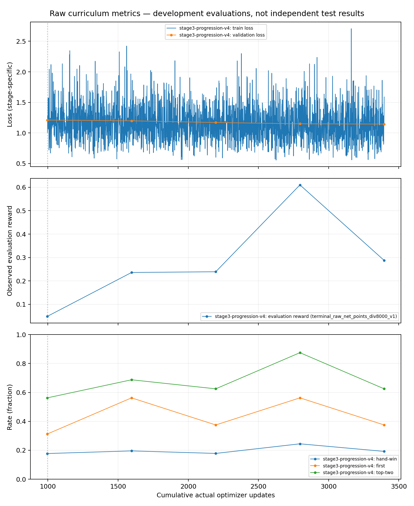

# 3A 最终 2400 步：执行审计通过，策略未达到晋级目标

本轮完成了两轮训练、**2400 次更新／175,190 次样本曝光**、全部 **23,688 条验证**，
以及最终 **64 场完整东风开发对局**。独立审计核对了 376 份优化器状态、保存模型的全部验证预测，
以及各检查点和对照的共 **320 场原生结算记录**；预测复验最大误差为 1.72×10⁻⁷。
权重保存、实际更新和结算一致性通过，**原定策略晋级条件未通过**，不能把执行成功当作模型变强。

## 完整 64 场结果

所有行对应同八个逻辑种子、四个座位、两种固定启发式对手组合。它们是已用于开发的对局，
不是 64 个独立统计样本，也不是雀魂真人段位胜率。

| 策略 | 前二率 | 净得点／场 |
|---|---:|---:|
| 合格鸣牌课程父模型，原执行规则 |65.625%|+2,656.25|
| 同父模型，完整合法菜单／立直类阈值 0.5 |59.375%|+2,457.81|
| 冻结 v8，保留原执行规则 |59.375%|+4,290.63|
| **本轮最终 2400 步** |**50.000%**|**+1,559.38**|

本轮相对完整合法菜单父模型，净得点低 **898.44 点／场**、前二率低 **9.375 个百分点**；
相对原执行规则父模型，分别低 **1,096.88 点／场、15.625 个百分点**。
这两组非负均值增益要求均未满足。

相对同组 v8，净得点均值低 **2,731.25 点／场**、前二率低 **9.375 个百分点**。
八个逻辑种子的配对 t 区间分别为 **[−6,279.07，+816.57] 点／场**和
**[−28.52，+9.77] 个百分点**。区间很宽且跨零，不能据此宣称统计上稳定退化或比肩；
当前结果不支持提升结论。学生和 v8 的执行策略不同，这也是完整策略对照，不是纯参数消融。

本轮一位率为 29.6875%，四位率为 20.3125%，和牌率为 21.01%，放铳率为 7.05%。
和牌率、放铳率采用各完整对局的局内比例再平均。相对 v8，放铳率下降约 3.39 个百分点，
和牌率也下降约 3.31 个百分点；风险指标改善没有转化为更高前二率或净得点。

## 为什么 1800 步看起来很好，最终却未晋级

| 同一组 16 场过程对局 | 和牌率 | 前二率 | 净得点／场 |
|---|---:|---:|---:|
|1800 步|24.46%|87.50%|+4,881.25|
|2400 步的匹配子集|19.22%|62.50%|+2,300.00|

同一子集的前二率下降了 25 个百分点，净得点下降了 2,581.25 点／场。
1800 步的高点只有两个逻辑种子，且当时也未通过全部立直保留条件。
它不是已证明合格的模型；本轮保持预先登记的最终 2400 步候选，没有事后改选过程高点。
最终 64 场结果与这张 16 场过程表必须分开阅读。

## 验证 loss 下降，立直执行仍不稳定

加权验证目标 loss 从 1.210554 降至 **1.145077**，目标 CE 从 1.136669 降至 **1.072477**。
这说明加权监督目标有所拟合，不能代替完整对局评价。

| 最终基础立直验证来源 | 正确接受立直 | 正确拒绝立直 |
|---|---:|---:|
|原始回放源|29/37（78.38%）|36/70（51.43%）|
|新增教师源|227/287（79.09%）|132/238（55.46%）|

两种来源的正确拒绝率均低于原定 60%。立直平衡准确率相对零步分别下降约
**5.95、3.15 个百分点**，也超过各来源最多下降 3 个百分点的保留要求。
普通出牌的分来源一致率有所提高，五类鸣牌平均平衡准确率提高约 1.80 个百分点，
四类 masked MC 的等权 CE 改善约 0.0991；这些通过项不能抵消失败项。
原鸣牌验证的大明杠正标签仍只命中 **5/88**，不能宣称吃碰杠问题已全部解决。
这些标签衡量既有教师／模拟偏好，不是每个局面的专家最优答案。

复用五次已有预测、保持原阈值，得到以下立直排序 AUC：

| 来源 | 零步 |1800 步|2400 步|
|---|---:|---:|---:|
|原始回放源|0.7610|0.7255|0.7479|
|新增教师源|0.7385|0.7658|0.7684|

1800→2400 步有 **75 个窗口改变了立直类别选择，全部转向立直**：38 个正例得到修正，
同时新增 37 个负例误选。合并正例平均立直倾向从 0.6043 升至 0.6655，
负例从 0.4146 升至 0.4734。排序 AUC 略有恢复／提高，而固定执行点的拒绝能力下降，
因此不能把这次变化只解释为整体区分能力变差。

这支持继续检查类别倾向与更新稳定性，但尚未证明立直偏移就是整场降分的唯一原因。
这些值是对既有动作标签的倾向，不是和牌概率；分析没有新增推理、搜索阈值或改变标签。

## 真实 loss、reward 与胜率曲线

训练 loss 来自全部 2400 次真实更新；验证和对局只有 0／600／1200／1800／2400 五个观测点。
连线不代表中间每一步都测过胜率。对局曲线全部使用同一 16 场子集，完整 64 场另列在上表。
横轴为实际参数来源累计更新数，本阶段为 996–3396，包含父模型的基础 608＋鸣牌 388 次更新。
废弃控制运行不并入这条参数来源。

SFT 更新的对局 reward 为 null。图中 reward 是评测净得点除以 8000，
不是本轮反向传播的强化学习奖励，也不是模型预测的和牌概率。

## 已开始的受控重试

[排样方案与入口](plans/curriculum-riichi-paired-replay-20261124.md)在本轮最终结果之前已公开。
重试从**同一合格鸣牌课程父权重**开始，使用新优化器，保留相同 TRAIN／验证、损失权重、
学习率、策略、两轮曝光和最终 2400 步预算，只改变混合块内立直正负例的排样。
本轮最终模型保留为对照；新模型的参数来源仍是固定 base→基础 608→鸣牌 388→新 3A。

训练已实际开始。首轮更新前，372 份 LoRA／4 份头张量与父模型完全一致，
12,479 个继承验证菜单预测误差为 0。排样方案能否改善立直稳定性及完整对局表现仍待训练结果；
原定失败条件继续保留，不能仅凭 loss 或过程高点晋级。

旧父模型不合格的 3B／第四阶段模型依赖任务已清理，独立数据采集和标注继续。
后续学生训练需要新合格父模型和新的明确登记。最终预留的 32 组独立种子仍未开启。
本次公开内容为摘要、曲线与代码；逐场记录、详细日志和研究权重保持私有。
