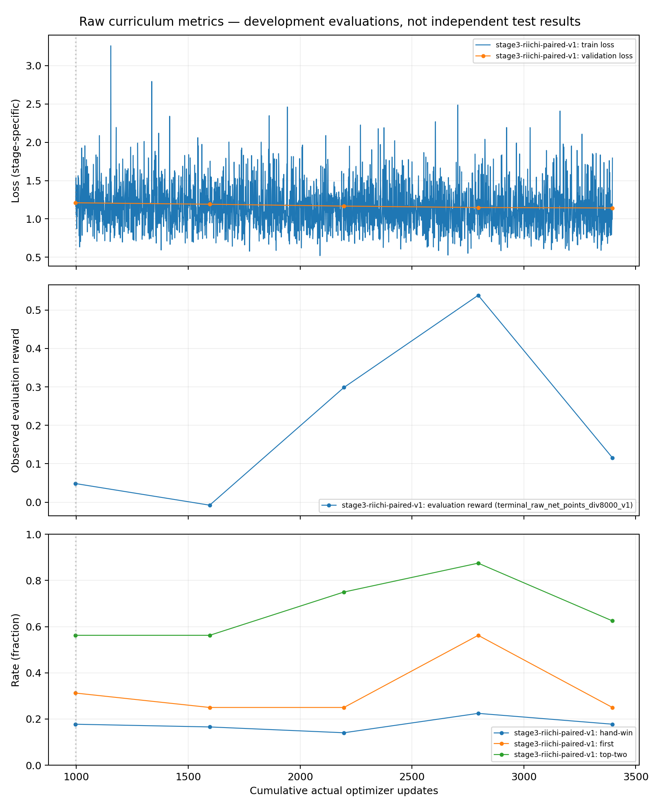
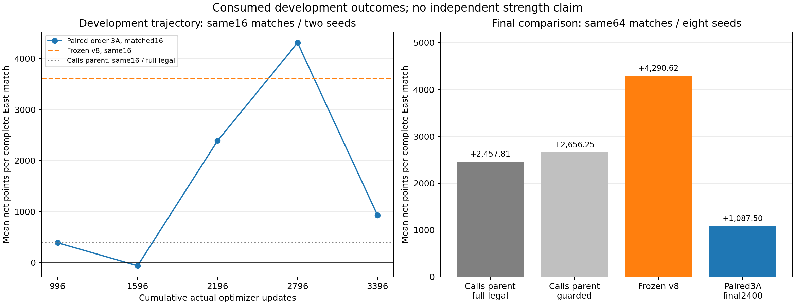

# 3A 排样重试最终 2400 步：未达到晋级目标

本轮已完成 **2,400 次更新、175,190 次样本曝光、全部 23,688 条验证和 64 场完整东风开发对局**。
最终立直保留和对局均值未达到原定目标，不能晋级 3B，不能替换实战 v8。
独立执行核验已经通过：376 份优化器状态、保存后全部 23,688 个验证菜单与
320 场原生结算记录均已核对，重载预测最大误差为 **2.00×10⁻⁷**。
执行通过与策略晋级是两项结论，后者仍为失败。

作业实际于迪拜时间 11 月 24 日 **07:11:45–17:42:49** 运行，耗时 **10 小时 31 分 04 秒**；
其中权重更新在 **17:21:49** 完成，后面完成验证和模拟。
独立核验在 **18:00:42** 完成，用时 17 分 53 秒。均来自实际调度器退出记录。

## 同一组 64 场完整东风

各策略使用同八个逻辑种子、四个座位、两种固定启发式对手组合。
这些是已经用于开发的对局，不是 64 个独立统计样本，也不是雀魂真人段位胜率。

| 策略 | 前二率 | 净得点／场 |
|---|---:|---:|
| 合格 Calls388 父模型，原执行规则 |65.625%|+2,656.25|
| 同父模型，完整合法菜单／立直类阈值 0.5 |59.375%|+2,457.81|
| 冻结 v8，保留原执行规则 |59.375%|+4,290.63|
| 原顺序 3A 对照最终 2400 步 |50.000%|+1,559.38|
| **本轮排样重试最终 2400 步** |**48.4375%**|**+1,087.50**|

本轮相对完整合法菜单父模型，前二率低 10.9375 个百分点、净得点低 1,370.31 点／场；
相对原执行规则父模型，分别低 17.1875 个百分点、1,568.75 点／场。
相对 v8，分别低 10.9375 个百分点、3,203.125 点／场。
相对原顺序对照，前二率低 1.5625 个百分点、净得点低 471.875 点／场。
因此本轮点估计不支持排样带来提升。独立核验重建的八种子配对 95% t 区间为：
相对 v8 的净得点增益 **[−6,422.23，+15.98] 点／场**，
前二率增益 **[−29.83，+7.95] 个百分点**。区间跨零，
不能宣称统计上稳定退化，也不能据此宣称比肩或稳定改善。

本轮一位率 29.69%、四位率 23.44%、和牌率 20.90%、放铳率 9.56%；
同组 v8 分别为 42.19%、14.06%、24.32%、10.44%。和牌／放铳率采用每场局内比例再平均。
较低的放铳率没有转化为更高前二率或净得点。学生与 v8 的执行规则不同，
这里比较的是完整策略，不能解释成纯参数消融。

## 过程高点没有保持到最终候选

下表的每一行都只使用同两个逻辑种子、四个座位、两种对手组合的 **16 场匹配子集**。
最终 64 场另列在上表，不把新增牌山与训练变化混在一起。

| 本阶段更新数 | 和牌率 | 一位率 | 前二率 | 净得点／场 |
|---|---:|---:|---:|---:|
|0|17.75%|31.25%|56.25%|+387.50|
|600|16.57%|25.00%|56.25%|−62.50|
|1200|14.05%|25.00%|75.00%|+2,387.50|
|1800|22.45%|56.25%|87.50%|+4,306.25|
|2400 的匹配子集|17.76%|25.00%|62.50%|+925.00|

1800→2400 在同一子集的前二率下降 25 个百分点、净得点下降 3,381.25 点／场。
1800 步也没有通过全部立直保留条件；它不能被事后改选为合格候选。

loss 曲线保留全部 2400 次真实更新；验证和对局只有 0／600／1200／1800／2400 五个观测点，
连线不表示每一步都测过胜率。横轴为实际参数来源累计更新数，本轮为 996–3396，
包含基础 608＋鸣牌 388 次更新。废弃原顺序控制运行不并入这条参数来源。
SFT 更新的对局 reward 为 null；图中的 reward 是评测净得点除以 8000，
不是反向传播中的强化学习奖励，也不是预测和牌概率。

## loss 降低，立直拒绝能力仍下降

最终加权验证目标 loss 为 **1.142775654**，目标 CE 为 **1.070268787**。
两者均略低于本轮 1800 步的 1.148596197／1.076362878，但立直保留未通过：

| 基础立直验证来源 | 正确接受立直 | 正确拒绝立直 |
|---|---:|---:|
|原始回放源|30/37（81.08%）|40/70（57.14%）|
|独立教师源|228/287（79.44%）|127/238（53.36%）|

两种来源的拒绝率均低于原定 60%。大明杠正标签命中仍只有 **5/88**；
因此不能宣称所有鸣牌缺口已解决。这些是既有教师／模拟标签的一致性，
不能把每个标签等同于专家最优答案。

读取全部五次已有预测，重建了 632 个基础立直窗口的原始混淆矩阵，未新增模型推理或对局。
1800→2400 共 39 个窗口改变立直类别：37 个转向立直，2 个反向转为跳过。
其中 18 个正例得到修正，19 个负例新增误选，另有 2 个负例误选得到修正。
正例平均立直倾向从 0.63775 升至 0.66772，负例从 0.44819 升至 0.47443。

| 类别分数排序 AUC | 零步 |1800 步|2400 步|
|---|---:|---:|---:|
|原始回放源|0.76100|0.72857|0.75097|
|独立教师源|0.73846|0.76711|0.76867|
|合并来源|0.74041|0.76409|0.76764|

排序略有改善，固定执行点的拒绝能力却下降。这支持检查类别倾向和训练目标变化，
不能仅解释为模型完全没有区分能力；也没有证明立直偏移就是整场降分的唯一原因。
分析不搜索新阈值、不改标签、不覆盖当前失败条件。

## 下一项受控修正

已核对到一个具体的课程转换差异：合格鸣牌父模型在基础立直回放上保留
“立直对最大弃牌 logit”的损失，加上条件弃牌损失；既有 3A 改成了
两倍“立直对所有弃牌 log-sum-exp”的损失，再加条件弃牌损失。
这同时改变了比较对象和相对梯度力度。排样重试未解决最终失败，下一项实验将单独检验
**在 3A 中完整保留父模型 13 类回放损失**，其余六类新目标和来源配比不变。

新目标模块已通过 6 项测试。实际全部 **87,595 条 TRAIN** 的损失值与相应原函数一致，
19 类来源的代表梯度误差为 0；这里使用模拟 logits 验证函数关系，没有加载学生模型、
没有新的优化器更新，也不证明该目标已经提升实战效果。
新训练还需要独立登记、实际验证目标重建、父权重继承证明和明确的 GPU 作业提交。
两次失败 3A 的权重不混入下一项同父模型控制运行。

独立核验同时确认：普通出牌分来源一致率有所提高，五类鸣牌平均平衡准确率提高
约 2.36 个百分点，四类 masked MC 等权 CE 改善约 0.0971；
这些通过项不能抵消立直保留和完整对局未达标。
原条件链的 3B 准备因父模型未通过而拒绝启动，训练／核验作业被取消，未进行学生更新。

修正入口和完整限制见[保留父损失的受控方案](plans/curriculum-3A-parent-loss-retention-20261124.md)。
新采集的鸣牌／终局数据继续独立整理，不静默加入该控制配方。
冻结 v8、主分支和已发布 Windows 模型均未替换；最终预留的 32 组独立种子仍未开启。

本次公开范围为源码、方案、汇总和曲线；逐场记录、原始牌面、标签、详细日志和研究权重保持私有。
