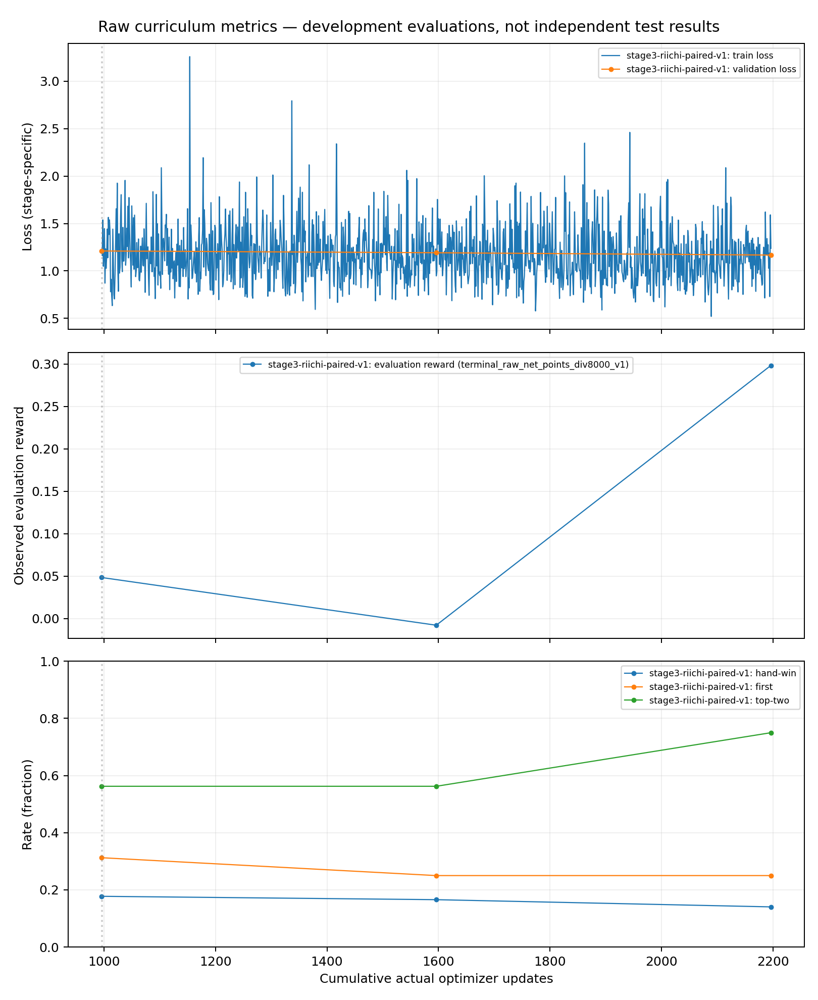

# 配对顺序重试 3A 第 1200 步：开发前二率回升，和牌率与立直仍有缺口

本次从同一个合格 Calls388 父模型开始，使用新的优化器；原失败 3A 的更新不属于本候选参数来源。
与原方案相比，只改变同一训练块内立直正反例的排列，数据、损失、学习率、执行策略及
2400 步预算保持不变。1200 步完成首轮 87,595 条样本遍历、23,688 条完整验证、
模型与优化器保存，以及同组 16 场完整东风开发对局。训练已继续第二轮，未挑选中间模型晋级。

## 同一组开发对局

各行使用相同的两个逻辑种子、四个座位和两种已冻结的效率/鸣牌启发式对手组合。
和牌率、放铳率均为每场完整对局的局内比例再求平均，不是雀魂真人段位胜率。

| 策略 | 和牌率 | 一位率 | 前二率 | 四位率 | 净得点／场 | 放铳率 |
|---|---:|---:|---:|---:|---:|---:|
| 共同零步，完整合法菜单 | 17.75% | 31.25% | 56.25% | 18.75% | +387.50 | 7.69% |
| 配对顺序 600 步 | 16.57% | 25.00% | 56.25% | 31.25% | −62.50 | 6.36% |
| 配对顺序 1200 步 | 14.05% | 25.00% | 75.00% | 18.75% | +2,387.50 | 6.41% |
| 原顺序 1200 步 | 17.82% | 37.50% | 62.50% | 18.75% | +1,912.50 | 5.89% |
| 冻结实战 v8 | 22.37% | 62.50% | 62.50% | 31.25% | +3,612.50 | 10.34% |

配对顺序 1200 步相对本次 600 步，前二率增加 **18.75 个百分点**，净得点增加
**2,450 点／场**；相对原顺序同一步数，分别高 **12.50 个百分点、475 点／场**。
相对共同零步，前二率高 18.75 个百分点、净得点高 2,000 点／场。

同时，和牌率由本次 600 步的 16.57% 降至 14.05%，一位率仍为 25.00%。
相对 v8，净得点低 1,225 点／场，和牌率和一位率也更低。
各指标的变化并不一致，目前只能确认这组开发对局的前二率和净得点回升。

这组开发对局只有两个独立牌山种子，16 场不能视为 16 个独立统计样本，且已用于中间观察。
它不能证明稳定提升或比肩 v8。原顺序与配对顺序执行同一个完整合法菜单、固定立直类 0.5 策略；
v8 使用其原 guarded 策略，v8 行比较的是完整策略。最终独立确认种子尚未开启。

## 完整验证

| 指标 | 共同零步 | 配对 600 步 | 配对 1200 步 | 原顺序 1200 步 |
|---|---:|---:|---:|---:|
| 加权目标验证 loss | 1.210554 | 1.191926 | 1.167409 | 1.170627 |
| 加权目标 CE | 1.136669 | 1.116347 | 1.091221 | 1.094543 |
| 基础普通出牌标签一致率 | 55.01% | 55.43% | 56.00% | 56.23% |
| 基础立直平衡准确率 | 70.33% | 62.96% | 64.95% | 65.15% |
| 大明杠正标签命中 | 1/88 | 0/88 | 2/88 | 3/88 |

立直判断有所恢复，仍比共同零步低约 5.38 个百分点。按原回放、教师回放分开计算，
本次 1200 步平衡准确率为 66.74%／64.60%；负例正确拒绝分别只有 31/70、101/238，
尚未达到原登记的分来源保留要求。
相对原顺序 1200 步，本次多命中 5 个立直正例，却少正确拒绝 6 个负例，整体平衡准确率略低。

鸣牌也存在命中与误选的权衡。以下是同一验证集的已有标签一致性计数：

| 操作 | 原顺序正例命中 | 本次正例命中 | 原顺序误选 | 本次误选 |
|---|---:|---:|---:|---:|
| 吃 | 193/415 | 197/415 | 60 | 68 |
| 碰 | 356/561 | 362/561 | 95 | 108 |
| 暗杠 | 77/151 | 79/151 | 68 | 70 |
| 大明杠 | 3/88 | 2/88 | 7 | 6 |
| 加杠 | 29/71 | 32/71 | 33 | 35 |

大明杠覆盖和立直保留尚未解决。更低的总 loss 不能代替这些分类能力与真实对局结果；
已有标签的一致性也不能证明每个标签都是实战最优动作。

## 真实过程曲线

训练 loss 来自前 1200 次真实优化器更新；验证和对局只在 0、600、1200 步有实测点。
点间连线不表示中间已测量。横轴包含父模型 608+388 次更新，本阶段累计范围为 996–2196。
SFT 训练 reward 为 null。图中 evaluation reward 是对局净得点除以 8000，三个观测值为
0.0484375、−0.0078125、0.2984375；它不是反向传播的强化学习奖励或和牌概率。

复用原导出器核对了零步、600、1200 步及 v8 共 64 场原生结算、位次、和牌/放铳计数，
以及本次三个保存模型和执行策略的标识。没有增加评测对局或打开最终独立种子。
公开内容仅含汇总和图；逐场记录、原始训练日志、快照数据与研究权重保持私有。

## 后续

继续已登记的第二轮训练，保留 1800、2400 步完整验证、固定对局及最终 64 场开发评测。
最终候选仍为完整 2400 步；晋级标准不变。3B 条件链尚未通过父模型准入或启动训练。
第四阶段的 [120 条非和牌候选标签已完成并分类](curriculum-rank-nonwin-data-20261124.md)，
其余和牌分支、完整数据配比及合格 3B 父模型仍需完成。生产模型和 Windows 工具未替换。

相关：[本次 600 步](curriculum-3A-paired-step600-20261124.md)、
[原顺序 1200 步](curriculum-3A-step1200-20261124.md)、
[原顺序最终失败结果](curriculum-3A-final2400-20261124.md)、
[本次冻结方案](plans/curriculum-riichi-paired-replay-20261124.md)。
