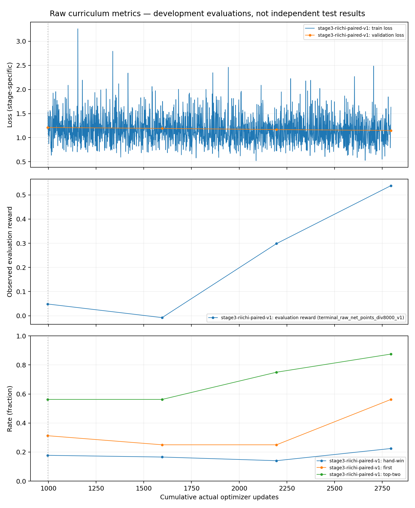

# 配对顺序重试 3A 第 1800 步：开发对局改善，尚未通过全部保留要求

本次仍从同一个合格 Calls388 父模型出发，使用新优化器，保持已登记的数据、损失、
学习率、执行策略及 2400 步预算。原失败 3A 的参数更新不进入本次候选。
1800 步已完成 131,395 次样本训练、23,688 条完整验证、权重与优化器保存，
以及同组 16 场完整东风开发对局；对局结果在 2026-11-24 11:03:11 UTC 记录完成。
训练已继续，1800 步没有作为中间候选晋级。

## 同一组开发对局

每行使用相同两个逻辑种子、四个座位和两种冻结的效率/鸣牌启发式对手组合。
和牌率和放铳率是每场完整对局内比例再求平均，不是真人段位胜率。

| 策略 | 和牌率 | 一位率 | 前二率 | 四位率 | 净得点／场 | 放铳率 |
|---|---:|---:|---:|---:|---:|---:|
| 共同零步，完整合法菜单 | 17.75% | 31.25% | 56.25% | 18.75% | +387.50 | 7.69% |
| 配对顺序 600 步 | 16.57% | 25.00% | 56.25% | 31.25% | −62.50 | 6.36% |
| 配对顺序 1200 步 | 14.05% | 25.00% | 75.00% | 18.75% | +2,387.50 | 6.41% |
| **配对顺序 1800 步** | **22.45%** | **56.25%** | **87.50%** | **12.50%** | **+4,306.25** | **6.42%** |
| 原顺序 1800 步 | 24.46% | 56.25% | 87.50% | 12.50% | +4,881.25 | 5.53% |
| 冻结实战 v8 | 22.37% | 62.50% | 62.50% | 31.25% | +3,612.50 | 10.34% |

相对本次 1200 步，1800 步净得点增加 **1,918.75 点／场**，前二率增加
**12.50 个百分点**，和牌率增加约 **8.40 个百分点**。放铳率基本相同。
相对同组 v8，净得点高 693.75 点／场、前二率高 25 个百分点，但一位率低 6.25 个百分点。

相对原顺序同一步数，本次前二率、一位率和四位率相同，净得点低 **575 点／场**，
和牌率更低、放铳率更高。当前结果不能证明配对顺序整体优于原顺序。
原顺序也曾在 1800 步取得较高开发成绩，后来最终 2400 步回落，因此本次仍按完整预算和原标准判断。

这 16 场只有 **两个独立逻辑种子**，且已用于中间观察，不能视为 16 个独立统计样本，
不能证明稳定超过或比肩 v8。学生执行完整合法菜单、固定立直类 0.5 策略，
v8 保持其原 guarded 策略；v8 行比较的是完整策略。最终独立确认种子尚未开启。

## 完整验证和仍有的缺口

| 指标 | 配对 1200 步 | 配对 1800 步 | 原顺序 1800 步 |
|---|---:|---:|---:|
| 加权目标验证 loss | 1.167409 | 1.148596 | 1.149549 |
| 加权目标 CE | 1.091221 | 1.076363 | 1.077531 |
| 基础普通出牌标签一致率 | 56.00% | 55.85% | 56.15% |
| 基础立直平衡准确率 | 64.95% | 66.91% | 66.92% |
| 大明杠正标签命中 | 2/88 | 4/88 | 3/88 |

本次立直平衡准确率有所恢复，仍低于共同零步的 70.33%。原回放来源的立直正例命中
26/37，负例正确拒绝 42/70，两项达到原定 60% 要求。教师来源分别为 214/287、
142/238；后者是 **59.66%**，仍低于原定 60%。总体负例正确拒绝为 184/308（59.74%），
全部分来源保留要求仍未通过。没有因这组对局成绩调整门槛。

以下是已有验证标签的一致性计数，不是专家最优动作证明：

| 操作 | 原顺序 1800 正例命中 | 本次正例命中 | 原顺序误选 | 本次误选 |
|---|---:|---:|---:|---:|
| 吃 | 201/415 | 198/415 | 80 | 78 |
| 碰 | 367/561 | 377/561 | 120 | 127 |
| 暗杠 | 82/151 | 82/151 | 60 | 65 |
| 大明杠 | 3/88 | 4/88 | 7 | 6 |
| 加杠 | 28/71 | 30/71 | 28 | 34 |

大明杠正标签仍大多未被选中，鸣牌能力不能视为已经解决；正例命中增加也可能伴随误选增加。
当前更低的总 loss 与较好的开发前二率，不能替代这些分类结果与最终完整评测。

## 真实过程曲线

训练 loss 来自 1800 次真实优化器更新，验证和对局在 0、600、1200、1800 步有实测点。
连线不表示中间已测量；横轴计入父模型 608+388 次更新，本阶段累计范围为 996–2796。
SFT 训练 reward 为 null。图中 evaluation reward 是对局净得点除以 8000，四个观测值为
0.0484375、−0.0078125、0.2984375、0.53828125，不是反向传播的强化学习奖励或和牌概率。

复用现有导出器核对了四个学生点及 v8 共 **80 场**原生结算、位次、和牌和放铳计数，
以及四个保存模型和执行策略的标识；没有新增模型前向、训练更新或评测对局。
1800 步参数标识为 `815cf5aa57bfa037c916f484fb7682efbd7425aeb6db3d8b8a92fb6a4b6960a2`，
执行策略标识为 `7a089e5dd30fdc6c3c713933c22b81962418ab2f107441dba3f06012153544d4`。
仅公开汇总和图；逐场记录、训练日志、快照数据和研究权重保持私有。

## 接续

继续完成已登记的 2400 步，进行最终完整验证、64 场开发评测和独立执行核验。
3B 仍需最终 3A 通过原标准；第四阶段仍需合格最终 3B、完整分类数据和实际集成。
已排队的模型接续作业调回正常调度优先级，数值配方、资源、时限和依赖保持不变。
这次开发结果不自动替换 v8、main 或 Windows 工具。

相关：[本次 1200 步](curriculum-3A-paired-step1200-20261124.md)、
[原顺序最终结果](curriculum-3A-final2400-20261124.md)、
[冻结重试方案](plans/curriculum-riichi-paired-replay-20261124.md)、
[后续 3B 数据说明](curriculum-3B-dataset-card-20261124.md)。
