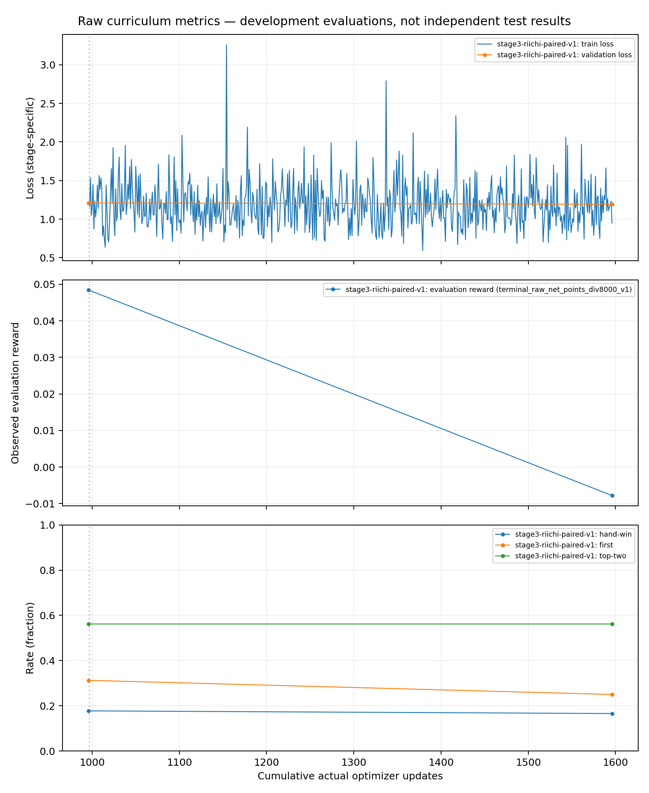

# 配对顺序重试 3A 第 600 步：尚未观察到对局收益

本次受控重试从同一个已合格 Calls388 父模型开始，使用新的优化器；
不继承原 3A 失败运行的更新。训练数据、损失权重、学习率、完整合法菜单、
固定立直类 0.5 决策及 2400 步预算保持不变，只调整同一训练块内立直正反例的排列。
该调整不是增加样本量，也不是改变立直阈值。

第 600 步完成 43,800 次样本曝光、23,688 条完整验证、模型与优化器保存，
以及已登记的 16 场完整东风开发对局。复用原有导出器核对了零步、600 步和
冻结 v8 共 48 场对局的结算、位次、和牌及放铳计数，没有新增模型前向或对局。
这是中间观测，不是最终策略晋级审计。

## 同一开发对局比较

各行使用相同的两个逻辑种子、四个座位和两种效率/鸣牌启发式对手组合。
和牌率、放铳率为每场完整对局的局内比例再求平均，不是雀魂真人段位胜率。

| 策略 | 和牌率 | 一位率 | 前二率 | 四位率 | 净得点／场 | 放铳率 |
|---|---:|---:|---:|---:|---:|---:|
| 共同零步，完整合法菜单 | 17.75% | 31.25% | 56.25% | 18.75% | +387.50 | 7.69% |
| 原顺序 3A 第 600 步 | 19.57% | 56.25% | 68.75% | 12.50% | +1,887.50 | 4.35% |
| 配对顺序 3A 第 600 步 | 16.57% | 25.00% | 56.25% | 31.25% | −62.50 | 6.36% |
| 冻结实战 v8 | 22.37% | 62.50% | 62.50% | 31.25% | +3,612.50 | 10.34% |

配对顺序 600 步相对共同零步，前二率持平，净得点低 450 点／场；
相对原顺序同一步数，前二率低 12.50 个百分点，净得点低 1,950 点／场。
相对 v8，前二率低 6.25 个百分点，净得点低 3,675 点／场。
目前没有观察到配对顺序带来的对局收益。

只有两个独立牌山种子，16 场不能视为 16 个独立统计样本。
这不证明稳定退步，也不支持稳定提升或比肩 v8。原顺序与配对顺序具有相同父模型、
数据、损失及执行策略；v8 使用其原 guarded 策略，v8 行比较的是完整策略。
本开发组已经用于观察，不能作为最终独立确认。

## 全量验证

| 指标 | 共同零步 | 原顺序 600 步 | 配对顺序 600 步 |
|---|---:|---:|---:|
| 加权目标验证 loss | 1.210554 | 1.198349 | 1.191926 |
| 加权目标 CE | 1.136669 | 1.121368 | 1.116347 |
| 基础普通出牌标签一致率 | 55.01% | 55.09% | 55.43% |
| 基础立直平衡准确率 | 70.33% | 62.59% | 62.96% |
| 大明杠正标签命中 | 1/88 | 0/88 | 0/88 |

较原顺序同一步数，立直平衡准确率只提高约 0.36 个百分点，仍明显低于共同零步。
按原回放、教师回放分别计算，原顺序为 61.89%／62.78%，配对顺序为
64.67%／62.79%。配对顺序中，立直负例判断正确分别为 30/70、104/238，
尚未达到既有的分来源保留要求。

其他动作也不能只数正例命中：例如吃牌命中从原顺序的 180/415 增为 191/415，
但相应误选从 49 增为 65。大明杠仍为 0/88；暗杠为 60/151、加杠为 14/71。
这些是已有标签一致性数据，不把所有旧标签当作实战最优答案。
更低的总验证 loss 没有在本次小样本对局中转化成更好的收益。

## 真实过程曲线

训练 loss 来自 600 条真实优化器更新日志；验证和对局只有 0、600 两个实测点。
点间连线不表示中间已测量。横轴包含父模型 608+388 次更新，当前范围为累计
996–1596；原失败 3A 的更新不属于本候选参数来源。

本次仍为监督学习，训练 reward 为 null。图中 evaluation reward 是完整对局
净得点除以 8000：零步 0.0484375，600 步 −0.0078125；它不是反向传播的
强化学习奖励，也不是和牌概率。公开内容仅为汇总与图；逐场牌谱、原始日志、
快照数据和研究权重保持私有。

## 后续

继续执行已登记的 2400 步预算，保留 1200、1800、2400 步完整验证与固定对局，
不依据这一处小样本更换数据、阈值或挑选最终模型。最终原晋级标准保持不变。
若最终仍失败，后续应利用已分类的动作/来源数据制定新的受控改进，
不能将更多同类曝光或更低 loss 自动解释为策略提升。

3B 仅有条件依赖链，尚未通过父模型准入或开始训练；第四阶段数据工作独立推进。
最终保留的独立种子尚未开启，生产模型和 Windows 工具没有替换。

相关：[原顺序 600 步](curriculum-3A-step600-20261123.md)、
[原顺序最终失败结果](curriculum-3A-final2400-20261124.md)、
[重试登记方案](plans/curriculum-riichi-paired-replay-20261124.md)、
[动作与来源数据分类](curriculum-operation-label-balance-20261124.md)。
