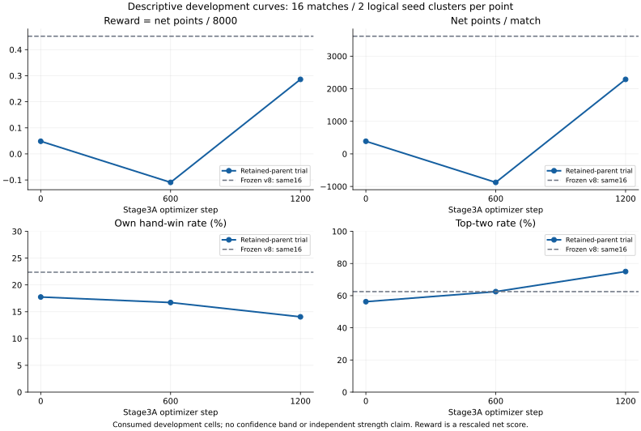
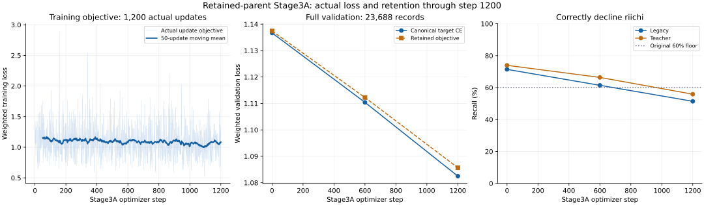

# Retained-parent Stage 3A: 1,200-update development results

The saved 1,200-update model improves top-two rate by 12.5 percentage points
and net points by 3,162.50 per match relative to this trial's 600-update model.
It still trails frozen practical v8 by 1,325 points per match, has a lower
hand-win rate, and fails the unchanged riichi-retention diagnostics. These
mixed development results do not establish stable improvement or v8 parity.

## Training and checkpoint ancestry

This trial continues the qualified calls388 weights, following basic608 from
the fixed Qwen base. It does not restart from base at each stage and does not
inherit either failed Stage 3A control. It starts a new optimizer while retaining
the exact inherited calls13 replay objective. The frozen recipe has 87,595
TRAIN rows, 23,688 validation menus, 19 source strata and 2,400 optimizer updates
over two epochs. Source masses remain 55% inherited replay, 15% risk teacher,
20% ordinary-completion teacher and 10% equally mixed four-phase masked MC.

At step 1,200, full validation completed before the checkpoint was saved;
the saved checkpoint was then reloaded for its 16 scheduled native matches.
Training subsequently resumed into epoch two. Neither intermediate strength
nor a low validation loss changes the registered final-only advancement rule.

Checkpoint bundle identity:
`d86892fc74f59b4c31f9028d87eca889347cd3f9406feefbf0f02b91c6fc6733`.

### Environment observation during the continuing trial

A finite companion step in the same GPU allocation recorded the environment
while this trial continued beyond 1,200 updates. All 11 tracked package versions
match the previously published [stage1 runtime list](../../reproduction/curriculum-runtime.txt),
including Transformers 5.21.0, PEFT 0.21.2 and RiichiEnv 0.4.11.

| Observed component | Value |
|---|---|
| Python |CPython 3.12.3|
| PyTorch |2.11.0+cu128|
| PyTorch compiled CUDA |12.8|
| GPU |NVIDIA RTX 5000 Ada Generation, 32,760 MiB|
| NVIDIA driver |570.195.03|
| GPU compute capability |8.9|

The full inventory of 141 installed distributions and actual allocation are
preserved privately with hashes. This is a current companion-process observation,
not a retroactive record of training startup or proof of identical package
binaries/bitwise reproduction. Fresh-process kernel or determinism flags are
not attributed to the trainer. No packages, model parameters or active training
configuration were changed by the capture.

## Same-cell native development comparison

Each row uses the same two consumed logical seeds, four seats and two opponent
profiles: 16 complete East matches per policy. The prior paired-order control
is included to distinguish recovery within this trial from superiority over
the previous objective.

| Policy | First | Top two | Net points / match | Hand-win rate | Deal-in rate | Fourth |
|---|---:|---:|---:|---:|---:|---:|
| Parent0, complete-legal |31.25%|56.25%|+387.50|17.75%|7.69%|18.75%|
| Retained600 |18.75%|62.50%|−875.00|16.72%|4.65%|25.00%|
| Retained1200 |31.25%|75.00%|+2,287.50|14.05%|7.30%|25.00%|
| Prior paired-order control1200 |25.00%|75.00%|+2,387.50|14.05%|6.41%|18.75%|
| Frozen practical v8 |62.50%|62.50%|+3,612.50|22.37%|10.34%|31.25%|

Relative to Retained600, hand-win rate falls 2.67 points while deal-in rate
rises 2.65 points. Relative to the prior paired1200 control, top-two rate is
unchanged and net points are 100 lower per match. The retained replay change
therefore has not demonstrated an overall native advantage over that control.
Hand-win and deal-in figures are per-match hand ratios averaged across matches.

Reward is the actual native terminal raw net score divided by 8,000; it is
not a separate win-probability estimate or a per-update reinforcement signal.
Lines connect only the actual 0/600/1200 evaluations. The dashed reference is
v8 on these exact same 16 cells. Two logical seed clusters are insufficient
for an independent strength claim; no confidence band is inferred here.

## Full validation and retention

| Full validation diagnostic | Parent0 | Retained600 | Retained1200 |
|---|---:|---:|---:|
| Canonical weighted target CE |1.136669|1.110398|1.082483|
| Retained weighted objective |1.137405|1.112241|1.085674|
| Legacy RI correct decline |50/70 ·71.43%|43/70 ·61.43%|36/70 ·51.43%|
| Teacher RI correct decline |176/238 ·73.95%|158/238 ·66.39%|133/238 ·55.88%|
| Legacy RI balanced accuracy |70.85%|67.20%|63.55%|
| Teacher RI balanced accuracy |70.42%|68.04%|65.57%|

At 1,200, RI acceptance is 28/37 legacy and 216/287 teacher. Correct decline
falls below the original 60% floor in both sources. Balanced accuracy falls
7.30/4.85 percentage points from the parent, exceeding the original 3-point
retention allowance. The retention diagnostic fails despite lower aggregate CE.
Correct decline measures held-out label agreement; these labels do not prove
that every corresponding strategic choice is optimal.

Plain-label agreement gains 0.43/1.56 points over the parent; mean five-call
balanced accuracy gains 0.79 points and equal-phase masked-MC CE improves
0.08927. Those aggregate improvements do not cancel the RI-specific regression.

The loss figure uses all 1,200 real optimizer journal entries, with a 50-update
moving mean, and all three actual full-validation observations. The training
prefix accounts for exactly 87,595 consumed examples. No synthetic software
test journal is used as training evidence.

## Evidence and next decision

### Saved-data diagnosis of RI drift

A finite full-epoch journal analysis confirms that all four inherited RI
strata were consumed; the decline examples were not accidentally omitted.

| RI replay stratum | Actual TRAIN examples / epoch | Registered loss mass | Updates containing the stratum |
|---|---:|---:|---:|
| Legacy decline |272|2.145894%|260/1200|
| Legacy accept |194|2.145894%|192/1200|
| Teacher decline |812|3.985231%|746/1200|
| Teacher accept |1075|3.985231%|845/1200|

Accept and decline have equal registered loss mass within each origin despite
different raw counts. A separate complete scan of all 87,595 TRAIN and 23,688
validation menus finds no reach option in either new hard-label teacher
stratum (risk discards and ordinary-completion discards). Across all hard-label
TRAIN strata, source mass times the fraction labelled reach at a reach window
is 6.1884%, versus 6.3087% for another action at such a window. These are target
exposure masses, not measured gradient magnitudes. Fifty closed-discard MC
menus and three kan MC menus also offer reach with soft targets; they are not
converted into hard accept/decline labels by this analysis.

The same 632 held-out basic RI menus show a broad upward reach-probability
shift, affecting both target classes:

| Held-out source | Mean reach probability at0 | At600 | At1200 | Correct→wrong / wrong→correct, 0→1200 |
|---|---:|---:|---:|---:|
| Legacy decline |0.4105|0.4392|0.4755|14 / 0|
| Legacy accept |0.5609|0.5845|0.6045|0 / 2|
| Teacher decline |0.4018|0.4254|0.4725|44 / 1|
| Teacher accept |0.5585|0.5897|0.6273|2 / 26|

No previously strong decline with reach probability at most0.2 crosses0.5;
the observed wrong-way changes occur among less decisive examples. This is
consistent with a shared decision-bias drift, rather than absence of decline
training or a large excess of hard positive reach targets. It does not identify
the causal parameter gradients, prove cross-task interference, or establish
that changing the serving threshold would improve play. The threshold remains
fixed; validation examples are not reused for training.

For the next prospective recipe, diagnose the actual TRAIN class gradients
and parent-behavior retention before adding more positive reach examples or
simply increasing epochs. The inherited max-discard class loss and full-class
serving decision are distinct mathematical quantities; prior full-group
controls also failed, so objective alignment alone is not yet a proven fix.
Preserve current data, objective and optimizer for the registered live trial.

An independent saved-result analysis checked all 23,688 validation prediction
IDs across all 19 sources and reconstructed 80 native match ledgers across
the five compared policies. Immutable private validation/journal snapshots,
checkpoint identities and completion bindings preserve the underlying evidence.
The analysis, RI diagnostics and plotting loaded no model and generated no
additional games; all ran as finite companion steps inside the existing
scheduled GPU allocation, with recorded successful exits.

Continue the frozen 2,400-update trial, observing 1,800 and final 2,400 before
the original final qualification and independent audit. If final qualification
fails, retain its evidence and revise the next trial prospectively; do not
admit a failed parent to Stage 3B or relabel an intermediate peak as the final
candidate. The next diagnosis must explain RI decline and lower hand-win rate,
alongside aggregate loss and score gains.

The independent final grid remains unopened. Main, production v8 and Windows
releases are unchanged. This report publishes aggregate results and figures
only; raw hands, labels, logs, gradients, simulation worlds and research weights
remain private.
