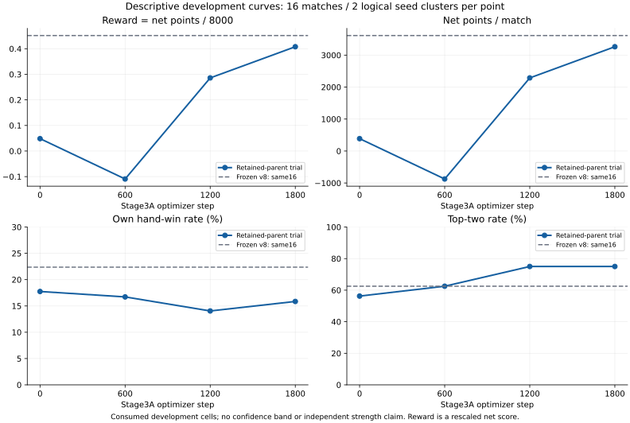
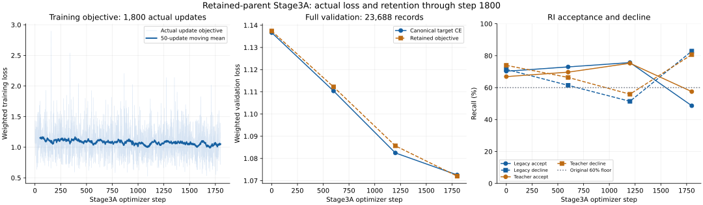

# Retained-parent Stage 3A: 1,800-update development results

At 1,800 updates, the same 16 development matches yield 75% top-two and +3,262.50
net points/match: 975 points above 1,200, but 350 below frozen practical v8.
The RI decision direction reverses: correct decline recovers while correct
acceptance falls below the original 60% requirement. Lower validation loss and
the improving net-point curve do not qualify this checkpoint or prove v8 parity.

## Actual fit and ancestry

This is the continuing 2,400-update retained-parent trial, not a new model started
from base. Its actual ancestry is fixed Qwen3.5-0.8B → qualified basic608 →
qualified calls388 → current 3A. Neither failed 3A control contributes parameters.
The frozen base revision is `2fc06364715b967f1860aea9cf38778875588b17`.

The unchanged recipe has 87,595 unique TRAIN rows and 23,688 validation menus,
with 19 source strata and 55% inherited replay / 15% risk teacher / 20% ordinary
completion teacher / 10% equal four-phase masked MC loss mass. At 1,800 updates,
the real journal records 131,395 consumed examples. Validation completes before
checkpoint save, then the saved checkpoint is reloaded for native evaluation.
The GPU fit subsequently continues toward its registered final 2,400 candidate.

Actual 1,800 checkpoint bundle:
`828e60b6f4796179812eac223a0ac6ec67a2e6c9e02d582862b2c93d38c9dc8e`.

## Same 16 complete East matches

Every row uses the same two consumed logical seeds, four seats and two opponent
profiles. Hand-win/deal-in figures average each match's hand ratio. The prior
paired-order 1,800 checkpoint is a diagnostic comparator; it is not a qualified
parent, and that control's final 2,400 model failed its original strategy gates.

| Policy | First | Top two | Net points/match | Hand-win | Deal-in | Fourth |
|---|---:|---:|---:|---:|---:|---:|
| Parent0, complete-legal |31.25%|56.25%|+387.50|17.75%|7.69%|18.75%|
| Retained600 |18.75%|62.50%|−875.00|16.72%|4.65%|25.00%|
| Retained1200 |31.25%|75.00%|+2,287.50|14.05%|7.30%|25.00%|
| Retained1800 |43.75%|75.00%|+3,262.50|15.85%|8.39%|18.75%|
| Prior paired-order1800 |56.25%|87.50%|+4,306.25|22.45%|6.42%|12.50%|
| Frozen practical v8 |62.50%|62.50%|+3,612.50|22.37%|10.34%|31.25%|

Relative to Retained1200, net points increase 975/match, top-two is unchanged,
hand-win rises 1.81 percentage points and deal-in rises 1.09 points. Relative to
v8, net remains 350 lower and hand-win 6.52 points lower, while top-two is 12.5
points higher. Relative to the prior paired1800, net is 1,043.75 lower and
top-two 12.5 points lower. The retained replay objective has not demonstrated
an overall advantage over that earlier control.

These are descriptive results from only two consumed seed clusters, not an
independent strength estimate. Reward is actual terminal raw net points / 8,000;
it is a rescaled evaluation score, not a per-update reinforcement signal. Lines
connect only the actual 0/600/1200/1800 observations. No confidence band or
additional test games are inferred. The registered final 64-match evaluation remains
separate from this common 16-match curve and from unopened independent confirmation.

## Full validation: RI instability changes direction

Canonical target CE falls 1.082483 at 1,200 → 1.072567 at 1,800; the retained
objective falls 1.085674 → 1.072016. The same fixed RI menus show a different
failure from the first epoch:

| Held-out class | Parent0 | Retained1200 | Retained1800 |
|---|---:|---:|---:|
| Legacy: correctly accept RI |26/37 ·70.27%|28/37 ·75.68%|18/37 ·48.65%|
| Legacy: correctly decline RI |50/70 ·71.43%|36/70 ·51.43%|58/70 ·82.86%|
| Teacher: correctly accept RI |192/287 ·66.90%|216/287 ·75.26%|165/287 ·57.49%|
| Teacher: correctly decline RI |176/238 ·73.95%|133/238 ·55.88%|192/238 ·80.67%|
| Legacy RI balanced accuracy |70.85%|63.55%|65.75%|
| Teacher RI balanced accuracy |70.42%|65.57%|69.08%|

Both acceptance recalls now fail the unchanged 60% source-quality floor. Legacy
balanced accuracy remains 5.10 points below Parent0, beyond the original 3-point
retention allowance. The basic-retention diagnostic therefore still fails.
Correct decline alone would conceal the acceptance regression; the loss figure
shows both target classes for each source. Agreement with these fixed labels
does not prove that every teacher or legacy label is strategically optimal.

Plain-label agreement gains 0.80/1.69 points over Parent0 for legacy/teacher.
Mean five-call balanced accuracy improves 2.21 points and equal-phase masked-MC
CE improves 0.100114. These improvements do not cancel the RI-specific failure.

## Interpretation and next action

The earlier saved-prediction analysis established an upward reach-probability
shift through 1,200. It should not be generalized into a monotonic trend: by
1,800, the same fixed labels instead show too few accepted RI decisions. The
new observation strengthens the reason to test stability of both target classes,
rather than forcing a one-direction policy bias. It does not identify a causal
parameter gradient or prove that sampling is the only cause.

The separately frozen [balanced-replay recipe](plans/curriculum-ri-balanced-replay-fit-20261125.md)
is unchanged: one example from each RI stratum per update, per-original
inverse-repeat correction, the same unique data and source masses, and no
threshold or class-quality gate adjustment. This report adds an observation;
it does not retune that recipe on validation. The live trial continues through
final 2,400 and its full independent audit. Only a completed, successfully audited
control with a failed original strategy grade can trigger the standby trial.
An actually qualified current final instead follows the existing 3B path.

The standby 2472→3B registration/trainer/auditor and finite qualified-only bridge
are now separately bound. Six interface checks preserve original numerical
calculations except the explicit parent-step/path substitution. They are not
actual child-model or strength results; no 3B parent seal, registration or fit
has been created. See the [prospective 3B integration](plans/curriculum-yaku-balanced-course-20261125.md).

## Evidence scope

A finite saved-result check validates all 23,688 distinct prediction IDs and 19
strata, and independently reaccounts 80 native ledgers across the five policies
in the new 1,800 analysis. The 1,200 row uses its earlier completed analysis;
shared Parent0/600/v8 aggregates are checked identical between snapshots.
The loss plot contains all 1,800 real optimizer observations and 131,395 actual
exposures. Plot sources use immutable completed snapshots, not future hashes
of a still-growing journal. No software-test journal, new inference, new game
or optimizer update is used in the analysis/rendering. Raw cases, predictions,
ledgers, journals and research weights remain private. The independent final
grid remains unopened; production v8, main and Windows are unchanged.
