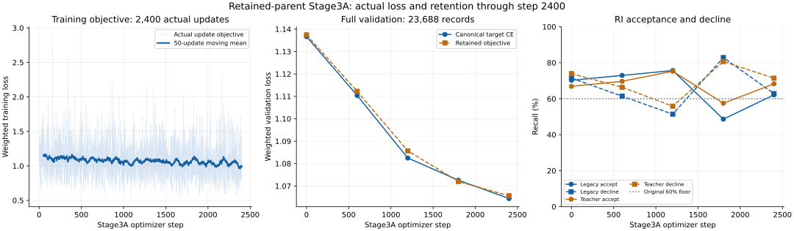
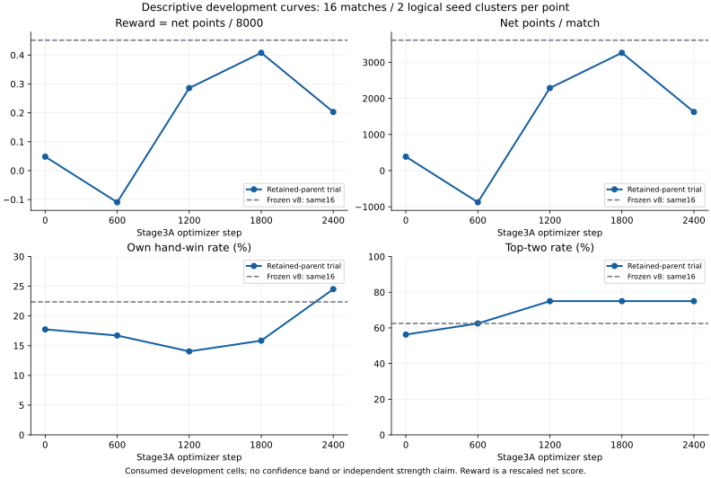

# Stage 3A retained-parent trial: final 2,400-update result

**The full run and its independent execution audit completed, but the original
strategy advancement criteria failed. This model does not replace frozen v8.**
Lower validation loss did not establish higher playing strength.

## Training lineage and data

Frozen Qwen3.5-0.8B revision `2fc06364715b967f1860aea9cf38778875588b17`
→ qualified basic608 → qualified calls388 → this retained-parent 3A trial.
The trial inherited all 372 LoRA tensors and four head tensors exactly and
started a fresh optimizer. No previous failed 3A control contributed updates.
Final model identity:
`5b74de14e5d84c6de86b6b19ac374c21b3c02fb7d6a7976f2c51cfd62498bc4f`.

Training used 87,595 unique TRAIN records from 19 strata, two epochs,
175,190 actual exposures, batch 1 × accumulation 73, and 2,400 optimizer
updates. Source loss masses were 55% inherited basic/call replay, 15% teacher
closed-discard risk, 20% teacher ordinary completion and 10% equally weighted
four-phase MC. Learning rates were 3e-6 for LoRA and 1.5e-5 for the head,
with seed 2026112304. Validation used 23,688 unchanged menus, not expanded TRAIN.

The auditor verified all 376 optimizer states, final saved-model reload parity
over all 23,688 menus (maximum probability discrepancy 1.81e-7), complete
exposure accounting and 320 actual complete cached matches across checkpoints
and references. An execution audit pass and a strategy advancement pass are
separate results; only the former passed.

## Final matched 64-game development comparison

Each policy used the same 8 logical seeds × 4 seats × 2 heuristic opponent
profiles, with complete East matches. Opponents are efficiency/calling
baselines, not human opponents or Mortal. Rates below are the recorded
arithmetic means of per-match metrics; hand rates need not equal pooled counts.

| Policy | First | Top two | Fourth | Net points/match | Hand win | Deal-in |
|---|---:|---:|---:|---:|---:|---:|
| Retained 3A, step 2400 |35.94%|54.69%|12.50%|+2,210.94|23.08%|7.78%|
| Same complete-legal parent |25.00%|59.38%|10.94%|+2,457.81|25.70%|9.35%|
| Original guarded parent |31.25%|65.63%|14.06%|+2,656.25|25.34%|9.16%|
| Frozen practical v8 |42.19%|59.38%|14.06%|+4,290.63|24.32%|10.44%|

Relative to v8, net points were **−2,079.69/match**, clustered 95% interval
**[−4,934.35, +774.97]**; top-two change was **−4.69 percentage points**, interval
**[−20.42, +11.05] pp**. These are paired t intervals over eight seed clusters,
not 64 independent samples. Both intervals cross zero. This consumed development
grid cannot establish stable superiority or infer human win rate. The reserved
confirmation grid remains unopened.

## Actual curves

All 2,400 loss observations come from real optimizer updates. Validation uses
the canonical retained objective and target cross-entropy; they are close but
are not the same quantity. Native reward is terminal raw net points / 8,000,
measured at saved checkpoints, not a reinforcement-learning reward per update.

Intermediate native curves use the same 16 cells (two seed clusters). The final
curve point is the corresponding subset of final64, not the final64 aggregate.

| Local step | Top two, common16 | Net points, common16 | Hand win, common16 |
|---|---:|---:|---:|
|0|56.25%|+387.50|17.75%|
|600|62.50%|−875.00|16.72%|
|1200|75.00%|+2,287.50|14.05%|
|1800|75.00%|+3,262.50|15.85%|
|2400|75.00%|+1,625.00|24.52%|
|Frozen v8 reference|62.50%|+3,612.50|22.37%|

The last 600 updates increased common16 hand win, while net dropped 1,637.50.
The common16 top-two plateau does not override the lower final64 top-two rate.
Only the predeclared final checkpoint is eligible for advancement; there was no
post-hoc selection of the highest-scoring intermediate point.

## What still fails

Full-validation target CE fell **1.136669 → 1.064415**. Legacy RI balanced
accuracy fell **70.85% → 62.51%**, a loss of **8.34 pp** exceeding the original
retention allowance. Its final accept/decline recalls were 23/37 and 44/70.
Teacher RI balanced accuracy fell 70.42% → 69.86%, with recalls 196/287 and
170/238. Every final source-specific 60% class floor passed, but the separate
retention rule failed. Do not describe the final point as still failing those
60% floors merely because an earlier checkpoint did.

Original per-operation held-out label agreement also exposes gaps:

| Operation | Parent accepted positive labels | Final accepted positive labels | Final correctly declined negatives |
|---|---:|---:|---:|
|Chi|182/415|179/415|2574/2622|
|Pon|323/561|362/561|1347/1430|
|Ankan|78/151|84/151|135/206|
|Daiminkan|1/88|3/88|183/191|
|Kakan|26/71|32/71|40/75|

These are source-label agreement measurements, not expert proof that every
label is strategically optimal. The mean over five operations hides the severe
daiminkan acceptance gap. Legal availability alone does not justify calling.

## Score accounting and implications

The saved 256 complete comparison ledgers were re-accounted with the pinned
settlement code. Every match's own score components close exactly to terminal
score minus 25,000. Compared with v8, the current model's per-match difference is:

| Component | Difference vs v8 |
|---|---:|
|Own win receipts|−1,332.81|
|Ron payments|+454.69|
|Payments on opponents' tsumo|−1,381.25|
|RI deposits|−46.88|
|Draw settlement|+210.94|
|Final unclaimed pool|+15.63|
|Total raw net|−2,079.69|

Unrounded values close exactly; displayed rounded rows may differ by 0.01.
Own win receipts include honba and RI pools. The trial won 90 of its 408 hands
across these matches; v8 won 95 of 387. Its chi and pon counts per 100 hands
were 5.88/14.22 versus v8's 17.57/21.71. This describes the observed lower income,
greater opponent-tsumo payments and lower calling activity; it does not prove a
single causal explanation or justify forcing calls regardless of hand context.

Next, test more regular RI presentation with unchanged per-original objective
mass. This specifically tests RI optimization/retention, not an asserted full
solution to the kan or attack-efficiency gaps. The failed first replay launch
and its canonical-request repair are documented in the
[retry plan](plans/curriculum-ri-canonical-retry-20261125.md). Do not change
reward coefficients merely because this aggregate net is lower.

## Public numerical artifacts

- [All real optimizer loss/CE observations](data/curriculum-3A-retained2400-training-20261125.csv)
- [Matched16 checkpoint and canonical-validation aggregates](data/curriculum-3A-retained2400-development16-20261125.csv)
- [Final64 policy aggregates](data/curriculum-3A-retained2400-final64-20261125.csv)
- [Final64 score decomposition and operation frequencies](data/curriculum-3A-retained2400-score-components64-20261125.csv)

These files contain scalar/aggregate observations only. Raw hands, world samples,
seeds/seats, labels, per-example gradients, local paths and research weights are
not published. No main merge, production promotion or Windows release is implied.
