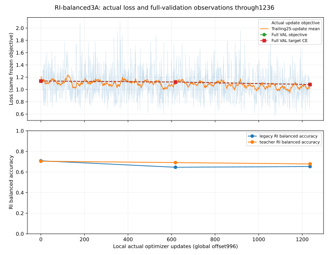
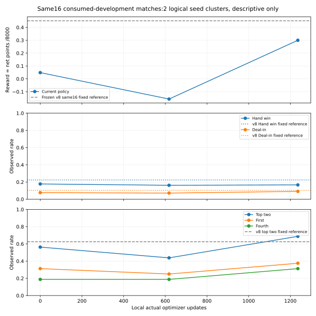

# RI-balanced3A: actual1236-update observation

The fixed2,472-update course has completed its halfway checkpoint and full
23,688-menu validation. All16 declared complete East development matches
finished, and their terminal point totals close to the native score ledgers.
This is an intermediate observation; the full registered budget continues.

## Same16 development cells

| Policy/checkpoint | First | Top two | Fourth | Net points/match | Hand win | Deal-in/hand |
|---|---:|---:|---:|---:|---:|---:|
|Complete-legal initializer0|31.25%|56.25%|18.75%|+387.50|17.7455%|7.6860%|
|618 updates|25.00%|43.75%|18.75%|−1,256.25|16.2302%|7.1677%|
|1,236 updates|37.50%|68.75%|31.25%|+2,400.00|16.6741%|9.1369%|
|Frozen v8, same cells|62.50%|62.50%|31.25%|+3,612.50|22.3735%|10.3373%|

Relative to618, the observed top-two rate rises25 percentage points and net
points rise3,656.25 per match. Relative to the initializer, those differences
are+12.5 points and+2,012.50. Relative to v8, top two is+6.25 points while net
points remain−1,212.50 per match. A better top-two point estimate does not
establish parity on the joint top-two/net objective.

First and fourth both rise relative to618, and the hand-win increase is small.
These16 cells contain only two independent logical wall-seed groups, crossed
with four seats and two heuristic opponent profiles. They are consumed
development games, not16 independent seeds, human competition or Mortal
opponents. No stable interval/strength claim follows from this small sample.
Do not select or promote this intermediate checkpoint from its observed peak.

## Full validation and retained capabilities

| Actual validation observation | Initializer0 | 618 | 1,236 |
|---|---:|---:|---:|
|Canonical target CE|1.136669|1.121281|1.079978|
|Retained objective|1.137405|1.122291|1.081413|
|Legacy basic RI balanced agreement|70.8494%|64.5753%|65.2896%|
|Teacher basic RI balanced agreement|70.4243%|69.0920%|67.8264%|

Loss improves while RI retention remains below initialization. Legacy RI has
24/37 accepted-positive and46/70 declined-negative labels; teacher RI has
200/287 and157/238 respectively. The legacy balanced-agreement drop remains
larger than the original three-percentage-point retention allowance. This
observation does not clear the original advancement requirements.

| Positive-labelled operation windows selected | Initializer0 | 618 | 1,236 |
|---|---:|---:|---:|
|Chi|182/415|181/415|191/415|
|Pon|323/561|334/561|364/561|
|Ankan|78/151|60/151|70/151|
|Daiminkan|1/88|1/88|2/88|
|Kakan|26/71|11/71|27/71|

Chi/pon and kakan improve against618; ankan has not recovered its initial
positive-label selection, and daiminkan remains weak. The accompanying CSV
also includes negative-label counts and balanced agreement, so increased
positive selection is not presented as unconditional quality. These are
agreement measures against admitted source labels, not optimal-action proof
or free-play operation rates.

## Actual curves and reproducible aggregates

The charts contain actual optimizer observations1–1,236 and actual full
validation/native observations0/618/1,236. The25-update training mean is
explicitly smoothed; no additional evaluations are interpolated or invented.
Native reward means terminal net points/8,000, giving0.3000 at1,236; the
trainer's unused RL diagnostic is not substituted for that reward.

- [All1,236 scalar optimizer observations](data/curriculum-3A-ri-balanced1236-training-20261125.csv)
- [Matched development and full-validation scalars](data/curriculum-3A-ri-balanced1236-development16-20261125.csv)
- [Operation label counts and balanced agreement](data/curriculum-3A-ri-balanced1236-operation-labels-20261125.csv)

The earlier0/618 journal prefix is byte identical to its bound snapshot. The
original export attempt used an incorrectly padded read-only checkpoint path;
its source/log/cancellation observation were retained. A separate corrected
export verified the actual checkpoint, full point journal and score closure,
then created these scalar-only projections without model loading, new games
or student updates. Raw matches, seeds, seats, per-example records, gradients
and private research weights remain private.

## Next registered work

Continue the unchanged course through1,854 and2,472 observations, then its
independent full audit and original strategy/retention grade. The actual final
2,472 checkpoint is the only eligible parent. The already queued alternative
can activate only after successful complete execution/audit with a failed
strategy grade. Neither a lower validation loss nor this intermediate top-two
gain bypasses those rules. Later3B/placement training and the unopened final
32-seed v8 confirmation remain incomplete. No production/EXE replacement or
main merge is automatic.
