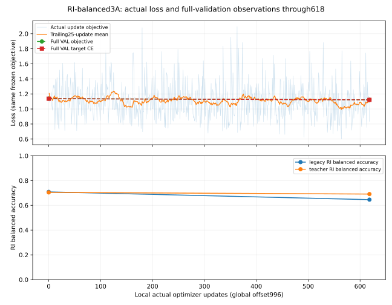

# RI-balanced Stage3A: first618-update result

**This first declared checkpoint did not improve the matched development
results. Full-validation loss fell, while RI retention and the observed
same16 match outcomes worsened. It does not replace practical v8.**

The run continues from qualified basic608 -> calls388, with a new optimizer;
the previous failed2400-update control contributes no weights. It retains
87,595 unique TRAIN records,23,688 VAL records and19 source objectives. Every
73-record update includes the four RI strata, with inverse-repeat weights
preserving the original per-record objective. The complete registered budget
is2,472 updates/two epochs; this observation contains618 actual updates and
45,114 physical record exposures. Newly collected targeted labels are not in it.

## Matched complete-East development games

All rows below use the same16 cells:two logical seeds x four seats x two
heuristic opponent profiles. Step0 and618 use the same complete-legal-menu,
fixed RI-class0.5 execution policy. Frozen practical v8 retains its original
serving policy. These are consumed development results, not human win rates
or the unopened independent test.

| Policy | First | Top two | Fourth | Net points/match | Hand win | Deal-in |
|---|---:|---:|---:|---:|---:|---:|
|Complete-legal parent, step0|31.25%|56.25%|18.75%|+387.50|17.75%|7.69%|
|RI-balanced3A, step618|25.00%|43.75%|18.75%|−1,256.25|16.23%|7.17%|
|Frozen practical v8, same16 subset|62.50%|62.50%|31.25%|+3,612.50|22.37%|10.34%|

Against its own initialization, step618 changes top-two by−12.50 percentage
points and net by−1,643.75/match. Against v8 it changes top-two by−18.75pp and
net by−4,868.75/match. Only two logical seed clusters underlie these observations;
sixteen seat/profile cells are not sixteen independent seeds. Do not infer a
stable improvement/regression interval or select a checkpoint from this grid.
Hand rates are arithmetic means of each match's hand rate, not pooled hands.

The current16 and48 baseline match ledgers were independently recounted.
Own score components close exactly to recorded terminal net and terminal score
minus25,000. Reward is actual terminal raw net/8,000:0.0484375 ->−0.15703125.
It is not the unused per-update RL reward field in the supervised trainer.

## Complete validation and remaining call gaps

| Metric on the unchanged full VAL | Step0 | Step618 |
|---|---:|---:|
|Canonical target cross-entropy|1.136669|1.121281|
|Retained training objective|1.137405|1.122291|
|Legacy RI balanced accuracy|70.85%|64.58%|
|Teacher RI balanced accuracy|70.42%|69.09%|

Legacy RI acceptance recall is26/37 ->24/37 and correct-decline recall is
50/70 ->45/70. Teacher acceptance is192/287 ->194/287; correct decline is
176/238 ->168/238. Thus the legacy RI balanced-accuracy drop is6.27pp despite
every update containing both source-specific positive/negative RI strata.
This intermediate observation does not resolve the retention problem.

| Operation | Parent accepted positive source labels | Step618 accepted positive source labels |
|---|---:|---:|
|Chi|182/415|181/415|
|Pon|323/561|334/561|
|Ankan|78/151|60/151|
|Daiminkan|1/88|1/88|
|Kakan|26/71|11/71|

These are agreements with source labels, not proof that every labeled call/kan
is optimal. Correct declines increase for ankan and kakan; positive recall
alone is not overall action quality. The full positive/negative counts and
balanced agreements are in the operation CSV. The daiminkan acceptance gap
remains, so this point cannot support a claim that call/kan learning is solved.

## Actual curves and aggregate data

There are618 real optimizer-loss observations. The orange training line is a
trailing25-update mean. Validation and native metrics have only two actual
observations,0 and618; connecting lines do not add unmeasured checkpoints.
The v8 horizontal lines are fixed same16 references, not v8 training curves.

- [Scalar update loss/CE/exposure CSV](data/curriculum-3A-ri-balanced618-training-20261125.csv)
- [Full-validation and matched16 aggregate CSV](data/curriculum-3A-ri-balanced618-development16-20261125.csv)
- [Full source-label operation counts](data/curriculum-3A-ri-balanced618-operation-labels-20261125.csv)

## Interpretation and continuation

So far, packing RI examples into every update has not preserved their behavior.
Inverse-repeat weighting deliberately leaves the original objective mass intact;
this trial does not test increasing RI/call objective mass or adding new cases.
The loss/retention/outcome directions make objective tradeoffs and source-label
balance relevant next diagnoses. They do not prove one exclusive cause from
this checkpoint, nor justify assuming that more updates will automatically help.

Keep the frozen run and its declared1236/1854/2472 observations. Only the final
registered budget may qualify for advancement under the unchanged criteria;
618 is not a replacement candidate. Full fit, independent audit, later-course
qualification and the reserved32-seed v8 comparison remain unfinished.

Only SVG figures, scalar curves and aggregate tables are public. Raw hands,
worlds, seeds/seats, per-example outputs, gradients, paths and research weights
remain private. No automatic main merge, practical-model replacement or release.
