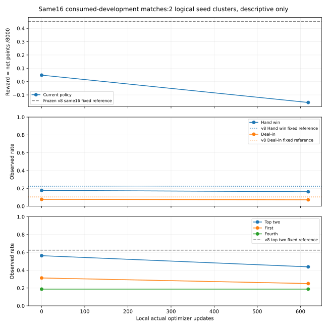

# RI-balanced Stage3A: first618-update result

**This first declared checkpoint did not improve the matched development
results. Full-validation loss fell, while RI retention and the observed
same16 match outcomes worsened. It does not replace practical v8.**

The run continues from qualified basic608 -> calls388, with a new optimizer;
the previous failed2400-update control contributes no weights. It retains
87,595 unique TRAIN records,23,688 VAL records and19 source objectives. Every
73-record update includes the four RI strata, with inverse-repeat weights
preserving the original per-record objective. The complete registered budget
is2,472 updates/two epochs; this observation contains618 actual updates and
45,114 physical record exposures. Newly collected targeted labels are not in it.

## Matched complete-East development games

All rows below use the same16 cells:two logical seeds x four seats x two
heuristic opponent profiles. Step0 and618 use the same complete-legal-menu,
fixed RI-class0.5 execution policy. Frozen practical v8 retains its original
serving policy. These are consumed development results, not human win rates
or the unopened independent test.

| Policy | First | Top two | Fourth | Net points/match | Hand win | Deal-in |
|---|---:|---:|---:|---:|---:|---:|
|Complete-legal parent, step0|31.25%|56.25%|18.75%|+387.50|17.75%|7.69%|
|RI-balanced3A, step618|25.00%|43.75%|18.75%|−1,256.25|16.23%|7.17%|
|Frozen practical v8, same16 subset|62.50%|62.50%|31.25%|+3,612.50|22.37%|10.34%|

Against its own initialization, step618 changes top-two by−12.50 percentage
points and net by−1,643.75/match. Against v8 it changes top-two by−18.75pp and
net by−4,868.75/match. Only two logical seed clusters underlie these observations;
sixteen seat/profile cells are not sixteen independent seeds. Do not infer a
stable improvement/regression interval or select a checkpoint from this grid.
Hand rates are arithmetic means of each match's hand rate, not pooled hands.

The current16 and48 baseline match ledgers were independently recounted.
Own score components close exactly to recorded terminal net and terminal score
minus25,000. Reward is actual terminal raw net/8,000:0.0484375 ->−0.15703125.
It is not the unused per-update RL reward field in the supervised trainer.

## Complete validation and remaining call gaps

| Metric on the unchanged full VAL | Step0 | Step618 |
|---|---:|---:|
|Canonical target cross-entropy|1.136669|1.121281|
|Retained training objective|1.137405|1.122291|
|Legacy RI balanced accuracy|70.85%|64.58%|
|Teacher RI balanced accuracy|70.42%|69.09%|

Legacy RI acceptance recall is26/37 ->24/37 and correct-decline recall is
50/70 ->45/70. Teacher acceptance is192/287 ->194/287; correct decline is
176/238 ->168/238. Thus the legacy RI balanced-accuracy drop is6.27pp despite
every update containing both source-specific positive/negative RI strata.
This intermediate observation does not resolve the retention problem.

| Operation | Parent accepted positive source labels | Step618 accepted positive source labels |
|---|---:|---:|
|Chi|182/415|181/415|
|Pon|323/561|334/561|
|Ankan|78/151|60/151|
|Daiminkan|1/88|1/88|
|Kakan|26/71|11/71|

These are agreements with source labels, not proof that every labeled call/kan
is optimal. Correct declines increase for ankan and kakan; positive recall
alone is not overall action quality. The full positive/negative counts and
balanced agreements are in the operation CSV. The daiminkan acceptance gap
remains, so this point cannot support a claim that call/kan learning is solved.

## Actual curves and aggregate data

There are618 real optimizer-loss observations. The orange training line is a
trailing25-update mean. Validation and native metrics have only two actual
observations,0 and618; connecting lines do not add unmeasured checkpoints.
The v8 horizontal lines are fixed same16 references, not v8 training curves.

- [Scalar update loss/CE/exposure CSV](data/curriculum-3A-ri-balanced618-training-20261125.csv)
- [Full-validation and matched16 aggregate CSV](data/curriculum-3A-ri-balanced618-development16-20261125.csv)
- [Full source-label operation counts](data/curriculum-3A-ri-balanced618-operation-labels-20261125.csv)

## Interpretation and continuation

So far, packing RI examples into every update has not preserved their behavior.
Inverse-repeat weighting deliberately leaves the original objective mass intact;
this trial does not test increasing RI/call objective mass or adding new cases.
The loss/retention/outcome directions make objective tradeoffs and source-label
balance relevant next diagnoses. They do not prove one exclusive cause from
this checkpoint, nor justify assuming that more updates will automatically help.

A separate local gradient probe fixed eight TRAIN examples per source before
predictions,152 examples across all19 sources. It differentiated all372 LoRA
and four head tensors,11,347,456 trainable parameters, with dropout disabled
and no optimizer. Exact loaded adapter/head tensors and the checkpoint bundle
were unchanged before/after. No VAL/test example was encoded or differentiated.

Some individual new-source mean gradients oppose RI means, but the
source-mass-weighted new-task mean and full19-source mean are positively aligned
with both legacy and teacher RI gradients on this panel. This does not support
a blanket explanation that the combined new objective locally pushes against
TRAIN RI loss. It is a small deterministic TRAIN panel in eval mode, not a global
causal test or simulation of AdamW, dropout and the actual update trajectory.
Per-source gradients, norms, sample identifiers and alignment details stay private.

There is also an objective/decision distinction: the retained RI component
compares reach against the maximum discard logit, whereas execution requires
reach probability at least0.5 against all discard mass. This alone does not
establish the cause or an untested fix. The previous full-group/class-weight2
trial already completed2,400 updates and failed its retention/native criteria
([actual prior result](curriculum-3A-paired-final2400-20261124.md)). Do not silently
repeat it as a newly discovered solution. Next diagnoses should compare cached
ranking, probability/margin movement and correct-to-incorrect transitions,
separating coverage/generalization and calibration before registering a new fit.

### Completed cached RI diagnosis

The actual complete0/618 validation-score files cover the same23,688 distinct
menus. Projecting only the four predetermined basic-replay RI strata gives632
menus:legacy37 accepts/70 declines and teacher287 accepts/238 declines. Original
IDs, menus and labels are equal across checkpoints; fixed-serving confusion
counts independently reproduce the published full-validation observation.
No model inference, optimizer update, threshold search or new game is involved.

| RI source | Class-probability AUC,0 ->618 | Binary class NLL,0 ->618 | Correct ->wrong | Wrong ->correct |
|---|---:|---:|---:|---:|
|Legacy,107 menus|0.761004 ->0.746718|0.588615 ->0.603727|10|3|
|Teacher,525 menus|0.738456 ->0.744459|0.609017 ->0.600854|22|16|

Across632 menus,32 previously correct decisions become wrong and19 previously
wrong decisions become correct. The51 class flips include20 new false-positive
RI accepts,12 new false-negative declines,12 corrected accepts and7 corrected
declines. Thus a net tendency toward RI does not explain every regression:
some originally correct accepts also become declines. None of the32 newly
incorrect cases improves its own retained RI objective, max-class NLL or
group-class NLL. Their errors cannot be explained as those same examples
successfully minimizing the wrong class surrogate. Average source improvement
can conceal these individual deteriorations. AUC declines on legacy while
slightly improving on teacher, so this is not solely a single fixed-threshold
effect. These are consumed development-label diagnostics, not strength or
optimal-action proofs.

A separate full TRAIN inventory finds2353 basic-replay RI examples:
legacy194 accepts/272 declines and teacher1075 accepts/812 declines. Acceptance
and decline retain equal registered loss mass within each origin; together the
four strata occupy12.26225% of the19-source objective. Neither new hard teacher
source(closed discard under RI, ordinary completion) contains a reach option.
They therefore do not directly add an uncounted stream of hard accept labels.
There are53 soft-MC menus with a reach option, and115 additional hard menus in
the retained advanced sources,93 of which also contain kan alternatives outside
the RI-only decoder scope. These groups are not silently merged into the632-row
basic RI metric. Exact visible-input matching finds no duplicated hard RI menu
or binary-label conflict in TRAIN. This rules out this particular duplication
mechanism, not more general label noise or gradient interactions.

### Complete replay RI TRAIN comparison

A separate read-only GPU probe evaluated every one of the2353 original four-stratum
RI TRAIN menus with the exact qualified calls388 initialization and frozen618
checkpoint. Selection was the complete population, fixed before predictions;
no model-error sampling or class-dependent truncation was used. The selected
IDs and family groups are disjoint from all original VAL records. Both model
bundles were unchanged afterwards. No optimizer, student update, validation/test
inference or new native match was involved.

| TRAIN source | Balanced agreement,0 ->618 | Class-probability AUC,0 ->618 | Binary class NLL,0 ->618 |
|---|---:|---:|---:|
|Legacy,466 menus|62.4716% ->61.1867%|0.694038 ->0.684259|0.623513 ->0.637260|
|Teacher,1887 menus|67.3959% ->67.3422%|0.743207 ->0.742621|0.605160 ->0.601464|

Legacy TRAIN accept recall changes119/194 ->124/194 while correct declines change
173/272 ->159/272. Teacher accepts change656/1075 ->680/1075 and correct declines
599/812 ->580/812. Thus the lost RI behavior is not confined to unseen VAL;
calling this only a held-out generalization gap is unsupported. Teacher mean
class NLL improves without an improvement at the fixed decision point.

An independent256-family basic teacher supplement has been started under a
[separate frozen recipe](plans/curriculum-basic-teacher-supplement-20261125.md).
It is not in this fit, and its collection/audit cannot establish student strength.
More coverage remains worth testing, but these TRAIN results mean adding data
alone is not an established remedy. If the full registered trial fails, a future
recipe must explicitly examine retention of the parent's RI decisions together
with the new data; it must not repeat the already failed full-group2 trial or
pretend that an intermediate checkpoint has qualified.

Keep the frozen run and its declared1236/1854/2472 observations. Only the final
registered budget may qualify for advancement under the unchanged criteria;
618 is not a replacement candidate. Full fit, independent audit, later-course
qualification and the reserved32-seed v8 comparison remain unfinished.

Only SVG figures, scalar curves and aggregate tables are public. Raw hands,
worlds, seeds/seats, per-example outputs, gradients, paths and research weights
remain private. No automatic main merge, practical-model replacement or release.
