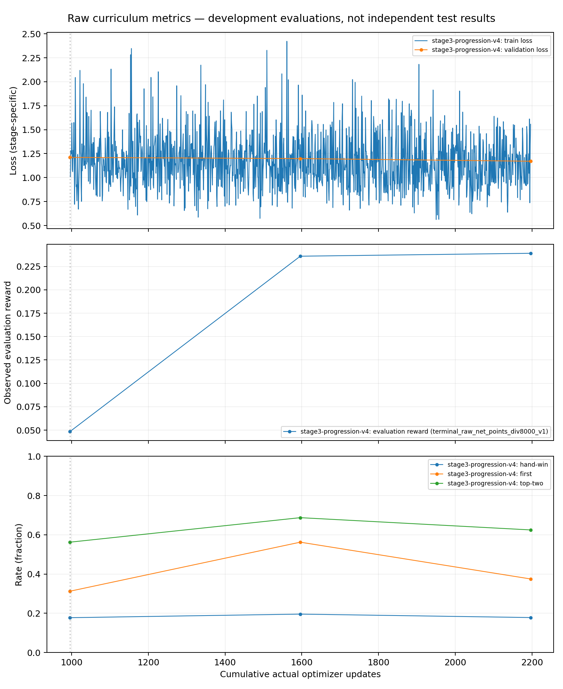

# 3A 第 1200 步：loss 改善，开发对局尚无明显进一步提升

本轮从同一封存的第二阶段模型接续，固定训练 2400 次更新。
1200 步已完成一轮训练、87,595 次样本曝光、全部 23,688 条验证及模型/优化器保存，
并完成同组 16 场东风开发评测。训练已继续，未根据中间成绩挑选最终模型。

## 同一组完整东风开发对局

全部策略使用相同两个逻辑种子、四个座位和两种已冻结的启发式对手组合。
和牌率、放铳率均为各场局内比例再求平均；这些不是雀魂真人段位胜率。

| 策略 | 和牌率 | 一位率 | 前二率 | 四位率 | 净得点／场 | 放铳率 |
|---|---:|---:|---:|---:|---:|---:|
| 本轮零步 | 17.75% | 31.25% | 56.25% | 18.75% | +387.50 | 7.69% |
| 本轮 600 步 | 19.57% | 56.25% | 68.75% | 12.50% | +1,887.50 | 4.35% |
| 本轮 1200 步 | 17.82% | 37.50% | 62.50% | 18.75% | +1,912.50 | 5.89% |
| 冻结 v8 | 22.37% | 62.50% | 62.50% | 31.25% | +3,612.50 | 10.34% |

1200 步相对零步净得点增加 **1,525 点／场**，前二率增加 **6.25 个百分点**。
相对 600 步，净得点仅增加 **25 点／场**，前二率下降 6.25 个百分点，和牌率和一位率也下降。
相对 v8，前二率相同，净得点仍低 **1,700 点／场**。
因此，不能将本次结果解释为持续稳定提升或已经比肩 v8。

只有两个逻辑种子，16 场不能视为 16 个独立样本；这组数据已用于观察，属于开发集。
v8 使用其原 guarded 执行策略，本轮使用固定完整合法菜单/立直类 0.5 策略，
因此这里比较的是完整策略，不是纯权重消融。

## 全量验证与仍存在的问题

| 指标 | 零步 | 600 步 | 1200 步 |
|---|---:|---:|---:|
| 加权目标验证 loss | 1.210554 | 1.198349 | 1.170627 |
| 加权目标 CE | 1.136669 | 1.121368 | 1.094543 |
| 原基础普通出牌标签一致率 | 55.01% | 55.09% | 56.23% |
| 原基础立直平衡准确率 | 70.33% | 62.59% | 65.15% |
| 原鸣牌验证大明杠正标签命中 | 1/88 | 0/88 | 3/88 |

立直平衡准确率由原基础 324 个正例、308 个负例的接受/拒绝召回率等权平均得到。
1200 步较 600 步有所恢复，仍比零步低约 5.18 个百分点；原基础负例的正确拒绝率只有 44.81%。
loss 下降不能代替立直保留、鸣牌决策与完整对局效果的检查。
旧标签一致性也不能证明这些标签在每个局面都是最优动作。

实际训练集的原鸣牌回放包含下列硬标签窗口。同一局面可同时提供多个操作，不能将各行相加当作独立局面数。

| 可选操作 | 正标签数 | 负标签数 | 计入本轮样本权重后的正例占比 |
|---|---:|---:|---:|
| 吃 | 1,444 | 9,709 | 19.25% |
| 碰 | 2,040 | 5,142 | 21.97% |
| 暗杠 | 501 | 693 | 35.77% |
| 大明杠 | 341 | 602 | 25.25% |
| 加杠 | 157 | 223 | 37.77% |

这些数字说明正例存在，但不证明覆盖充分或标签可靠。有效样本权重也不等于梯度贡献。
尤其大明杠已有 341 个训练正例，验证命中仍低；原因不能简化为“模型完全没见过杠”，
还需区分标签来源、场景迁移、动作竞争及实际训练梯度。当前配方没有据此临时改动。

## 真实 loss、reward 与胜率曲线

训练 loss 来自前 1200 次真实更新。验证与对局只在 0、600、1200 步有观测，连线没有新增测量点。
横轴为当前参数来源累计更新数，包含父模型 608+388 次更新；本阶段对应累计 996–2196。
废弃运行与独立控制测试不计入当前参数来源。

SFT 更新没有对局 reward。图中 reward 是评测对局净得点除以 8000，
不是本轮反向传播的强化学习奖励，也不是模型预测的和牌概率。
导出时重新核对了三次开发评测与 v8 对照的共 64 场原生结算、名次、和牌/放铳计数，
以及本轮三次评测对应的保存模型和执行策略标识。未新增模型推理或打开最终测试牌山。
原始牌局、逐条预测、详细训练日志与研究权重保持私有。

## 后续

继续原定 2400 步预算，保留 1800/2400 步观测及最终 64 场开发评测；最终候选按完整预算确定。
是否进入 3B 仍依据原登记的立直保留、鸣牌、风险和对局标准，不能因 loss 下降直接晋级。
3B 学习役种与路线选择；第四阶段学习终局位次。两者尚未开始学生训练。
最终独立 v8 对照仍未开启，当前生产模型和 Windows 工具未替换。
