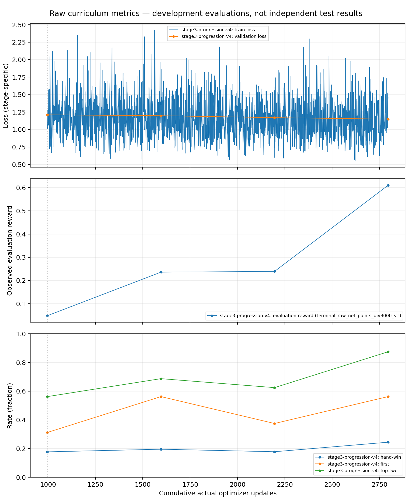

# 3A 第 1800 步：同组开发对局改善，尚未完成独立确认

1800 步已完成 131,395 次样本曝光、全部 23,688 条验证，以及保存模型的 16 场东风开发评测。
本轮固定训练 2400 次更新，训练已经继续；1800 步是登记的中间观测点，尚未选为最终模型。

## 同一组完整东风开发对局

各行使用相同两个逻辑种子、四个座位和两种固定启发式对手组合。
和牌率、放铳率为各完整对局的局内比例再求平均，不能当作雀魂真人段位胜率。

| 策略 | 和牌率 | 一位率 | 前二率 | 四位率 | 净得点／场 | 放铳率 |
|---|---:|---:|---:|---:|---:|---:|
| 本轮零步 | 17.75% | 31.25% | 56.25% | 18.75% | +387.50 | 7.69% |
| 本轮 600 步 | 19.57% | 56.25% | 68.75% | 12.50% | +1,887.50 | 4.35% |
| 本轮 1200 步 | 17.82% | 37.50% | 62.50% | 18.75% | +1,912.50 | 5.89% |
| 本轮 1800 步 | 24.46% | 56.25% | 87.50% | 12.50% | +4,881.25 | 5.53% |
| 冻结 v8 | 22.37% | 62.50% | 62.50% | 31.25% | +3,612.50 | 10.34% |

相对 1200 步，1800 步净得点增加 **2,968.75 点／场**，前二率增加 **25 个百分点**。
相对同组 v8，净得点高 **1,268.75 点／场**，前二率高 **25 个百分点**，一位率低 6.25 个百分点。
在这一开发组中，继续训练后观测到了改善；它不是所有指标都优于 v8 的结论。

这组只有两个逻辑种子，16 场不能视为 16 个独立统计样本。
同组结果已用于观察，属于开发数据；它不足以证明稳定提升或整体比肩 v8。
本轮各点使用相同完整合法菜单与固定立直类 0.5 执行策略；v8 保留原 guarded 策略，
因此对照是完整策略比较，不是单独改变参数的消融。

## 全量验证与仍未解决的问题

| 指标 | 零步 | 600 步 | 1200 步 | 1800 步 |
|---|---:|---:|---:|---:|
| 加权目标验证 loss | 1.210554 | 1.198349 | 1.170627 | 1.149549 |
| 加权目标 CE | 1.136669 | 1.121368 | 1.094543 | 1.077531 |
| 原基础普通出牌标签一致率 | 55.01% | 55.09% | 56.23% | 56.15% |
| 原基础立直平衡准确率 | 70.33% | 62.59% | 65.15% | 66.92% |
| 原鸣牌验证大明杠正标签命中 | 1/88 | 0/88 | 3/88 | 3/88 |

1800 步的合并立直接受率为 218/324，正确拒绝率为 205/308，两者等权平均得到 66.92%。
这比 1200 步有所恢复，仍比零步低约 3.41 个百分点，超过原登记的最多下降 3 个百分点。
合并统计也会掩盖来源差异：原始回放源立直正例只接受 **19/37（51.35%）**，低于该来源的 60% 要求；
新增教师源的接受率为 199/287（69.34%），正确拒绝率为 157/238（65.97%）。
因此，这个中间点仍未满足全部阶段质量条件，不能仅凭开发对局均值宣布晋级。

大明杠正标签命中仍低，吃碰杠能力也不能宣称全部解决。
这些验证指标衡量已有标签的一致性，不证明每个旧标签都是实战最优动作；
后续判断仍结合原登记标准和完整对局表现，保留各项差异。

## 实际 loss、reward 与胜率曲线

训练曲线来自前 1800 次真实更新；验证和对局仅有 0、600、1200、1800 四个观测点。
连线不代表中间已逐步测量。横轴为当前参数来源的累计更新数，包含父模型 608+388 次更新；
本阶段对应累计 996–2796。废弃运行和独立控制测试不计入当前参数来源。

SFT 更新没有对局 reward。图中 reward 为完整对局净得点除以 8000，
是评测指标，不是本轮反向传播的强化学习奖励，也不是模型预测和牌概率。

导出时重新核对四次开发评测及 v8 对照的共 **80 场原生结算、名次、和牌和放铳计数**，
并核对本轮四个评测点的保存参数及执行策略标识。没有新增推理对局或开启最终测试牌山。
原始逐场记录、详细训练日志、预测和研究权重保持私有。

## 后续执行

继续原定 2400 步完整预算，保留最终 64 场开发评测，并以匹配的 16 场子集延续过程曲线。
正式晋级依据最终模型与原登记条件，1800 步不会自动替代最终候选。
3B 役种／路线选择及第四阶段终局位次训练尚未开始；最终独立 v8 对照仍未开启。
本报告不替换生产模型或 Windows 工具。
