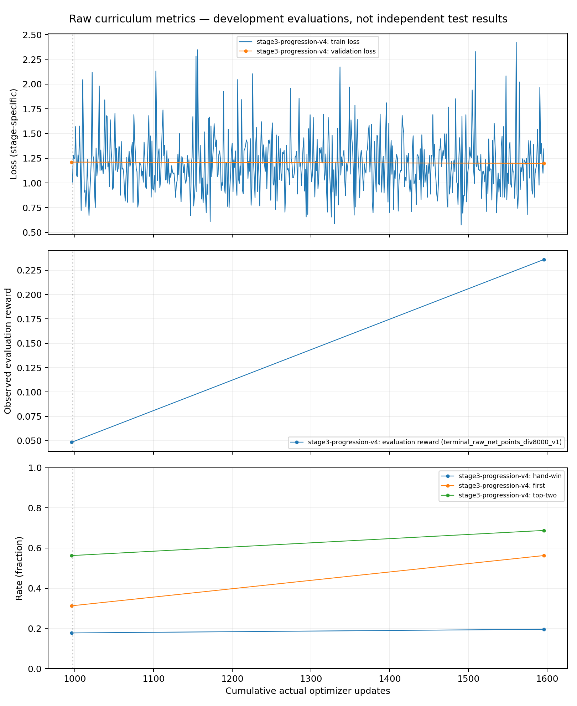

# 3A 第 600 步：开发对局改善，尚未比肩 v8

本轮 3A 从已封存的 Calls388 参数接续，固定训练 2400 次更新。
第 600 步已完成 43,800 次样本曝光、全部 23,688 条验证、完整模型/优化器保存及 16 场东风开发对局。
训练已继续；600 步是中间观测点，没有被选择为最终模型。

## 同一组 16 场完整东风对局

以下三行使用相同两个逻辑种子、四个座位和两种对手组合。
对手为已冻结的效率/鸣牌启发式代理，结果不是雀魂真人段位胜率。
和牌率、放铳率为各完整对局的局内比例再求平均。

| 策略 | 和牌率 | 一位率 | 前二率 | 四位率 | 净得点／场 | 放铳率 |
|---|---:|---:|---:|---:|---:|---:|
| 本轮零步 | 17.75% | 31.25% | 56.25% | 18.75% | +387.50 | 7.69% |
| 本轮 600 步 | 19.57% | 56.25% | 68.75% | 12.50% | +1,887.50 | 4.35% |
| 冻结 v8 | 22.37% | 62.50% | 62.50% | 31.25% | +3,612.50 | 10.34% |

相对零步，600 步净得点增加 **1,500 点／场**，前二率增加 **12.50 个百分点**。
相对 v8，前二率高 6.25 个百分点，但净得点低 **1,725 点／场**，和牌率、一位率也更低。
这只能说明本次小样本的观测改善，不能据此宣称稳定提升或比肩 v8。

只有两个独立牌山种子，16 场并不是 16 个独立统计样本；该开发组已经参与观察，不能充当最终独立确认。
零步和 600 步使用相同的完整合法菜单与固定立直类 0.5 执行策略；
v8 保留原 guarded 策略，因此 v8 对照是完整策略比较，不是纯参数消融。

## 全量验证：改善与退化同时存在

| 指标 | 零步 | 600 步 |
|---|---:|---:|
| 加权训练目标对应的验证 loss | 1.210554 | 1.198349 |
| 加权目标 CE | 1.136669 | 1.121368 |
| 原基础普通出牌标签一致率 | 55.01% | 55.09% |
| 原基础立直平衡准确率 | 70.33% | 62.59% |

整体 loss 下降没有消除立直偏移：立直正例判断增加，但负例判断恶化，平衡准确率下降 **7.74 个百分点**。
既有大明杠正标签的命中也仍很低：零步为 1/88，600 步为 0/88。
这些是已有验证标签的一致性指标，不将所有旧标签直接视为实战最优动作。

只统计 TRAIN 中纯立直/弃牌菜单时，旧回放正负例数为 1285/1090，
对应有效样本损失权重占比约 6.1365%/6.1331%，接近平衡。
新增教师数据没有这类纯硬标签窗口，新增 MC 数据有 50 个软目标窗口。
该统计不覆盖包含其他动作的混合菜单，也不等于实际梯度占比；
目前不能把偏移简单归因于新增硬立直正例过多，具体原因尚未确认。

## 实际曲线快照

训练 loss 来自 600 条真实优化器日志；验证和对局只有零步、600 步两个观测点，连线不代表中间已经逐步测量。
横轴是实际累计更新数，包含父模型 608+388 次更新，本阶段对应累计 996–1596。
废弃失败运行和独立控制测试的更新未计入当前参数来源。

SFT 训练 reward 为 null。中图的 observed evaluation reward 来自完整对局净得点除以 8000，
不是反向传播的强化学习奖励，也不是模型预测的和牌概率。
该图只为进度摘要；原始逐场记录、详细梯度日志、快照 CSV 和研究权重保持私有。

## 后续执行

继续已登记的 2400 步完整预算，不因这一处小样本结果修改数据或提前挑选模型。
保留 1200/1800/2400 步验证与实际对局，最终使用 64 场开发评测，
并按原晋级标准检查立直保留、鸣牌、进攻风险和实际净得点/前二率。
第四阶段训练尚未启动，最终未参与调参的 v8 对照仍未开启；生产模型与 Windows 工具未替换。
