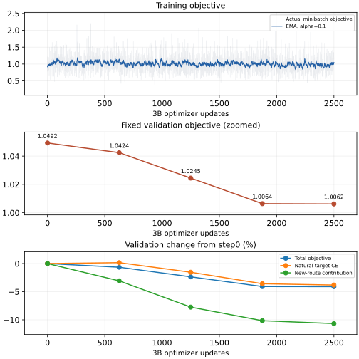
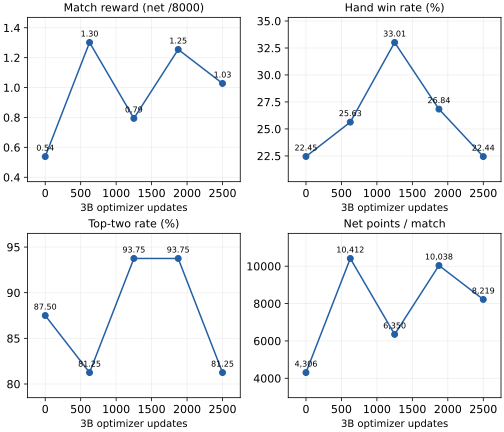
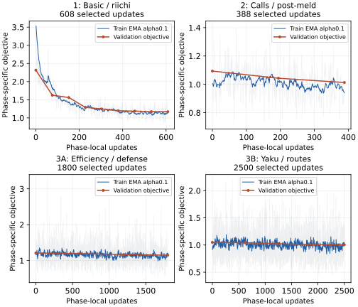

# 固定 base 课程复现：3B 最终结果（2026-11-26）

3B 的 2,500 次更新、完整验证、开发对局和权重重新加载核验已完成，可用研究推理包已导出。
同一组 64 场的前二率和净得点点估计仍低于冻结 v8；整个“至少比肩 v8”的目标尚未完成。
第四阶段终局位次训练仍在等待定向数据采集完成。

## 完整 64 场开发结果

8 个已消费逻辑种子 × 2 类对手 × 4 个座位，每个模型 64 场完整东风。
这些开发数据参与了训练流程中的观察；独立最终确认尚未打开。

| 模型 | 前二率 | 净得点／场 | 和牌率 | 放铳率 |
|---|---:|---:|---:|---:|
| 3A parent | 67.19% | +3356.250 | 24.33% | 9.54% |
| Frozen v8 | 59.38% | +4290.625 | 24.32% | 10.44% |
| 3B 2500 | 56.25% | +3090.625 | 22.34% | 8.65% |

3B 减去各参考模型的配对差值（8 个逻辑种子簇，原核验中的双侧 95% t 区间）：

| 参考模型 | 前二率差，百分点 [95% CI] | 净得点差 [95% CI] |
|---|---:|---:|
| 3A parent | -10.938 [-32.162, +10.287] | -265.62 [-5471.46, +4940.21] |
| Frozen v8 | -3.125 [-23.071, +16.821] | -1200.00 [-7642.74, +5242.74] |

区间仍很宽，尚不能从这组开发数据确认稳定提升或达到 v8。
[64 场汇总 CSV](curriculum-3b-final-20261126-endpoint64.csv)。

## 真实学习曲线

验证目标从 1.0492376 降到 1.0062133；1,875→2,500 步只再下降 0.0002023，已经接近平台。
自然分布目标 CE 从 0.9319505 降到 0.8964059。原始训练观测和 EMA、固定验证观测分别绘制。

对局曲线始终使用同一组 16 场（2 个逻辑种子 × 2 类对手 × 4 座位）。
1,250/1,875 步的 93.75% 前二率属于这个小网格；2,500 步在同网格为 81.25%、+8,218.75 点／场。
完整 64 场结果独立列在上表，不接入这条 16 场曲线。
reward 定义为终局净得点除以 8,000，是评测结果；本轮采用监督微调，训练 journal 的 reward 为 null。

[曲线汇总 CSV](curriculum-3b-final-20261126-curve16.csv)。所有点来自实际完成的观测；真实平台段保留原样。

## 训练路线与数据配比

参数来自固定 `Qwen/Qwen3.5-0.8B`，revision `2fc06364715b967f1860aea9cf38778875588b17`。
选中参数谱系为：基础出牌／立直 608 步 → 鸣牌／副露后出牌 388 步 → 3A 牌效／攻守 1,800 步 → 3B 役种／路线 2,500 步。
3A 父权重曾按已消费开发结果从 10 个历史 checkpoint 中选择；这是有记录的适应性选择，并非一次无选择的完整独立重训。
v8 是评测参考，不是这个参数谱系的初始化。

3B 有 91,247 条 TRAIN、24,516 条 VAL，共 25 个来源；新增六类共 3,652／828 条，VAL 覆盖 45 个来源家族。
19 类回放保留原目标并占 80% loss mass；六类新增来源占 20%，每类 3.3333%：国士无双、九莲宝灯、四暗刻、大三元、七对子、随机初始手牌控制组。
类别名表示生成目标与教师标注层次，不能直接当成实战完成该役种的证明。
[完整 25 类数据配比](curriculum-active3B-data-20261125.csv)。

固定 recipe：rank-16 LoRA 与共享决策头，2 epochs、182,494 条实际曝光；batch 1、梯度累积 73、混合块 511；
adapter LR 3e-6，head LR 1.5e-5，使用全新 optimizer。
普通决策和鸣牌共享该策略；评测还包含固定 RI0.5 类选择与可用和牌／单动作快捷路径。
这些执行规则属于所报告策略的一部分，和牌快捷路径不代表模型学会了和／过比较。

## 核验、交付和下一步

- 2,500 次实际更新、182,494 条曝光和 376 份 optimizer 参数状态全部对应；未恢复父 optimizer。
- 重新加载最终权重后检查全部 24,516 个验证菜单，最大概率误差 1.851825502e-07。
- 核验 320 份已有完整对局记录及原生结算；最终 checkpoint 的 64 场是其中一个网格。
- 研究推理包复制了实际评测的 adapter、head、tokenizer 与冻结 runtime，并完成一次非保留验证请求的加载、推荐测试。
- 论文已同步现有项目，PDF 曲线、完整配比表、64 场参考对比和配对区间已检查。

参数身份：`18ce835247e265e804cad81b0bc48b5778c959c8e4ceb2936913728176c2b9bf`。
参数更新在 11 月 26 日 01:50（Asia/Dubai）完成；核验在 02:31 完成，论文在 02:36 同步。
这次交付保留了研究权重和原始记录，生产模型保持原版本。

3B 策略评分为未达标：新增六来源平均 CE 改善 0.089593，
原五类鸣牌平均 balanced accuracy 变化 +3.074 个百分点，
但原四类 MC 平均 CE 变差 0.022745，部分 legacy 立直保留指标也下降。
这说明不同目标存在取舍；没有因果对照证明具体由步数或 20% 新来源权重造成。

按既定决定，3B 策略评分只作报告，不否决进入第四阶段；权重、数据和执行完整性仍必须通过。
第四阶段继续收集终局和／过、杠与追分局面，然后按已登记的完整配比续训。
最终模型通过第四阶段的既定条件后，才能冻结并进入 32 组保留种子、每个模型 256 场的独立确认。
整个目标仍为至少比肩 v8，本轮结果不构成目标完成。

复用代码：[完整匹配结果表](../../../tools/attach_curriculum_3b_reference_comparison_v2.py)、
[论文与 checkpoint 生成方案](../plans/curriculum-3B-paper-checkpoint-artifacts-20261126.md)。

## 64 场结算与鸣牌分解

复用三个模型各 64 场的原生记录，逐场复核六项分数收支并还原净得点；本次没有新增对局、模型推理或训练更新。

- 3B 和牌 90 次，v8 和牌 95 次；每次和牌的平均实际结算收入（含本场和立直棒）分别为 6,340.000、6,983.158 点，不能直接当作牌型本身的番符价值。
- 相对 v8，3B 每场和牌收入少 1,450.000 点，被自摸支出多 923.438 点；放铳支出少 650.000 点。其余立直押金、流局结算和末局未领取棒的差额合计弥补部分损失，六项最终精确对应 -1,200.000 点／场。
- 3B 吃牌 46 次、副露和牌 28 次，3A 父模型为 30／17 次，v8 为 68／32 次。大明杠事件数分别为 0、0、4。各模型实际进行的小局数略有不同，事件数不能视为有合法机会时的接受率，也不能据此断言某次应当鸣牌。

本组结果提示后续需要同时观察和牌效率、有效和牌收入与对手自摸代价。上述是已消费开发记录的描述性分解，并未证明差距由某个训练配比或某种牌型偏好造成。第四阶段仍按已登记方案推进。

[完整分解表](curriculum-3b-matched64-behavior-20261126.md) · [汇总 CSV](curriculum-3b-matched64-behavior-20261126.csv) · [分析代码](../../../tools/summarize_curriculum_matched64_behavior_v1.py)
