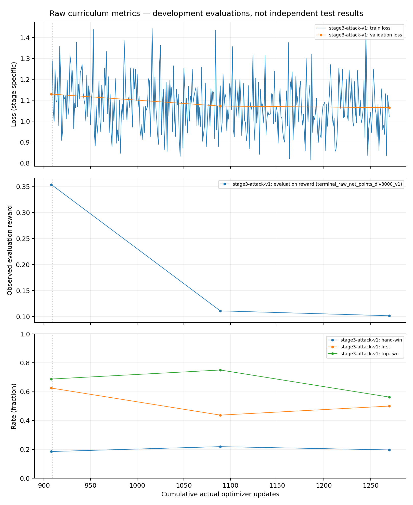

# Risk-recovery course: completed362, not v8 parity

2026-11-22, Asia/Dubai. Fit312301 completed362 optimizer updates and45,918 actual sample exposures; audit312304 completed with exit0. Both recorded job exits are zero. The final checkpoint is `ed71582759808c7cf8bae75b10e4ff269c276e1a69a6d9ebd169c41867cdbf60`. This is the sole preregistered candidate. Code/source evidence passes; the strategy-quality and additional recovery criteria do not. No deployment or fourth-course fit started automatically.

## Full64 complete-East development matches

| Metric | Pre-calls stage1 | Calls parent | Recovery362 | Frozen v8 |
|---|---:|---:|---:|---:|
| First |35.94%|26.56%|29.69%|42.19%|
| Top two |59.38%|53.13%|57.81%|59.38%|
| Fourth |20.31%|21.88%|15.63%|14.06%|
| Net points/match |+1,760.94|+484.38|+1,610.94|+4,290.63|
| Hand win |26.54%|20.64%|20.76%|24.32%|
| Deal-in |15.94%|12.10%|10.09%|10.44%|

The recovery improves over its calls parent by+1,126.56 net points/match and+4.69 percentage points top-two, with deal-in−2.00 points. Whole-seed paired95% intervals are[−2,249.68,+4,502.80] for net and[−12.92,+22.30] points for top-two: these development results do not establish a reliable gain. Against v8, net is−2,679.69,[−5,549.97,+190.60], and top-two−1.56 points,[−21.26,+18.14]. First place is12.50 points lower than v8, with interval[−23.67,−1.33]. None of this is the untouched final test.

The additional pre-calls recovery criteria also remain unmet: net is150 points/match below stage1 and top-two1.56 points lower. Better means than the weak immediate parent do not establish recovery of the earlier full-game result, or equivalence to v8.

## Validation, actual curves and interpretation

Weighted target CE decreases1.129846→1.072545→1.064848 at0/181/362. Conditional-MC mean CE improves0.249813; unknown alternatives stay masked. Ordinary expert agreement improves1.34 points and five-call balanced agreement3.06 points. However, riichi balanced agreement drops5.154 points against a preregistered maximum5-point drop, so the original attack-course quality gate fails. Its other components pass. Do not retrospectively relax the threshold or rename the failure; the remaining full-game gap to v8 matters independently of this small threshold miss.

Final riichi counts areTP25/FN12/TN19/FP51, compared with23/14/30/40 initially. Accepting observed riichi improves, but correctly declining it falls. Final daiminkan counts79/9/62/46 improve balance over84/4/29/79; kakan acceptance rises while correct declines fall. These are consumed expert-label diagnostics, not optimal-action certificates. The data provide conditional hand-horizon targets, not full public-belief terminal-placement labels. Aggregate imitation improvements therefore cannot guarantee stronger full matches.

[Standalone PDF](../figures/stage3-attack-recovery-v2/curriculum-curves.pdf). The connected game points use the same16-match subset throughout; final64 has its [separate CSV](../figures/stage3-attack-recovery-v2/evaluation-stage-end64.csv). On that16 subset, top-two68.75%→75.00%→56.25% and net+2,831.25→+887.50→+812.50. The attractive181 top-two point does not justify selecting it after inspection. Supervised reward is null; plotted game reward is observed terminal net/8,000. [Provenance](../figures/stage3-attack-recovery-v2/plot-data-provenance.json) records the fixed-grid transformation without new games. The [362 scalar training points](../figures/stage3-attack-recovery-v2/train-curve.csv) retain original values without smoothing; their [column-export provenance](../figures/stage3-attack-recovery-v2/scalar-export-provenance.json) binds the original aggregate CSV.

## Integrity and next work

Audit verifies exact372-adapter/4-head parent tensors at initialization, all376 optimizer states, all5,905 final reloaded menus (maximum probability difference1.38e−7), actual two-epoch exposure, source/data hashes and224 cached/new complete-game ledgers. The original failed calls grade remains false. The frozen final32-seed ×four-seat ×two-profile test remains unopened. Neither software checks nor development means complete the four-course objective.

Next, correct the stage4 source gaps before labelling: train open/small-hand wins, score-dependent pursuit and preservation, ordinary progression/calls, and multi-riichi coverage. The [source audit](curriculum-stage4-input-coverage-20261121.md) keeps valid input generation distinct from a validated continuation teacher and reliable paired full-terminal labels. A future parent choice or changed replay/riichi loss mixture needs a new prospective registration; it cannot modify these completed results. New weights, raw hands/worlds/targets and detailed prediction records remain private.
