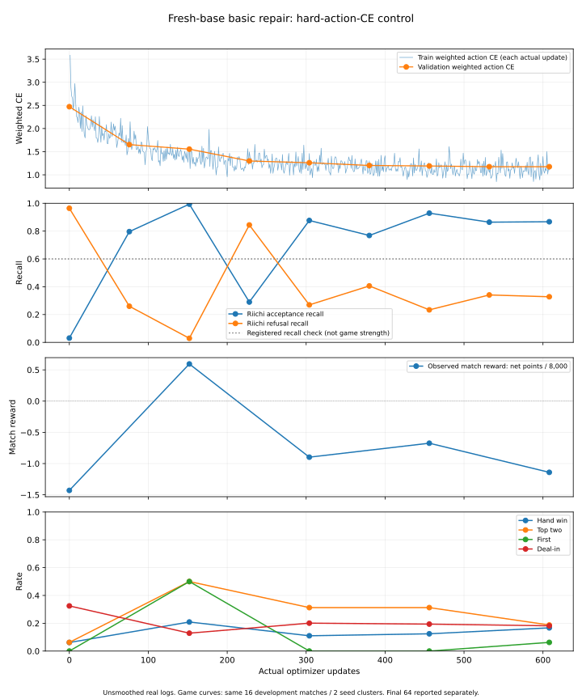

# Fresh-base basic repair: completed608-update control

2026-11-23, Asia/Dubai. The registered hard-action-CE recipe completes all608
optimizer updates and57,140 sample exposures, with no midpoint selection.
Its final64-match development mean remains below frozen v8. This is the basic
course, not a completed four-course policy or a production replacement. The
unopened32-seed final comparison remains reserved.

## Recipe and complete final validation

Fresh rank16 LoRA/256 pointer initialize from the fixed Qwen3.5-0.8B revision
and seed; no Mahjong/Mortal policy parameters initialize the student. Preserve
all9,292/1,972 legacy basic decisions and add audited4,993/1,294 actual Mortal
teacher decisions:14,285 TRAIN/3,266 validation, six source/classes. Loss mass
is65% ordinary discard and35% riichi, balanced by RI accept/decline and split
by the registered source weights.94-record without-replacement accumulation,
four complete epochs and152 updates/epoch give608 updates. Ordinary hard
action CE and the original serving/guard remain unchanged.

| Final608 measure | Value |
|---|---:|
| Weighted validation hard CE |1.175198|
| Natural validation hard CE |1.236991|
| Ordinary discard agreement |52.32%|
| RI acceptance recall |281/324 (86.73%)|
| RI refusal recall |101/308 (32.79%)|
| Legacy acceptance / refusal |34/37;26/70|
| Teacher acceptance / refusal |247/287;75/238|

Loss falls, but refusal remains below the unchanged0.6 source-specific recall
requirement. The final loss almost plateaus relative to532 (1.175244), and
source-specific refusal does not improve through the full budget. This does
not prove that teacher decisions are optimal or that imitation is the desired
final strength metric. It does show that the declared basic RI repair is not
yet achieved; no gate or final checkpoint is changed after seeing the result.

## Final64 and matched16 are separate measurements

All policies use the same consumed eight logical seeds, four controlled seats
and two registered efficiency/calling profiles, complete red-four-player East
rules and the unchanged native serving route. Rates are means of per-match
rates. Reward is terminal raw net points/8,000, separate from supervised loss.

| Full64 development matches | Plain584 control | Basic608 control | Frozen v8 |
|---|---:|---:|---:|
| Net points/match |+1,760.94|−678.13|+4,290.63|
| Top two |59.38%|43.75%|59.38%|
| Hand win |26.54%|24.12%|24.32%|
| Deal-in |15.94%|16.81%|10.44%|
| First |35.94%|25.00%|42.19%|
| Fourth |20.31%|29.69%|14.06%|

Basic608 trails v8 by4,968.75 net points/match and15.625 percentage points in
top-two rate. Its hand-win mean is close to v8, while deal-in is6.36 percentage
points higher. These observed differences do not isolate a causal effect of
riichi, defensive play, calls or the data source: the basic course has not
learned the later courses. The data/mix/batch changes from Plain584 were a
combined recipe, not a single-factor data-size experiment.

Pairing whole logical-seed groups gives exploratory95% intervals: net change
to v8−4,968.75[−12,329.38,+2,391.88], top-two−15.625pp[−45.5761,+14.3261].
The net change to Plain584 is−2,439.06[−7,040.36,+2,162.24]. These are wide,
consumed-development intervals, not independent confirmation or a precise
population strength difference. Native financial checks use the same engine;
they are not an independent complete han/fu scoring implementation.

The final checkpoint's matching16-game subset has net−9,125.00/top-two18.75%.
It is retained for the five-point process curve; the full64 mean is not spliced
into that curve. Earlier152's favorable16-game mean is not selected or relabelled
as the final result. All eight seeds are development evidence after inspection,
not64 independent randomized samples or the final unseen comparison.

## Audit, real curves and the isolated next experiment

The training wrapper records successful completion and preserves all169 earlier
recovery input bindings. Independent audit315412 completes with exit0:0:
608 actual optimizer updates,57,140 exposures,376 optimizer states, all four
full epoch-order receipts and all validation profiles pass.372 initial adapter
and4 head tensors exactly match the earlier fresh control. Saved-model serving
reloads check664 initial and all3,266 final menus, with maximum probability
errors5.43e-8/1.76e-7.192 cached complete-game records have their real score/rank
ledgers, summaries, identities and matched subsets reconciled. This is integrity
evidence; aggregate, unchanged legacy and teacher RI-quality checks still fail.

Dependent315509 archives the actual audit exit and scalar-only CSV/PNG/PDF.
GPU315889 successfully exports standalone loss, RI recall, observed reward and
rate figures, verifying608 real training points, nine validation points and
five matched16 game points.315907 preserves the plotted values while omitting
per-update gradient norms/source-count/source-loss diagnostics from the public
training CSV. The publication projection and figure provenance retain hashes.
No additional games, smoothed data points or synthetic training reward are
generated. Supervised training reward is null; the reward panel shows real
complete-game net points/8,000.

Public scalar files: [training](curriculum-basic-repair-final-20261123/train-curve.csv),
[validation](curriculum-basic-repair-final-20261123/validation-curve.csv),
[matched16 games](curriculum-basic-repair-final-20261123/evaluation-matched16.csv),
[final64 games](curriculum-basic-repair-final-20261123/evaluation-final64.csv).
The [figure provenance](curriculum-basic-repair-final-20261123/figure-provenance.json)
and [publication projection](curriculum-basic-repair-final-20261123/publication-projection.json)
explain the exact source/output transformation. PNG/PDF originals remain local;
the standalone SVG is displayed here.

Fresh RI-class-loss control315768 starts on ws-l1-002 after the actual completed
source-quality failure, full audit and terminal/scalar archives. It preserves the exact initial
tensors/data/source weights/sampler/LR/plain serving/full608 budget and changes
only binary RI loss from logsumexp-discard to best-discard margin, retaining
conditional-discard/plain CE. It records the changed objective and original
hard CE separately. Actual initial tensor/prediction/game equality is required
before its first update. Initial validation/equality checks are in progress at
this report revision; no new-control strength result follows yet. This is a new experiment, not continuation of a failed
student or a minimum-loss checkpoint selection.

The independently audited312/75 missing post-reach decisions remain outside
both frozen fit mixtures. The [completed data and guard diagnostic](curriculum-post-reach-complete-20261123.md)
also finds a training/execution mismatch for later defensive targets; its
positive guard-removal mean has a zero-crossing interval and higher deal-in.
No live rule is removed and no teacher target is relabelled to fit it. Decide
separate explicit data/objective/serving experiments after the isolated control
rather than confounding this comparison.

All computation is in bounded scheduler GPU allocations with companion CPUs,
resource checks, timeouts/logs/actual exits and dependency cleanup. Raw hands,
teacher labels/traces/predictions, per-record diagnostics and new weights stay
private. Source/plans/aggregate evidence and real curves are the only public
outputs. No main merge, later-course qualification or production replacement
is authorized by this report; the full four-course/v8 objective is unachieved.
