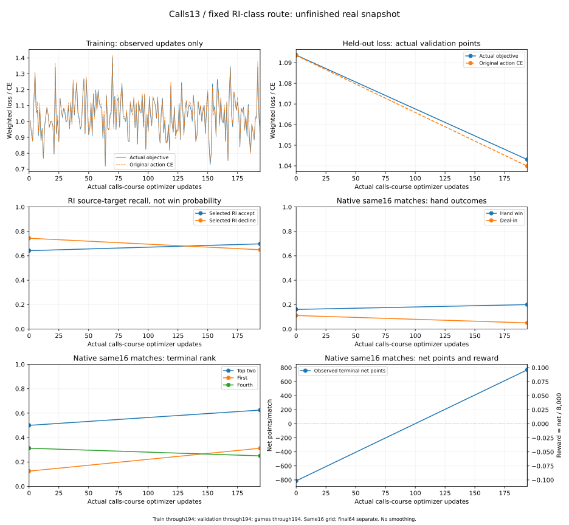

# Calls course: actual194-update results and remaining gaps

2026-11-23, Asia/Dubai. The fresh-base reproduction has completed the first
49,022-record calls-course epoch and its registered194-step validation and
native match callbacks. The same GPU fit316781 is still running toward the
sole predeclared final388 checkpoint; audit316782 waits for its successful
completion. No midpoint is selected and the four-course/v8 objective is not
achieved.

The [minimal training CSV](curriculum-calls194-verified-20261123/train-curve.csv)
contains all194 actual optimizer updates. Held-out loss and game metrics have
only two observations,0 and194: connecting the points is not a measurement at
intermediate steps. The original-action CE is separate from the actual
class-aware objective. Supervised reward remains null; native game reward is
terminal net points/8,000. No smoothing or synthetic curve values are used.

## Same16 complete East matches

Each policy is evaluated on the exact same two consumed development seeds,
two opponent profiles and four seats. The frozen v8 row is the matching subset
of its existing64-match cache, with the16 financial/win/rank ledgers checked
again. The full64 v8 mean must not be substituted for this matching subset.

| Policy | Hand-win rate | Deal-in rate | First | Top two | Fourth | Mean net points |
|---|---:|---:|---:|---:|---:|---:|
| Calls0, same trained basic parent |16.06%|11.06%|12.50%|50.00%|31.25%|−812.50|
| Calls194 |19.99%|5.02%|31.25%|62.50%|25.00%|+768.75|
| Frozen v8, matching16 |22.37%|10.34%|62.50%|62.50%|31.25%|+3,612.50|

Hand rates are averages of each complete match's hand rate, not pooled hand
counts. Native reward changes from−0.1015625 to+0.09609375. The current model's
net change is+1,581.25 versus its parent but−2,843.75 versus v8. Equal top-two
rates do not establish equal strength. Only two independent seed clusters are
available; a descriptive paired-cluster t interval for net change is roughly
[−57,106,+60,268] versus the parent and[−7,053,+1,365] versus v8. They provide no
stable improvement/parity claim. Top-two cluster differences against v8 have
zero sample variance; the diagnostic stores no misleading zero-width
confidence interval. These are consumed development results, not the final
unopened32-seed comparison.

See [matched game CSV](curriculum-calls194-verified-20261123/matched-reference16.csv)
and [aggregate diagnostics](curriculum-calls194-verified-20261123/diagnosis-summary.json).
The separate final64 CSV is intentionally header-only at this unfinished point.

## Validation improves unevenly

The actual weighted validation objective falls1.093672→1.043057; original-action
CE falls1.093529→1.039878. Ordinary basic agreement rises52.62%→53.45%.
With the unchanged fixed RI-class selector, pooled RI acceptance recall rises
64.20%→69.75%, while decline recall falls74.35%→64.94%; balanced accuracy drops
69.27%→67.34%. Legacy decline recall falls49/70→42/70 and teacher decline recall
180/238→158/238. This is a remaining tendency to select reach, despite lower CE.

| Offered operation | Positive-target recall0→194 | Other-action recall0→194 |
|---|---:|---:|
| Chi |216/415→167/415|2,217/2,622→2,590/2,622|
| Pon |127/561→229/561|1,244/1,430→1,377/1,430|
| Ankan |55/151→72/151|136/206→152/206|
| Daiminkan |10/88→1/88|188/191→190/191|
| Kakan |24/71→17/71|35/75→60/75|

The mean of exactly these five operations' balanced accuracies rises53.89%→60.22%,
but hides the daiminkan deterioration and reduced chi/kakan positive recall.
Positive-target agreement is imitation of the stored source choice, not proof
that the call was optimal. These cached validation selections use all saved
candidates; native serving also applies its existing candidate guard. They
must not be described as a replay of every live execution decision.

The [source-stratified CSV](curriculum-calls194-verified-20261123/operation-source-validation.csv)
shows that all88 positive daiminkan validation targets are legacy records:
agreement falls10→1. The new teacher has no positive daiminkan target; its
83 validation offers remain82 correct non-daiminkan choices plus one false
positive. The already documented absence of positive Mortal daiminkan labels
has therefore not been fixed by simply retaining legacy examples.

The [training-mix CSV](curriculum-calls194-verified-20261123/operation-training-mix.csv)
keeps actual record counts separate from loss coefficients. Legacy kan data
has341 positive/321 other daiminkan offers; teacher kan data has0/281. Under
the frozen source weights, positive daiminkan examples account for about1.09%
of total course objective coefficient mass, compared with3.23% for other
actions in daiminkan-containing menus. These are coefficients in supervised
loss, not measured gradient magnitudes or natural play frequencies. Source
differences and examples' difficulty can also matter, so this audit does not
prove a single causal explanation or justify automatically calling every kan.

Keep completing the frozen run and its final64/audit. A prospective repair
should preserve useful negative controls while separating positive/other
operation coverage within sources and checking genuine call value in native
continuations. More repetitions of the current mix alone cannot establish
that the missing positive behavior is being learned. No such new recipe,
reward or live routing is silently substituted into this active fit.

## Evidence, reproducibility and publication boundary

The unchanged exporter from source4561334defa61b4d09a35c5135cf408415107e4e
runs in GPU317644 on ws-l1-002 and completes0:0 in19s. It reconstructs24,958
cached validation menus across0/194, checks32 actual native ledgers and confirms
the complete194-update/49,022-exposure journal prefix. Its original five
regression checks were already verified in316913; no unnecessary new model
inference, games or tests are added here. The PNG is visually inspected.

The first auxiliary archival job317654 completes0:0 but its derived
"macro-five" mistakenly includes reach in the numerator. That staging output
is retained privately and is not published. A new helper/output,317688 on
ws-l1-002, completes0:0 in13s, explicitly restricts the mean to the five call
operations and avoids a zero-width interval from two identical cluster means.
The original exporter, snapshots, training and final-audit code remain unchanged;
the final audit already names exactly five call types. Both actual scheduler
terminals and shell exits are preserved. The correction changes no case,
prediction, curve observation or candidate selection.

[Provenance](curriculum-calls194-verified-20261123/provenance.json) binds the
registered recipe, exporter, actual captured journals and output hashes. Only
minimal real CSVs, SVG, aggregate diagnostics and this report are published.
Raw hands, per-case probabilities/labels, per-seed traces, source-per-update
components, gradients, journals and research weights stay private. PNG/PDF
are reproducible local export formats; only SVG is included here.

All processing/hashing/plotting runs inside finite scheduler GPU allocations
with companion CPUs, resource checks, logs, timeouts and exit records. No login
compute or unmanaged worker is used. Historical v1/v2 native-fixture failures
remain recorded; default CI is not claimed green. Courses3/4, final candidate
admission and the unopened256-match-per-policy comparison remain outstanding.
Main, production v8 and Windows are unchanged.
