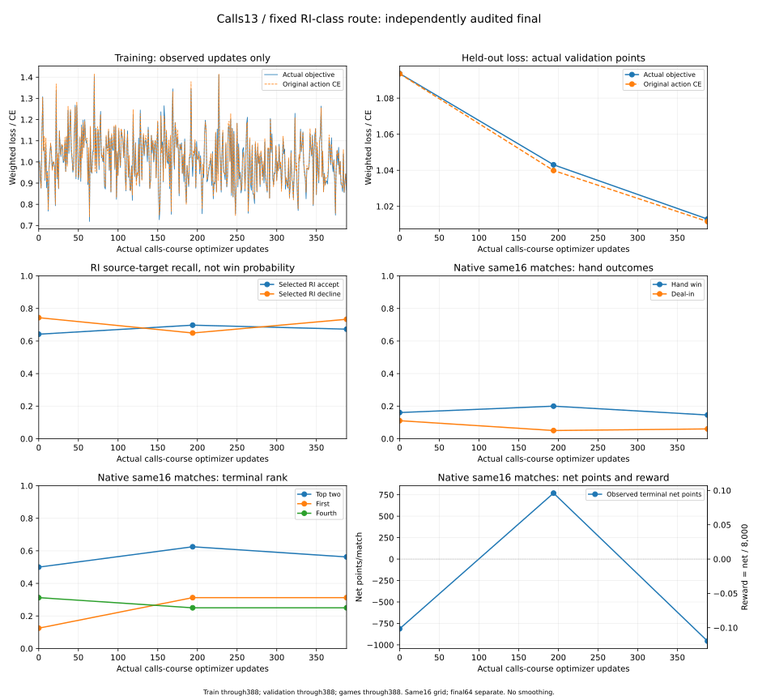

# Calls course final388: actual improvement in means, v8 parity unproven

The fresh-base curriculum's calls course completes its registered two epochs:
388 optimizer updates and98,044 record exposures. The independent evidence
audit passes and the original development advancement conditions pass. On the
matched complete64-game development grid, final388 improves the parent mean
by1,689.06 net points/match and14.06 percentage points top-two. Both paired
intervals include zero. This is **not stable-gain or v8-parity evidence**.

## Same rules, seeds, seats and complete matches

Each policy has8 logical seeds×2 opponent profiles×4 observer seats. All matches
finish under the same native Mahjong Soul East/red-five rules, including any
rule-driven continuations. Opponents are the fixed efficiency profile, or that
profile with one calling opponent. These are consumed development seeds,
not human opponents, Mortal opponents or independent final confirmation games.

| Policy on the same64 matches | Hand-win rate | Deal-in rate | First | Top two | Fourth | Net points/match |
|---|---:|---:|---:|---:|---:|---:|
| Pre-calls final608, fixed RI-class route |19.63%|15.37%|23.44%|51.56%|18.75%|+967.19|
| Calls final388, same route |25.34%|9.16%|31.25%|65.63%|14.06%|+2,656.25|
| Frozen v8, original reference route |24.32%|10.44%|42.19%|59.38%|14.06%|+4,290.63|

Hand-win/deal-in rates are the stored means of each match's hand proportions.
Net points are final observer score minus25,000. Game reward is net/8,000,
so final388's mean reward is0.33203125. The supervision itself does not have
an online RL reward: its training reward is null, not an invented zero curve.

Paired differences use whole logical-seed clusters, preserving all seat/profile
comparisons within each of8 clusters, with descriptive t7 intervals:

| Final388 minus reference | Mean net gain |95% paired interval | Mean top-two gain |95% paired interval |
|---|---:|---:|---:|---:|
| Pre-calls parent |+1,689.06|[−2,358.32,+5,736.45]|+14.06 pp|[−5.64,+33.76] pp|
| Frozen v8 |−1,634.38|[−7,433.19,+4,164.44]|+6.25 pp|[−16.78,+29.28] pp|

Higher top-two means coexist with lower first-place/net means than v8. Neither
an interval crossing zero nor the favorable top-two mean establishes equality,
noninferiority or superiority. The unopened32-seed×4-seat×2-profile final grid
remains unopened. All four courses and the eventual frozen-candidate comparison
are still required.

## Real loss and policy curves

The figure has388 actual optimizer observations and actual0/194/388 validation
and matched16-game points. No smoothing or generated observations are used.
The common16-game process grid has two consumed logical seeds; the full64-game
stage-end result is kept separately in the table/CSV. Its net trajectory is
−812.50→+768.75→−956.25; it must not be replaced by the full64 mean to make an
apparently monotonic curve. This small-grid reversal and the positive full64
mean illustrate why an intermediate peak is not a reliable candidate selector.
The sole registered candidate remains final388.

Weighted held-out objective falls1.093672→1.043057→1.012940; original action
CE falls1.093529→1.039878→1.011603. Selected pooled RI accept recall is
64.20%→69.75%→67.28%, and correct decline74.35%→64.94%→73.38%. Final source
checks pass separately for legacy and Mortal labels. Raw argmax still fails
the original RI-decline conditions; the registered full-class0.5 route remains
part of this policy's identity. Do not attribute that route's results to raw
argmax or switch the threshold retrospectively.

Five-call balanced accuracy improves6.24 percentage points from step0, but
the individual final hard-target counts expose unresolved decisions:

| Operation | Select on positive label | Decline on other label |
|---|---:|---:|
| Chi |182/415|2,577/2,622|
| Pon |323/561|1,348/1,430|
| Ankan |78/151|137/206|
| Daiminkan |1/88|190/191|
| Kakan |26/71|39/75|

The macro result does not solve daiminkan, and chi positive recall is lower
than the initial216/415 despite improved decline behavior. These are source
agreement labels, not certified optimal actions; appropriate calling depends
on actual hand/game value. Subsequent learning must consider the independently
audited risk/progression and conditional simulation sources, rather than
forcing a universally higher call rate.

## Actual training and evidence

The student continues the fixed Qwen3.5-0.8B/rank16 LoRA/256-pointer fresh-base
ancestry through final608 basic learning, then this calls course. It does not
initialize from v8 or Mortal parameters, and no correction network is stacked.
The original49,022 TRAIN/12,479 validation records,13 loss strata, accumulation253,
LR1e-5/head5e-5 and two full no-replacement epochs stay frozen. Legal wins remain
rule-executed; this course does not teach terminal Win/PASS or rare-yaku planning.

GPU316781 on ws-l1-005 completes0:0 in5h50m07s. Independent316782 on the same
node completes0:0 in8m53s. It verifies full exposure/order and all376 optimizer
states; exact372 adapter/4 head parent tensors; zero-error3,266-menu parent
probability parity and16 exact parent game events before updating; and12,479
final reloaded menus, maximum probability error1.9025336883693456e-7. All224
complete current/reference game records pass financial/win/dealin/rank checks.
This is complete ledger verification, not a separate independent han/fu engine.

Final export318062 on ws-l1-002 completes0:0 in20s using the unchanged verified
exporter33395d639bb03eeaec31b0d3c7fd4eb17ac43885c70dbcc5e2073544fa946cd2.
It reconstructs37,437 cached validation menus and96 actual process/final game
ledgers; the PNG is visually inspected. Corrected archive318188 completes0:0
in5s and verifies minimal public schemas/exposure and exact reference tables.
Earlier archive path failure318121 is preserved. Resource-check failures on
an occupied GPU are retained; no numerical work began there and no other
process was killed. Original source/config and all active-fit dependencies stay
unchanged. [Minimal CSV/SVG/provenance and aggregate evidence](curriculum-calls388-verified-20261123/)
contains no raw cases, private journals, per-update source details or new weights.

## Next course

The [87,595/23,688 progression corpus](curriculum-progression-union-20261123.md)
is independently audited. A [prospective full-RI-group objective and19-source
mix](../plans/curriculum-progression-objective-20261123.md) passes actual TRAIN
annotation/weight/gradient/order checks in GPU318101,0:0/39s. The actual epoch
wrapper and mixed-target validation integration pass GPU318108,0:0/33s; its
explicitly synthetic uniform profile is private software evidence, never a
student result or curve. No new progression optimizer has started.

Before freezing that fit, finish the [same-final-parameter complete-legal
execution comparison](../plans/curriculum-complete-legal-class-native-v2-20261123.md).
The original fixed-RI guarded policy's grade is preserved. The proposed route
has a distinct policy identity and zero training updates. It retains16 actual
old-route reproductions/two completed proposed games from the reporting-I/O
failure, then completes the fixed remaining62, without selecting by outcomes.
Source/selector effects must remain distinct from training effects.

All computation uses finite scheduler GPU allocations and companion CPUs with
resource checks/logs/timeouts/exits. No login computation, CPU-only workaround
or unmanaged background process is used. Main, production v8 and Windows are
unchanged; raw labels/histories/worlds/predictions/gradients and new research
weights stay private. The full active goal remains incomplete.
