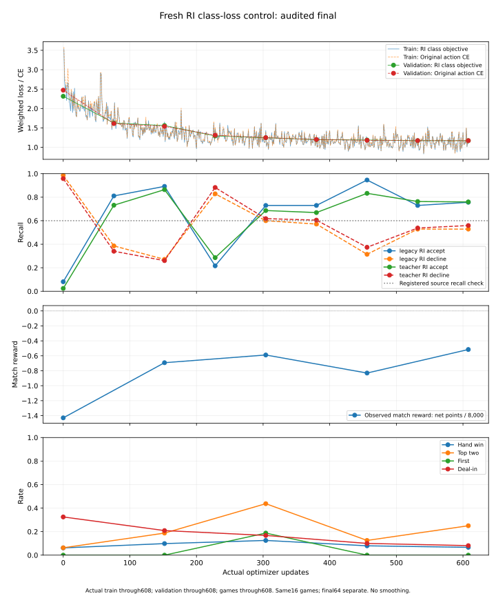

# Fresh RI-class control: complete608 result, still below the v8 goal

2026-11-23, Asia/Dubai. The registered fresh-base control completes all608
updates, four full epochs and57,140 exposures. Its64-match development mean
improves over the same-budget hard-CE control, but the paired interval crosses
zero and its mean remains below frozen v8. Raw-decoder RI refusal still fails
both source checks. This experiment is complete; the four-course/v8 objective
is not. No parent, later course, production policy or Windows version is admitted.

## Full64 development results

All policies use the same eight consumed logical seeds, four seats and two
efficiency/calling opponent profiles, in complete red-four-player East matches.
The existing hard-CE/v8 caches are reused. Rates are the registered mean of
per-match ratios; these are not Mahjong Soul live results or pooled hand ratios.

| Complete64, final608 | Hard CE control | Max-class control | Frozen v8 |
|---|---:|---:|---:|
| Net points/match |−678.13|+176.56|+4,290.63|
| Top two |43.75%|46.88%|59.38%|
| Hand win |24.12%|17.13%|24.32%|
| Deal-in |16.81%|14.43%|10.44%|
| First |25.00%|20.31%|42.19%|
| Fourth |29.69%|18.75%|14.06%|

| Paired difference, max-class minus reference | Mean | Exploratory95% interval |
|---|---:|---:|
| Net/match vs Hard CE |+854.69|[−4,652.93,+6,362.31]|
| Top-two percentage points vs Hard CE |+3.125|[−22.93,+29.18]|
| Net/match vs v8 |−4,114.06|[−9,330.33,+1,102.20]|
| Top-two percentage points vs v8 |−12.50|[−39.29,+14.29]|

Intervals are paired Student-t intervals over the eight logical seed-group
differences, using t7=2.364624. Seats/profiles within a seed are not independent
samples. This consumed development grid cannot establish independent final
strength, a stable gain over Hard CE or noninferiority to v8. The v8 difference
interval crossing zero is not evidence of parity. The lower win mean versus
both references remains a material concern; lower deal-in versus Hard CE is
not sufficient proof of better overall strategy.

Keep the process curve separate from full64. Its actual matched16 points are:

| Max-class process step | Net/match | Top two |
|---|---:|---:|
|152|−5,537.50|18.75%|
|304|−4,712.50|43.75%|
|456|−6,643.75|12.50%|
|608, matching subset only|−4,125.00|25.00%|

The final16 is selected from the final64, not another16 games. Do not splice
full64's+176.56/46.88% into the earlier16-point curve. Earlier favorable and
unfavorable results remain; no midpoint is selected.

## Raw RI decisions still fail qualification

| Final validation | Hard CE608 | Max-class608 |
|---|---:|---:|
| Common weighted original-action CE |1.175198|1.170279|
| Actual changed objective |not this run's objective|1.170503|
| Ordinary-discard agreement |52.32%|52.62%|
| RI accept recall |281/324 (86.73%)|246/324 (75.93%)|
| RI decline recall |101/308 (32.79%)|170/308 (55.19%)|
| Legacy accept / decline |34/37;26/70|28/37;37/70|
| Teacher accept / decline |247/287;75/238|218/287;133/238|

The raw max-class refusal improves but legacy37/70=52.86% and teacher
133/238=55.88% both remain below0.6. Aggregate=false, legacy=false, teacher=false,
all-source=false. Ordinary legacy agreement50.94% and CE1.34326 satisfy their
limits; they do not cancel the RI failure. No original grade is waived.

The whole trajectory matters: pooled accept/refusal moves from86.73%/26.30%
at152 to27.78%/87.01% at228,69.14%/61.36% at304,67.59%/59.74% at380,
84.57%/36.04% at456,75.93%/53.57% at532, then75.93%/55.19% at608.
Lower loss does not establish stable RI decisions. The previously audited
456-to53282 flips all move reach to discard:54 repair false reaches and28
lose true reaches. These are observed operating-point changes, not a unique
causal explanation. No extra model, thresholds or gradients are fitted here.

## Final cached fixed-decoder contrast is a lead, not native strength

The [predeclared final-only diagnostic](../plans/curriculum-riichi-final-decoder-contrast-20261123.md)
reuses the earlier fixed full-class0.5 rule: compare reach with all discards,
rather than each discard individually. No threshold search, model update or
real policy change occurs. Both actual completed608 checkpoints and3,266 cached
menus/model are checked, including the same632 RI cases.

| RI source recalls | Raw max-class policy | Hypothetical fixed-class rule |
|---|---:|---:|
| Pooled accept |246/324 (75.93%)|208/324 (64.20%)|
| Pooled decline |170/308 (55.19%)|229/308 (74.35%)|
| Legacy accept / decline |28/37;37/70|26/37;49/70 (70.27%/70.00%)|
| Teacher accept / decline |218/287;133/238|182/287;180/238 (63.41%/75.63%)|

All four source recall conditions are met in this hypothetical final comparison.
The unchanged non-RI plain metrics retain their original values.97 RI class
decisions differ:59 correct refusals replace false reaches, at a cost of38
lost true reaches. These static results do not override the failed actual
raw-policy grade, establish game improvement or admit a parent.

The same fixed rule on Hard CE608 yields251/324 accept and151/308 decline,
with legacy36/70 and teacher115/238 refusal still below0.6. The earlier152
collapse also existed in total class probability. Therefore decoder dispersion
alone is not a general explanation or demonstrated fix. The new result
supports a separately registered, fixed-weight native route comparison; it
cannot be assigned the raw policy's win/net results or deployed automatically.

## Reproducible training and complete real curves

The student starts from fixed Qwen3.5-0.8B revision
2fc06364715b967f1860aea9cf38778875588b17 with fresh rank16 LoRA/256 pointer.
No historical Mahjong or Mortal weights initialize it. Preserve all14,285
TRAIN/3,266 validation examples, six source masses, seed2026112002,94-record
accumulation,152 updates/epoch, four epochs, LR/head LR and ordinary serving.
Only RI binary loss changes from reach-versus-logsumexp(discards) to
reach-versus-best-discard, retaining conditional discard CE and plain CE.
The [audited data report](curriculum-basic-teacher-data-20261122.md) describes
the actual legacy/teacher decisions and whole-family split. No win/pass/scoring
mastery or rare-yaku quota is implied by this basic course.

Public [train CSV](curriculum-riichi-control-final-20261123/train-curve.csv),
[validation CSV](curriculum-riichi-control-final-20261123/validation-curve.csv),
[matched16 CSV](curriculum-riichi-control-final-20261123/evaluation-matched16.csv),
[separate final64 CSV](curriculum-riichi-control-final-20261123/evaluation-final64.csv)
and [provenance](curriculum-riichi-control-final-20261123/provenance.json) contain
608 actual train points, all nine validation points0/76/152/228/304/380/456/532/608,
five matched16 points0/152/304/456/608 and one separate final64 point.532 is
retained. Supervised reward is null; native reward is terminal raw net/8,000.
No smoothing, invented observations or interpolated games. PNG visually
inspected. Original action CE and the changed objective remain distinct.

## Actual execution and independent evidence

All listed computation runs in bounded scheduler GPU allocations with allocated
CPUs, resource checks, timeouts/logs/actual exits; no login compute or unmanaged
workers. Actual scheduler records and shell exits are archived.

| Job | Completed work | Actual result |
|---|---|---|
|315768, ws-l1-002|608 fit and full final64|0:0;4h13m13s|
|315769, ws-l1-002|Independent full evidence audit|0:0;5m31s|
|315770, ws-l1-002|Fit/audit terminal and scalar archive|0:0;4s|
|316338, ws-l1-002|Final-only cached fixed-rule contrast|0:0;9s|
|316358, ws-l3-018|Minimal actual final-curve export|0:0;5s|

The audit verifies all372 initial adapter/four pointer tensors against the
original fresh control, all3,266 initial cached probabilities with maximum
difference0, and16 identical initial game outcomes. All four complete source
orders match; every row is consumed once per epoch, no copies. All376 optimizer
states reach608 and57,140 exposures reconcile. Source/data hashes, held-out
groups and all validation/source metrics remain fixed. It reloads both0 and608
across3,266 menus each; maximum probability errors9.28e-8/1.48e-7. All192
current/reference native game records, summaries, identities, score ledgers,+ranks and win/deal-in counts reconcile, including the separate final16 subset.
Native financial consistency is not independent full han/fu scoring.

The final-only contrast additionally verifies both completed final64 integrity
packets and3,266-menu final-reload identities. Its sourcec99f7fbb passes
CI45093782483 and235 curriculum checks in preflight316333; it does not claim
a repeated unit-test run or new inference/games in316338.316358 reuses the
checked minimal exporter with --through-step608 --require-final, verifying the
actual full final evidence. The wider315770 CSV and complete captured journals
remain private and are not the public curve export.

Final class parameter identity:
8f295f24188790e07140d86eeec8e3bdd47ed5fd52dd2d318b044fa2dd69c236.
Hard CE identity5075708f4bb6bcb9cb674511b15ed80c4f76002115669b239beb3af435f6156a;
frozen v8 identity5ebce6af3777854cbec55ba29db2dc90be0f959193114bb3154179c5552370fa.
No new weights, raw hands, labels, case predictions/transitions, seed-wise
details or journals are published. No main merge or production/Windows change.

The full goal remains active: resolve RI policy behavior, then complete calls,
risk/execution consistency and terminal-placement learning, with actual
retention and native evaluations. The untouched32-seed/256-match-per-policy
comparison to frozen v8 remains unopened and required.
