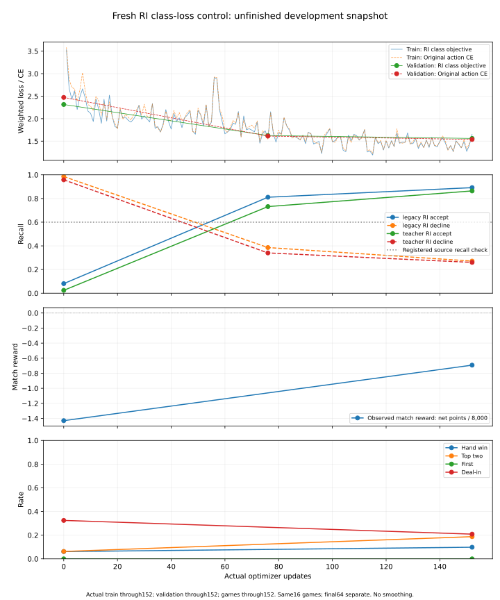

# RI class-loss control: first complete epoch and matched16 games

2026-11-23, Asia/Dubai. The fresh max-discard-class control reaches its first
complete epoch:152 actual updates and14,285 record exposures. Its first trained
16-game development result is worse than the original hard-CE control at the
same step and frozen v8 on the same grid. The registered608-update/four-epoch
experiment remains running; this snapshot is not a final or a selected model.
The four-course objective and unopened32-seed final comparison remain pending.

## Same-step validation and the76-to152 tradeoff

| At152 updates | Original hard CE | Max-discard class loss |
|---|---:|---:|
| Common weighted hard-action CE |1.554856|1.538486|
| Ordinary-discard CE |1.698577|1.727888|
| Ordinary-discard agreement |44.15%|43.55%|
| RI accept recall |322/324 (99.38%)|281/324 (86.73%)|
| RI decline recall |9/308 (2.92%)|81/308 (26.30%)|
| Legacy RI accept / decline |37/37;2/70|33/37;19/70|
| Teacher RI accept / decline |285/287;7/238|248/287;62/238|

The new class objective is1.560583, distinct from its1.538486 original-action
CE. The common CE is slightly lower than the original recipe at the same step,
while ordinary-discard CE/agreement are slightly worse. Refusal is better than
the original recipe's near-universal RI acceptance at152, but both sources
still fail the unchanged0.6 recall requirement. The pooled balanced RI recall
is about56.51% versus51.15%; this imitation diagnostic is not playing strength.

Within the new run, refusal falls from108/308 (35.06%) at76 to81/308 (26.30%)
at152, while acceptance rises from240/324 (74.07%) to281/324 (86.73%). Thus the
first76 point's refusal gain does not persist monotonically. Do not present a
falling CE or a favorable class-average as evidence the RI problem is solved.
Neither teacher decisions nor the source-quality gate certify optimal play.

## Complete paired development games

All arms use the same consumed two logical seeds, four controlled seats and
two efficiency/calling opponent profiles:16 complete red-four-player East
matches per policy, with the unchanged native serving/guard. Rates are means
of per-match rates. These are two logical seed clusters, not16 independent
draws. The original control and v8 are reused cached results, not rerun merely
to create a new comparison.

| Matched16 development matches | Hard CE152 | Class loss152 | Frozen v8 |
|---|---:|---:|---:|
| Net points/match |+4,756.25|−5,537.50|+3,612.50|
| Top two |50.00%|18.75%|62.50%|
| Hand win |20.91%|9.82%|22.37%|
| Deal-in |12.87%|20.88%|10.34%|
| First |50.00%|0.00%|62.50%|
| Fourth |0.00%|43.75%|31.25%|

The class-control net gap is−10,293.75 points/match to Hard CE152 and−9,150.00
to v8. Top-two gaps are−31.25 and−43.75 percentage points. Both logical seed
groups have negative net differences against each reference, but this tiny,
consumed development grid cannot establish a stable population strength gap.
No precise confidence interval or final-test claim is made from two groups.

The new model improves over its own untrained initial16 result (net−11,437.50,
top-two6.25%), but remains substantially behind the matched references here.
Its lower hand-win rate and higher deal-in accompany the loss. This does not
establish which individual RI/discard actions caused it, nor prove the later
calls/risk courses would fix it. The current comparison isolates the registered
loss change, but the observed effect's size and generalization remain uncertain.

Continue the full frozen608 budget and retain all unfavorable observations;
do not select the original recipe's favorable152 midpoint, choose the new
minimum-loss checkpoint or waive the source gate after seeing games. Later
course admission still needs the actual complete final evidence. If the full
control fails, use its retained per-source errors and actual games to decide
the next isolated data/objective experiment. Production/Windows remain on v8.

## Audit, curves and publication scope

GPU316013 on ws-l3-004 completes with actual scheduler/exit0:0. It reconstructs
all3,266 validation menus/model from fixed152 predictions and confirms every
source confusion/common CE and the new class objective. Actual first-epoch
order and every first152 update's source counts match the original control;
all14,285 records are exposed once. Maximum weighted-objective reconstruction
error is7.07e-8 and original-CE error is0. The48 selected complete-game records
(16 per arm) reconcile native financial ledgers, wins/deal-ins, scores/ranks,
grid/profiles, checkpoint identities and cached aggregate summaries. Native
ledger checks are not an independent full han/fu scorer. No new inference,
student updates or games are generated by this cached audit.

GPU316012 exports actual152-update/three-validation/two-game-point curves and
passes221 curriculum checks. Its original316010 allocation exits at the GPU
occupancy preflight before any export or tests; the next allocated job excludes
that occupied node and succeeds without touching other processes. The active
training remains uninterrupted. The final figure PNG is visually inspected.
Source ee3e8bd6a9b1fdc2d1bc97e4d73404dae467524a passes CI45080486930, both
core and Windows desktop jobs, with all three published source/plan/test files
read back exactly. The source is separate from the unchanged active fit.

Public scalar files: [training](curriculum-riichi-control152-20261123/train-curve.csv),
[validation](curriculum-riichi-control152-20261123/validation-curve.csv),
[same16 games](curriculum-riichi-control152-20261123/evaluation-matched16.csv).
The [provenance](curriculum-riichi-control152-20261123/provenance.json) records
actual coverage and private snapshot hashes. There is no final64 point yet;
its CSV contains a header only. Straight line segments connect observed points
only; they add no measurements. Supervised reward remains null; plotted reward
is observed complete-game terminal raw net points/8,000.

Only selected public SVG/scalar/provenance files and aggregate reports/source
are published. Full captured journals, source/gradient details per update,
hands, labels, traces, per-record probabilities and new research weights remain
private. All computation uses bounded scheduler GPU allocations with companion
CPUs, resource checks, timeouts/logs/actual exits and failed-dependency cleanup.
No main merge, later fit or production replacement follows this snapshot.
