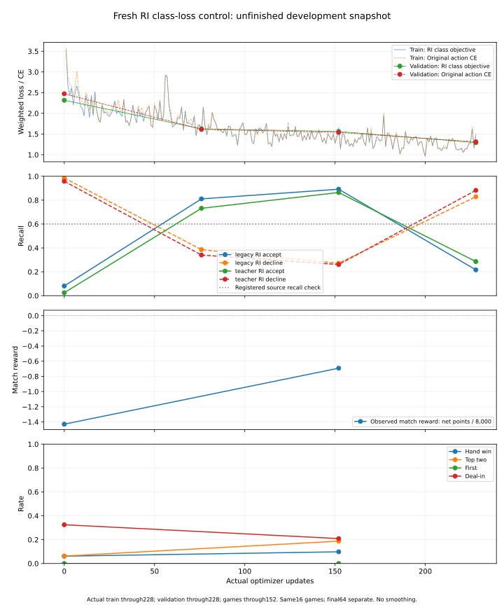

# RI control228: ranking improves while the actual decision swings

2026-11-23, Asia/Dubai. The registered fresh-base class-loss experiment reaches
228 updates/21,429 exposures and continues toward its sole608-update final.
At228 it swings toward declining RI, after favoring acceptance at152. Neither
source passes the original accept/decline requirement. No228 games were
registered; playing-strength evidence remains the poor actual152 matched16
result. The four-course/unopened-v8 objective is still unachieved.

## Actual validation trajectory

| Class-control validation |76|152|228|
|---|---:|---:|---:|
| Changed weighted objective |1.624495|1.560583|1.290784|
| Common original-action CE |1.612626|1.538486|1.310568|
| Ordinary-discard agreement |35.27%|43.55%|48.22%|
| RI acceptance |240/324 (74.07%)|281/324 (86.73%)|90/324 (27.78%)|
| RI refusal |108/308 (35.06%)|81/308 (26.30%)|268/308 (87.01%)|
| Teacher argmax-margin AUC |0.5736|0.6041|0.6813|
| Mean P(reach), teacher accepts |0.4531|0.5711|0.3269|
| Mean P(reach), teacher refuses |0.4173|0.5263|0.2436|

Ranking signal improves, but both probability cohorts shift downward between
152 and228. AUC describes discrimination of held-out imitation labels; it
does not certify the actual operating point, calibration, winning probability
or game strength. The probability values are action-preference mass, not a
hand-win estimate. No threshold is fitted or changed.

At228 the legacy source accepts8/37 and refuses58/70; teacher accepts82/287
and refuses210/238. The original hard-CE control at the same step is similarly
biased: pooled94/324 accepts and260/308 refusals, with weighted CE1.298851
and ordinary agreement48.37%. The isolated max-discard loss has not removed
this early swing. This is not evidence that both complete final policies will
be equivalent or that the loss hypothesis is definitively disproved.

The actual RI-positive fraction of RI loss weight is50.66%,49.38%,51.00% over
updates1–76,77–152,153–228. First228 actual source counts match the original
control, as do both generated epoch-order receipts; only76 updates of epoch2
are observed in this audit. These are loss-weight sums, not measured gradient
norms or proof that individual batch variation is harmless. There is no gross
sustained positive-class count/weight starvation in these checked intervals.

GPU316049 on ws-l1-019 completes scheduler/exit0:0. It reconstructs all3,266
menus at each of0/76/152/228 for both controls, exact source confusions/common
CE, new objectives and cached ranking/calibration diagnostics. The first228
update objective/common-CE accounting and21,429 exposures reconcile. It adds
no model inference, native games, optimizer updates or threshold tuning.

The minimal [training CSV](curriculum-riichi-control228-20261123/train-curve.csv),
[validation CSV](curriculum-riichi-control228-20261123/validation-curve.csv),
[matched16 game CSV](curriculum-riichi-control228-20261123/evaluation-matched16.csv)
and [provenance](curriculum-riichi-control228-20261123/provenance.json) retain
actual observations. The final64 CSV is header-only; no such result exists
yet. The PNG is visually inspected. No game line is extended to228; the last
observed game point is152. No smoothing or synthetic reward is added, and
supervised reward remains null.

## Actual parameter gradients, with limited scope

The [separately fixed gradient diagnostic](../plans/curriculum-riichi-joint-gradients-20261123.md)
reads the saved class-control0 and152 checkpoints. Within each of six sources,
hash-rank TRAIN IDs and choose eight distinct groups, divided into two panels
of four/source. Both checkpoints use exactly those48 TRAIN examples:96
example-checkpoint pairs. Distinctness is within source; panels/source groups
must not be treated as independent randomized samples.

Compute real gradients over the372 existing LoRA/four pointer tensors, using
dropout-free bf16 forward/fp32 trainable parameters with the base frozen. Source
means are combined with registered loss masses. Ordinary loss, RI max-class
loss and RI-decline conditional-discard loss are separate components. The
trainable parameter count is11,347,456:10,822,656 LoRA and524,800 pointer.

| Checkpoint/panel, all trainable parameters | cos(plain, RI binary) | cos(plain, all RI) | cos(RI binary, conditional discard) |
|---|---:|---:|---:|
| Initial0 / panel0 |−0.0742|+0.1063|+0.1893|
| Initial0 / panel1 |−0.2826|+0.5206|−0.2400|
| Trained152 / panel0 |−0.1234|−0.0497|−0.2178|
| Trained152 / panel1 |+0.0632|+0.1752|−0.0223|

At152, plain-versus-RI-binary cosine is−0.1226/+0.0559 for LoRA and
−0.1350/+0.1132 for the pointer across the two panels. The sign depends on
the panel in both parameter blocks. All-parameter weighted gradient norms
at152 are plain12.03/13.87, RI binary5.77/9.05 and conditional discard3.17/3.57.
The RI component is nonzero; its influence is not established by its example
count or loss mass alone.

There is local opposition in some measurements, including both152 binary/
conditional pairs, but the ordinary/binary interaction is not uniformly
negative. These results do not establish persistent harmful interference or
justify automatic gradient projection, source reweighting or an extra serving
network. These are small dropout-free conditional-mean gradient panels, not
actual94-record stochastic AdamW updates: optimizer moments/preconditioning,
clipping, dropout and sampling differ. Coordinate-dependent norms/cosines are
not direct expected match values. Gradients at228 were not measured here;
the228 decision swing is a separate cached validation observation.

GPU316047 on ws-l2-004 completes scheduler/exit0:0 in50 seconds after229
curriculum checks pass. Every measured gradient is finite. Repeated gradient-
enabled/no-grad forward canaries have probability error0. All372+4 trainable
tensors are exactly unchanged afterward, base parameters remain frozen, and
parameter grad buffers remain empty. The diagnostic constructs no optimizer,
saves no model and plays no native games. All source/data/checkpoint hashes remain
unchanged. This proves execution/integrity of the measurement, not a causal
training defect or independent policy improvement.

## Continue the registered experiment

The earlier [public-context probe](curriculum-riichi-context-probe-20261123.md)
finds learnable binary-label signal, but the older full Qwen context-v3 control
fails to translate its probe into stronger games. The new gradient evidence
also remains mixed. Do not turn either diagnostic into an untested causal
story or repeat a failed recipe without an isolated prospective change.

Keep all608 updates,57,140 exposures and the final-only candidate. Next native
games remain304, with final64 at608 and the matching16 subset kept separate.
Retain every unfavorable point. After the actual full audit, use source-specific
class components, bias/ranking trajectory and actual games to decide whether
the next main experiment should address optimization, joint-task formulation
or data. No unfinished/failed parent is admitted and no original gate is waived.
Calls/risk/terminal-placement fitting and the unopened32-seed final comparison
still remain; production v8, Windows and main are unchanged.

All computation is inside finite scheduler GPU allocations with companion
CPUs, node/resource checks, timeouts/logs/actual exits. Only source, plans,
aggregate diagnostics and selected real scalar/figure artifacts are published.
TRAIN IDs, case losses, individual gradients, full captured journals and new
research weights remain private. This diagnostic is separate from the active
fit's immutable executable source.
