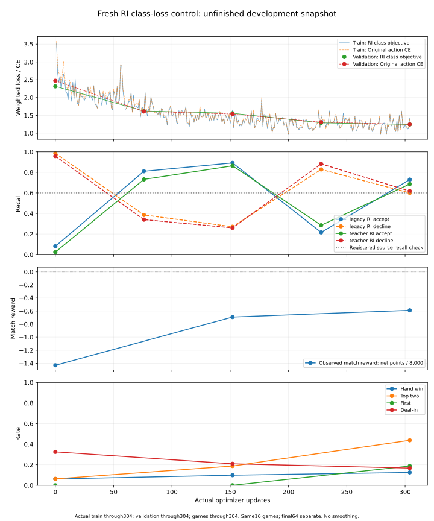

# RI class-loss control304: a better mean than the same-step control, below v8

2026-11-23, Asia/Dubai. The fresh max-discard-class model completes two full
epochs:304 updates and28,570 exposures of14,285 TRAIN decisions. Its matched16
mean improves over the original hard-CE model at the same step, but the two
seed clusters disagree on that improvement and both remain below frozen v8.
This is interim development evidence, not a stable gain, final candidate or
completed four-course policy. The608-update/four-epoch experiment continues.

## Complete matched development games

Both trained controls use the same consumed two logical seeds, four controlled
seats and two efficiency/calling profiles:16 complete red-four-player East
matches per policy. The matching frozen-v8 records are selected from its
already-audited64 cache. No reference model or games are rerun for this audit.
Rates follow the registered mean of per-match rates, not a pooled hand ratio.

| Matched16 at304 | Original hard CE304 | Max-class304 | Frozen v8 |
|---|---:|---:|---:|
| Net points/match |−7,181.25|−4,712.50|+3,612.50|
| Top two |31.25%|43.75%|62.50%|
| Hand win |11.00%|12.50%|22.37%|
| Deal-in |20.07%|16.73%|10.34%|
| First |0.00%|18.75%|62.50%|
| Fourth |37.50%|31.25%|31.25%|

Class304 minus Hard CE304 is+2,468.75 net points/match and+12.50 percentage
points in top-two rate. One logical seed group improves and the other regresses
against that reference. With only two consumed clusters, do not describe this
as stable improvement or quote a precise population interval. No seed-wise
scores/derived diagnostics are published. Against v8 the class model trails
by8,325.00 net points/match and18.75 top-two points; both seed groups have a
negative net difference. This also is not an independent final-test claim.

Relative to its own152 snapshot, the new model's same16 mean moves from
−5,537.50 to−4,712.50 net points and18.75% to43.75% top two. This is a process
comparison on the same consumed grid, not an unseen confirmation. All earlier
unfavorable points are retained; none is promoted or removed from the curve.

The controls each have11 observed own wins, across88/90 hands respectively;
v8 has24/108. Different trajectories and per-match aggregation explain why
the mean hand-win rates do not equal a simple total-wins/total-hands ratio.
The following point ledger components sum exactly to the reported net means:

| Per-match settlement component | Hard CE304 | Max-class304 | v8 |
|---|---:|---:|---:|
| Own-win income |+1,968.75|+3,612.50|+9,712.50|
| Ron payments |−6,206.25|−5,306.25|−2,300.00|
| Other players' tsumo payments |−3,506.25|−4,050.00|−2,175.00|
| Draw settlement |+875.00|+1,343.75|−375.00|
| RI deposits |−312.50|−500.00|−1,250.00|
| Final unclaimed RI pool |0.00|+187.50|0.00|

The class model's advantage over Hard CE304 includes+1,643.75 in own-win
income and900.00 less ron expense, offset in part by higher tsumo payments.
Its gap to v8 still includes much lower own-win income and higher ron/tsumo
expense. These are observed outcome components, not causal action values or
proof that any particular discard/RI decision caused the gap. The basic course
does not yet include the later calls/risk/terminal-placement fits.

## RI validation is more balanced at this point

| At304 updates | Hard CE304 | Max-class304 |
|---|---:|---:|
| Common weighted original-action CE |1.260962|1.247781|
| Actual changed class objective |not this run's objective|1.246200|
| Ordinary-discard agreement |49.16%|50.08%|
| RI accept recall |284/324 (87.65%)|224/324 (69.14%)|
| RI refusal recall |83/308 (26.95%)|189/308 (61.36%)|
| Legacy accept / decline |34/37;20/70|27/37;42/70|
| Teacher accept / decline |250/287;63/238|197/287;147/238|
| Teacher argmax-margin AUC |0.6947|0.7122|

Both new RI classes exceed or meet0.6 in each source at304. This is an actual
improvement in the observed operating point, following the previous152/228
swings; one point does not establish stability. The original aggregate and
teacher-source checks pass here. The full legacy-source check still fails:
ordinary agreement48.31% remains below48.46%, and ordinary CE1.42723 exceeds
1.41642. All-source qualification is therefore false, and in any case304 is
not the registered final. No gate is waived or parent admitted.

Teacher ranking continues to improve, while the actual accept/refuse balance
has moved substantially between snapshots. Keep original CE separate from
the changed objective, and assess future source recalls alongside actual games.
Action-preference probabilities and AUC are not winning probabilities. The
earlier successful offline probe and mixed local-gradient diagnostics do not
replace this model's qualification or playing-strength measurements.

## Actual curves and reusable evidence audit

Public scalar files: [train](curriculum-riichi-control304-20261123/train-curve.csv),
[validation](curriculum-riichi-control304-20261123/validation-curve.csv),
[matched16 games](curriculum-riichi-control304-20261123/evaluation-matched16.csv),
[provenance](curriculum-riichi-control304-20261123/provenance.json).
The final64 CSV has only its header: no final64 result exists yet. The PNG is
visually inspected.304 real train points, five validation points0/76/152/228/304
and three actual matched16 points0/152/304 are preserved without smoothing or
synthetic observations. Supervised reward remains null; game reward is terminal
raw net points/8,000. Straight segments connect only observed points.

The [reusable audit protocol](../plans/curriculum-riichi-matched-points-20261123.md)
consolidates earlier point-specific checks for152/304/456. GPU316075 on
ws-l1-017 completes0:0 and exactly reproduces the earlier independent152
validation profiles, three policy summaries, identities and paired deltas.
This validates orchestration against real existing evidence, not new games.
Source9d7bca7290b965bc4b1593db24dd33134e2a1916 passes CI45085818210, core
and Windows desktop jobs, with both published source/plan files read back
exactly before304 is analyzed.

Delayed bounded GPU316083 on ws-l1-019 completes0:0 after actual304 validation
and16 new-policy games exist. It reconstructs both3,266-menu profiles and
common/changed objectives; every actual1–304 source count and both complete
epoch orders match the original control. All28,570 exposures reconcile, with
maximum objective reconstruction error7.07e-8 and original-CE error0. All48
selected cached complete-game records reconcile native ledgers, score/rank,
wins/deal-ins, grid/profiles, checkpoint identities and aggregates; the full
reference64 summary is checked before taking its same16 subset. Native ledger
checks are not an independent complete han/fu scorer. The audit loads no
language model, generates no policy games and performs no optimizer updates.

Only final608 may be considered after its full independent audit and actual
final64; keep the matching16 final subset separate on the process curve. Next
validation is380, next native game point456. Complete the full budget and
then decide whether this basic parent qualifies for the prepared calls course.
Calls/risk/placement fits and the untouched32-seed/256-match final comparison
to frozen v8 remain required. The four-course goal is active and unachieved.

All computation uses finite GPU scheduler jobs with companion CPUs, resource
checks, timeouts/logs/actual exits and dependency cleanup. Raw hands/labels/
traces, per-case probabilities, seed-wise details, full captured journals and
new weights remain private. Only source/plans/aggregate evidence and selected
minimal real figures/scalars are published. No main merge or production/
Windows replacement follows from this interim mean improvement.
