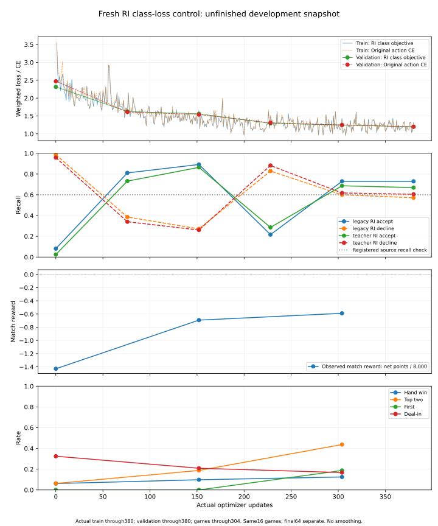

# RI control380: lower loss, but no further RI decision gain

2026-11-23, Asia/Dubai. The fixed fresh-base max-class control completes380
actual updates and35,714 record exposures. Ordinary-discard validation improves,
while RI accuracy slightly regresses from304. Source qualification remains false.
This is interim development evidence, not a final candidate or new native
strength result. The original608-update/four-epoch fit continues unchanged.

## Validation and same-case retention

Both controls use the same3,266 validation menus, including632 RI offers with
324 teacher-selected and308 teacher-declined labels. These are imitation labels,
not guaranteed optimal actions or winning probabilities.

| Validation | Original hard CE380 | Max-class304 | Max-class380 |
|---|---:|---:|---:|
| Common weighted original-action CE |1.202135|1.247781|1.199252|
| Actual changed class objective |not this run's objective|1.246200|1.195975|
| Ordinary-discard agreement |51.18%|50.08%|51.56%|
| RI accept recall |249/324 (76.85%)|224/324 (69.14%)|219/324 (67.59%)|
| RI decline recall |125/308 (40.58%)|189/308 (61.36%)|184/308 (59.74%)|
| Legacy accept / decline |30/37;31/70|27/37;42/70|27/37;40/70|
| Teacher accept / decline |219/287;94/238|197/287;147/238|192/287;144/238|
| Teacher argmax-margin AUC |0.6809|0.7122|0.7145|

Align the same632 RI cases between consecutive snapshots. Identity, group,
source, truth and legal discard counts must stay equal; before/after correct
counts reconcile with the independently reconstructed source confusions.

| Max-class304 to380 | Legacy | Teacher | Pooled |
|---|---:|---:|---:|
| Correct remains correct |60|313|373|
| Correct becomes wrong |9|31|40|
| Wrong becomes correct |7|23|30|
| Wrong remains wrong |31|158|189|
| Total changed RI decisions |16|54|70|
| Net change in correct decisions |−2|−8|−10|

Thus lower validation CE coexists with30 repaired and40 regressed RI choices.
The total correct falls413 to403. Both accept and decline recall fall; this
point cannot be summarized as a uniform shift toward always accepting or always
declining. The immediately previous228-to304 interval changed277 cases, versus
70 here. The latest interval has less decision churn, but that observation
does not establish convergence, a causal mechanism or better Mahjong play.
All earlier unfavorable points remain in the actual curves.

At380 the legacy ordinary agreement49.87% and CE1.37053 now satisfy their
registered limits, but legacy RI refusal40/70 remains below0.6. Pooled refusal
184/308 is also below0.6, while the teacher source passes at192/287 accept and
144/238 decline. Aggregate=false, legacy=false, teacher=true, all-source=false.
No threshold is tuned, gate waived or intermediate parent admitted.

Teacher ranking AUC edges up, but recall at the real decoder still regresses.
The observed positive RI loss-weight fraction over updates305–380 is0.499673,
close to its fixed balanced target; this is loss mass, not measured gradients.
The earlier mixed actual-gradient and successful offline-probe diagnostics do
not prove the cause of this model's remaining errors.

## Actual curves and playing-strength limit

The minimal public [train CSV](curriculum-riichi-control380-20261123/train-curve.csv)
has380 real update points; the [validation CSV](curriculum-riichi-control380-20261123/validation-curve.csv)
has0/76/152/228/304/380. The [game CSV](curriculum-riichi-control380-20261123/evaluation-matched16.csv)
still has only0/152/304. No380 match result is generated, inferred or interpolated;
final64 remains header-only. The PNG is visually inspected. Supervised reward
is null; observed native reward is terminal net points/8,000. The full journals
are captured privately, with no smoothing or synthetic observations.

Latest actual native strength remains the [304 matched16 result](curriculum-riichi-control304-20261123.md):
max-class−4,712.50 net/match and43.75% top two, versus original hard CE304
−7,181.25 and31.25%, and v8+3,612.50 and62.50%. The apparent mean advantage
over hard CE has opposite signs in the two consumed seed clusters; it is not
stable independent evidence.380 validation does not update these game numbers.
Next native games are456; the sole final candidate is608 with the full64 audit.

## Reproducible independent audit

The [prospective protocol](../plans/curriculum-riichi-validation-drift-20261123.md)
and reusable helper are published before seeing380 under source609afce4a2f40f95e1ffbf1f93215626a8b2683c.
CI45088467784 passes both core137412354042 and desktop137412354243; all three
source/test/protocol files are read back exactly. Tests check population/label
rejection and conservation of improvements and regressions, not desired results.

GPU316143 on ws-l3-018 completes0:0 in2m17s, including a bounded wait for the
same live315768 fit's complete380 evidence.232 curriculum checks pass. Both
controls' six cached validation points, all actual1–380 source counts and three
generated epoch orders reconcile. Two epochs are complete and only76 updates
of the third are observed:35,714 exposures, not three complete epochs. Maximum
objective reconstruction error is7.07e-8 and common-CE error4.44e-16. The prior
independent304 profiles, mechanisms and identities match exactly. Actual scheduler
terminal and shell exit are archived; no language model is loaded, no new policy
games generated and no optimizer update performed by this independent audit.

Class380 identity is a6e49b320843307d6bea6591ea996d9bcdb2f03b49ef8b7354a83d0eac5760c0;
hard CE380 is31aa9625489dfef0071f0c48e62ca21d0725ffea782771a5342986fb8092e228.
Source/dataset/registration bindings and all previous artifacts remain unchanged.
Main315768 continues its original budget; final audit315769 and terminal/scalar
capture315770 remain dependent. Later calls/risk/placement fits and the unopened
32-seed/256-match v8 comparison are still required. The full objective is active.

Only source/protocol, aggregate evidence and selected minimal real curves/scalars
are public. Raw hands, labels, transitions, per-case probabilities, seed-wise
diagnostics, captured journals and new weights remain private. No main merge,
production policy or Windows replacement follows this interim validation.
