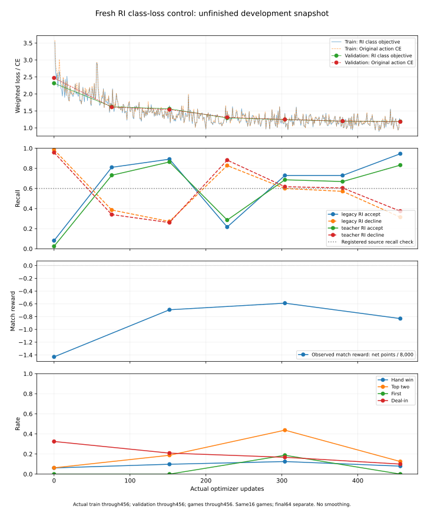

# RI control456: fewer deal-ins, but lower wins and no net gain

2026-11-23, Asia/Dubai. The fresh max-class control completes three entire
epochs:456 updates and42,855 exposures of14,285 TRAIN decisions. Its same16
development mean regresses from304 and is below both the original hard-CE456
control and frozen v8. RI validation again shifts toward accepting reach despite
lower common CE and better ranking AUC. The objective remains unachieved.
Continue the frozen608/four-epoch/final-only experiment; no midpoint, parent,
production policy or Windows release is admitted by this result.

## Actual complete-East development results

Each arm uses the same consumed two logical seeds, four seats and two opponent
profiles,16 complete red-four-player East matches. Reference-v8 rows are reused
from its existing64 cache; no reference inference or games are repeated. Rates
are the registered means of per-match rates, not pooled hand ratios.

| Same16 development matches | Hard CE456 | Max-class456 | Frozen v8 |
|---|---:|---:|---:|
| Net points/match |−5,393.75|−6,643.75|+3,612.50|
| Top two |31.25%|12.50%|62.50%|
| Hand win |12.43%|7.93%|22.37%|
| Deal-in |19.38%|9.96%|10.34%|
| First |0.00%|0.00%|62.50%|
| Fourth |50.00%|37.50%|31.25%|

Max-class minus Hard CE456 is−1,250.00 net points/match and−18.75 percentage
points in top-two rate. One seed group has a small positive net difference and
the other a negative one; top-two differences are negative in both. Against v8
the mean difference is−10,256.25 net and−50.00 top-two points, with both seed-net
differences negative. Only two consumed clusters are present: do not claim a
precise population interval, independent confirmation or a stable causal effect.
Raw seed-wise scores and derived details remain private.

Compared with its own304 snapshot, the same16 mean falls from−4,712.50 to
−6,643.75 net and43.75% to12.50% top two. Its lower deal-in mean is insufficient
to offset the weak winning results. Keep all observed points, including the
earlier favorable mean versus Hard CE304; none is selected or removed.

## Financial accounting and actual event counts

| Per-match settlement component | Hard CE456 | Max-class456 | v8 |
|---|---:|---:|---:|
| Own-win income |+2,818.75|+2,631.25|+9,712.50|
| Ron payments |−4,881.25|−3,012.50|−2,300.00|
| Other players' tsumo payments |−4,175.00|−4,700.00|−2,175.00|
| Draw settlement |+1,906.25|+687.50|−375.00|
| RI deposits |−1,062.50|−2,250.00|−1,250.00|
| Sum |−5,393.75|−6,643.75|+3,612.50|

The observed net gap to Hard CE includes1,868.75 less ron expense but1,218.75
less draw income,1,187.50 more RI deposits,525.00 more tsumo expense and187.50
less own-win income. The gap to v8 includes7,081.25 less own-win income and
2,525.00 more tsumo expense. These are exact settlement components, not causal
action values or a claim that deposits alone cause the loss. Own-win income
includes the actual settlement; it must not be confused with a hand's pure
han/fu value or an independently calculated hypothetical no-riichi return.

| Controlled-player events over16 matches | Hard CE456 | Max-class456 | v8 |
|---|---:|---:|---:|
| Hands encountered |94|118|108|
| Own wins |12|9|24|
| RI declarations |17|36|20|
| Ron events before any own RI in that hand |19|7|10|
| Ron events after own RI |0|3|0|

Declarations are counts, not acceptance rates among legal RI offers. The arms'
different decisions produce different trajectories and hand counts. Their mean
per-match win/deal-in rates therefore differ from pooled event ratios. More
declarations alongside fewer wins agrees with the validation-bias concern, but
does not establish that individual reach choices caused losses or that never
reaching would improve play. Later calls/risk/placement courses remain unfitted.

## RI decisions regress again despite lower loss

| Validation | Hard CE456 | Max-class380 | Max-class456 |
|---|---:|---:|---:|
| Common weighted original-action CE |1.190960|1.199252|1.180501|
| Actual changed class objective |not this run's objective|1.195975|1.186678|
| Ordinary-discard agreement |52.62%|51.56%|52.32%|
| RI accept recall |301/324 (92.90%)|219/324 (67.59%)|274/324 (84.57%)|
| RI decline recall |72/308 (23.38%)|184/308 (59.74%)|111/308 (36.04%)|
| Legacy accept / decline |35/37;14/70|27/37;40/70|35/37;22/70|
| Teacher accept / decline |266/287;58/238|192/287;144/238|239/287;89/238|
| Teacher argmax-margin AUC |0.7298|0.7145|0.7575|

For the same632 RI cases,380→456 changes128 decisions:55 wrong-to-correct,
73 correct-to-wrong,330 correct-to-correct and174 wrong-to-wrong. Correct total
falls403→385. Legacy correct total falls67→57 and teacher336→328. This is
greater churn than304→380's70 changed cases. A near-balanced304/380 operating
point did not remain stable at456; improved AUC/lower CE do not prove adequate
decisions at the actual unchanged decoder.

All-source qualification is false: aggregate=false, legacy=false, teacher=false.
Legacy refusal22/70 and teacher89/238 are below the unchanged0.6 requirement.
Actual RI-positive loss mass over381–456 is0.500349, close to its fixed target;
it is not an actual gradient measurement. Source counts, tags, sample order,
numerical trainer settings and all prior bindings are unchanged. No threshold
is tuned, gate waived or incomplete model used as a later-course parent.

The single loss change has not established a stable solution to RI bias or a
native gain. Retain the earlier mixed local-gradient and offline-probe findings
without turning them into a proven cause or deployed fix. Complete final608
and its full64 audit before registering the next main-training decision.

## Actual curves and reproducible audit

Public [train](curriculum-riichi-control456-20261123/train-curve.csv),
[validation](curriculum-riichi-control456-20261123/validation-curve.csv),
[same16 games](curriculum-riichi-control456-20261123/evaluation-matched16.csv)
and [provenance](curriculum-riichi-control456-20261123/provenance.json) preserve456
actual train points, validation0/76/152/228/304/380/456 and games0/152/304/456.
Final64 remains header-only. PNG visually inspected; no smoothing, synthetic
points or interpolated game observations. Supervised reward is null; native
reward is terminal raw net/8,000. Full captured journals remain private.

The existing [matched-point auditor](../plans/curriculum-riichi-matched-points-20261123.md)
and [same-case validation audit](../plans/curriculum-riichi-validation-drift-20261123.md)
are reused without editing successful source bindings. The former source9d7bca7
passes CI45085818210 and exactly reproduces prior152 evidence; the latter
source609afce4 passes CI45088467784 and232 curriculum checks in the completed380
job.456 does not claim a new unit-test run: it exercises both already-checked
helpers on newly available actual data.

GPU316196 on ws-l3-018 completes0:0 in16s. Its conservative scheduled begin time
is advanced only after complete456 validation and16-game metric records exist.
The same pending job/resource budget is retained, and actual terminal/shell
exit are archived. It verifies prior380 success/CI/source bindings, reconstructs
both complete seven-point validation prefixes, same-case transitions and all
actual1–456 loss/CE/source counts with all three complete epoch orders. All
42,855 exposures reconcile; maximum objective/common-CE errors7.07e-8/0.
All48 selected cached games reconcile grids, identities, native ledgers, ranks,
scores, wins/deal-ins and financial components; the full v8 cache aggregate is
checked before selecting its matched16. Both helpers'456 profiles, source
quality and exposures agree exactly. No audit model inference, new games or
optimizer updates occur. Native ledgers are not independent full han/fu scoring.

Class456 identity34091755d14f71ff6b414f8edebd2608d97d2314d9aa536aae05fccf86b59a1c;
hard CE45627c516071c445d0cbdff75131f8fe09e2bbada075cc81243bc4ffab35d5e46c1.
Main315768 continues;315769 final independent audit and315770 terminal/scalars
remain dependent. Next validation532 has no games;608 is the sole candidate
with full64 and its matching16 subset kept separate on the process curve.
Later calls/risk/placement fits and the untouched32-seed/256-match-per-policy
comparison with v8 are still required. The full goal remains active.

Only code/protocols, aggregate evidence and selected minimal curves/scalars are
public. Hands, labels, raw event traces, per-case transitions/probabilities,
seed-wise details, full private journals and new weights remain private. No
main merge or production/Windows replacement follows this negative result.
