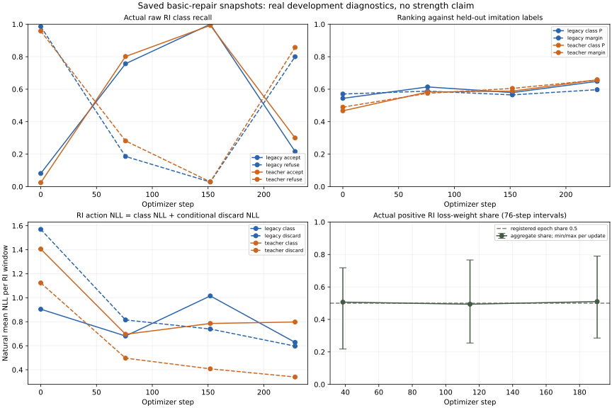

# RI drift: action CE can conceal a worsening class decision

2026-11-22. The current basic fit is still running, with at least287/608 updates
observed. This diagnostic changes no training, policy or candidate selection.
It uses four already consumed development snapshots and does not establish a
causal training defect or v8-level strength. The original608 final and complete
four-course objective remain unchanged.

GPU315665 completes16s/exit0:0 on ws-l3-004:176 curriculum checks, exact saved
validation-menu/source confusion reproduction and actual228-update loss/source
accounting. GPU315720 completes11s/exit0:0, exporting aggregate-only CSV and
actual SVG/PNG/PDF figures. GPU315727 completes13s/exit0:0:181 curriculum checks
and24 actual TRAIN-menu materializer/CUDA loss-gradient prototype checks.
Every active and previously completed source binding remains unchanged.

The chart uses saved validation0/76/152/228, not invented intermediate points.
Its bottom-right bars are observed per-update minimum/maximum loss-weight
shares, not confidence intervals or measured gradient norms. PNG/PDF originals
also exist in the private aggregate-artifact directory; this repository
publishes SVG, scalar CSV and provenance only.

## Ranking improves, but class probability moves too far

The same632 RI windows (legacy107, teacher525) are used at every snapshot.
Teacher labels have287 accepts and238 refusals. These are imitation labels,
not independently optimal moves or winning probabilities.

| Teacher validation |76|152|228|
|---|---:|---:|---:|
| Actual raw accept recall |80.14%|99.30%|29.97%|
| Actual raw correct refusal |28.15%|2.94%|85.71%|
| Class-probability AUC |0.5827|0.5878|0.6580|
| Argmax-logit-margin AUC |0.5747|0.6047|0.6565|
| Mean P(reach), actual teacher accepts |0.5060|0.7497|0.3321|
| Mean P(reach), actual teacher refuses |0.4672|0.7103|0.2604|

At228, the model ranks teacher-accept situations better than at76, while its
overall reach probabilities shift downward. This is not a complete failure to
learn, and a better AUC does not mean the actual class decision is stable.
Legacy class/margin AUC at228 is0.6483/0.5969; keep the sources separate.
Calibration/Brier scores refer only to these held-out imitation labels.

## Lower total action loss does not ensure a better RI class loss

For the actual one-reach/ordinary-discard menus, normalized action CE equals
the reach-versus-all-discards binary CE plus the conditional chosen-discard CE
(zero conditional term on teacher-accept examples). The maximum numerical
decomposition error is1.78e-15. Normalization corrects only floating-point
probability-sum error; actual raw argmax order and the old fixed0.5 diagnostic
remain unchanged.

| Natural mean NLL per teacher RI window |76|152|228|
|---|---:|---:|---:|
| Whether to reach: class CE |0.6958|0.7856|0.7978|
| Conditional discard CE |0.4967|0.4076|0.3396|
| Combined action CE |1.1926|1.1932|1.1374|

Thus teacher action CE improves between76 and228 even though its RI class CE
worsens. Improved conditional tile selection can conceal a weaker class
component in a single action-loss number; overall basic loss also includes
many non-RI plain rows. The table uses natural means, not the six-source
weighted training objective, which remains separately recorded.

This does not prove that the CE objective is the only cause. Plain/RI gradient
interaction, data uncertainty, optimization trajectory and limited feature
learning still require controlled evidence. Simply interpreting each tile's
probability as a separate class, or replacing raw argmax with fixed class0.5,
does not solve the observed bias. The latter disagrees on189/632 menus at76,
but only20/632 at152: the near-always-reach152 collapse is largely present in
the total class probability itself, not only discard-probability dispersion.
At228 there are89 disagreements, including56 teacher-accept cases that fixed
class0.5 would miss after raw argmax accepts them. No decoder is deployed.

## The run is not persistently starving positive RI examples

| Actual update interval | RI-positive fraction of RI loss weight |
|---|---:|
|1–76|50.66%|
|77–152|49.38%|
|153–228|51.00%|
|Complete epoch1–152|50.00%|

The actual first epoch consumes each source count exactly once. Individual
updates vary (first-epoch positive share21.76%–76.60%), but the checked periods
stay near their declared balance. The actual weighted objective reconstructs
within5.11e-8 for every update. These are loss-weight sums, not per-class
gradient magnitudes; they do not prove batch variation harmless. They do rule
out a grossly missing class or sustained count-weight shortage in the observed
periods as a sufficient explanation.

## A concrete conditional control is prepared, not trained

The [conditional class-loss plan](../plans/curriculum-riichi-class-loss-control-20261122.md)
keeps the same fixed base, fresh initialization, data, source weights, sampler,
epochs, LR and ordinary serving. Its prototype changes only the binary RI
component from reach-versus-logsumexp(discards) to reach-versus-max(discard),
retaining conditional discard CE and unchanged plain CE. This matches the
existing individual-action argmax class boundary without adding a network,
second forward or new decoding threshold. It remains an experimental
alignment hypothesis, not a demonstrated policy improvement.

The pinned materializer's actual option order supplies private training-only
reach indices. On24 actual TRAIN menus covering all six sources, removing
those indices reproduces the materialized input exactly and leaves every raw
request unchanged. CUDA gradients are finite, standard CE decomposes within
4.45e-16, ordinary loss differs by0 and logit-shift gradient sums agree within
8.89e-16. Tests also cover tied maxima, candidate permutation and two-choice
equivalence to the old CE. These are logit-level checks, not Qwen updates,
LoRA-gradient evidence, a registered control fit or a trained policy.

Finish current608/final64 first. If its source-quality audit still fails,
complete the new control's full registration/training/audit/preflight and source
CI before launching the isolated fixed-budget comparison. If current basic
succeeds, continue the qualified later courses. Do not choose a favorable
midpoint or waive original grades. The next actual game point remains304.

Public artifacts: [snapshot metrics](curriculum-riichi-mechanisms-20261122/riichi-snapshot-metrics.csv),
[weight intervals](curriculum-riichi-mechanisms-20261122/riichi-weight-intervals.csv),
[figure/source provenance](curriculum-riichi-mechanisms-20261122/provenance.json).
New case IDs/groups, source hands, labels, per-case probabilities/margins,
per-update derived weights and research weights stay private. No main/Windows
change or final reserved-test exposure occurs.
