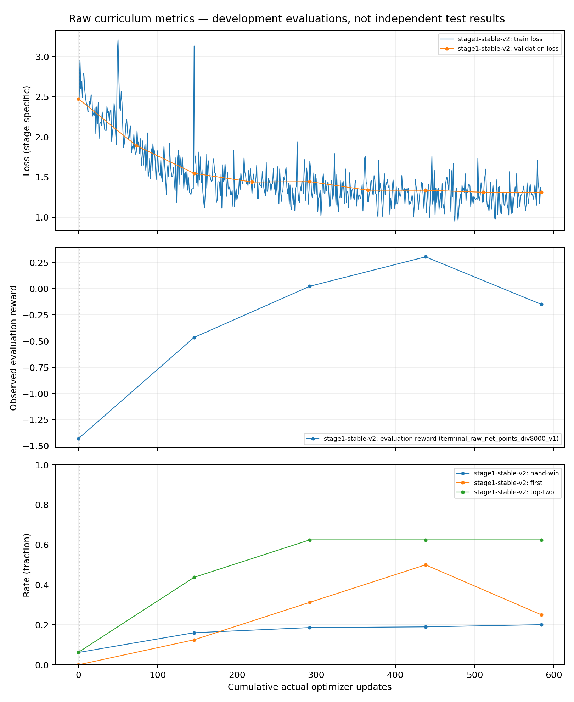

# Stable-v2 stage1: completed results and riichi diagnostics

2026-11-21, Asia/Dubai. GPU training311884 and audit311887 completed0:0. The registered final584 checkpoint is the sole candidate;1,972 saved-final menus and192 cached complete games were independently reconciled by the end audit. This is a completed stage1 development experiment, not evidence that the full route or v8-level strength has been achieved.

## Final64 result

| Policy | Top-two | Net points/match | Hand-win | Dealin | Fourth |
|---|---:|---:|---:|---:|---:|
| Initial curriculum, final1162 |51.56%|+18.75|23.93%|18.69%|31.25%|
| Stable-v2, final584 |59.38%|+1,760.94|26.54%|15.94%|20.31%|
| Frozen practical v8 |59.38%|+4,290.63|24.32%|10.44%|14.06%|

These are the same8 whole-seed groups ×2 profiles ×4 seats. Stable-v2 improves the first curriculum's development means but still loses net points/risk to v8. Its top-two difference versus v8 is0 with paired95% interval[−11.17,+11.17] percentage points; net difference−2,529.69/match with interval[−8,580.68,+3,521.31]. Dealin difference is+5.50 points, interval[+0.88,+10.12]. These are consumed-development comparisons with eight clusters, not independent confirmation or proof of equivalence/noninferiority.

The matched16 subset at final584 is top-two62.50%, net−1,193.75, hand-win20.07% and dealin12.86%. Its net is lower than the438-point peak+2,431.25, illustrating why neither a16-game peak nor mixed16/64 means should select a checkpoint. The final64 mean remains+1,760.94. Both actual curve and full-grid data are preserved separately.

Final weighted CE is1.311692, plain agreement50.72%, riichi TP26/FN11/TN30/FP40. Acceptance70.27% and correct decline42.86% fail the original both60 gate; the audit retains `passed:false`. Practical v8 itself gives51.35%/44.29% on this consumed imitation diagnostic. The separately bound [research admission amendment](curriculum-transfer-accumulation-20261121.md) accepts the fixed final for a further course without relabeling the original gate, solving riichi or claiming v8 strength. The [calls course](../plans/curriculum-stage2-calls-20261121.md) now continues these exact weights with full replay and a new optimizer.

Final identity: `e608f317c630bf737cac0402b73a2974231c6a8da3c5f26a652d1c18e2d7311f`. All37,168 actual exposures,376 optimizer states, source/data hashes, held-out groups and matched-grid plot inputs pass. Final reload maximum probability discrepancy is1.20e-7. Internal settlement checks do not independently verify han/fu.

## Actual curves and exportable points

Reward/rate curves below use the **same16 matches at every point**, including the final64's matching subset. Thus the final reward curve is−1,193.75/8,000, while the separate full64 result is+1,760.94/8,000. Reward is observed terminal net points/8,000, not an RL loss or a fabricated training reward. Lines connect measured checkpoints; they do not provide independent confidence estimates.

[Standalone PDF](../figures/stage1-stable-v2/curves.pdf) · [TRAIN loss points](../figures/stage1-stable-v2/train-loss.csv) · [Validation loss points](../figures/stage1-stable-v2/validation-loss.csv) · [Matched16 game points](../figures/stage1-stable-v2/evaluation-matched16.csv) · [Final64 table](../figures/stage1-stable-v2/evaluation-final64.csv) · [Provenance](../figures/stage1-stable-v2/provenance.json). These exports contain aggregate losses/game statistics, excluding raw hands, per-case predictions, source-count details and gradients.

## Interim validation and complete-match results

The recipe preserves the first run's9,292/1,972 source-isolated decisions, rank16 LoRA/256-dimensional pointer, seed, source/base identity, loss masses and peak learning rates. It starts fresh from base. Changes are without-replacement64-record accumulation groups containing both riichi labels and four epochs. That is a combined recipe/exposure experiment, not a causal batching ablation.

At the203-update health observation, all update records are finite and contiguous, actual category counts match the epoch scheduler, source-weighted losses reconcile, and all registered inputs remain unchanged. The first146 updates contain exactly8,826 plain +194 riichi-selected +272 riichi-declined =9,292 records. The saved146 optimizer has376 parameter states all at146, epoch1, next-microbatch0 and records-seen9,292. Initial4 head and372 adapter tensors match the first run exactly, and actual LoRA/head updates were verified after8 updates. These checks prove training execution, not decision quality.

| Update | Weighted validation CE | Plain exact agreement | Teacher-riichi accepted | Teacher-decline correctly declined |
|---:|---:|---:|---:|---:|
|0|2.473897|15.07%|3/37|69/70|
|73|1.891910|30.99%|5/37|66/70|
|146|1.546582|44.13%|18/37|24/70|
|219|1.438572|47.77%|20/37|34/70|
|292|1.442875|46.81%|13/37|47/70|
|365|1.336671|48.31%|27/37|31/70|
|438|1.335966|49.97%|31/37|20/70|
|511|1.310907|50.94%|30/37|25/70|
|584|1.311692|50.72%|26/37|30/70|

CE/plain imitation improve, while riichi changes from conservative at73 to over-accepting at146. At219 both acceptance and correct decline improve relative to146, but remain54.05%/48.57%, below the two-sided phase target. At292 acceptance falls to35.14% while correct decline rises to67.14%. At438, acceptance reaches83.78% but correct decline falls to28.57%; the two-sided target is still unmet even though weighted CE improves. Keep the fixed recipe through its registered budget; do not silently select an early point or change inference from these diagnostics.

All points below use the same16 complete development matches, two seeds × two opponent profiles × four seats. The v8 reference is the matching subset of its cached64, reused without playing new games.

| Policy / update | Top-two | Net points/match | Hand-win rate | Dealin rate |
|---|---:|---:|---:|---:|
| Stable-v2,0 |6.25%|−11,437.50|6.16%|32.47%|
| Stable-v2,146 |43.75%|−3,718.75|16.04%|18.30%|
| Stable-v2,292 |62.50%|+187.50|18.62%|16.21%|
| Stable-v2,438 |62.50%|+2,431.25|18.97%|12.42%|
| Frozen v8, matching16 |62.50%|+3,612.50|22.37%|10.34%|

At438, first-place rate is50% and fourth25%, compared with v8's62.50%/31.25% on this small grid. Net points and dealin improve relative to292, but net still trails v8 by1,181.25/match and hand-win remains lower. Matching a top-two point does not establish comparable strength. Only two consumed seed groups underlie each point; they are not independent confirmation or a precise population-strength estimate. Final584 still needs its64-match grid and evidence audit. The [public-context diagnostic and controlled variant](curriculum-riichi-context-20261121.md) remain separate from this frozen run.

## Discrimination is weak, not just a convenient threshold problem

The saved-score audit uses the exact same107 already-consumed validation riichi windows for both curriculum runs. It loads no model, plays no games and changes no policy. It distinguishes the current flat candidate argmax from a diagnostic comparison of reach probability mass against total discard probability mass. It also examines the reach-versus-best-discard logit margin, which represents a possible constant reach-bias adjustment.

| Run / point | Reach-mass AUC | Flat-margin AUC | Best balanced accuracy from a margin threshold on consumed validation | Could that threshold give both recalls≥60%? |
|---|---:|---:|---:|---|
| Stable-v2,0 |0.5436|0.5703|0.5853|No|
| Stable-v2,73 |0.6143|0.5826|0.6154|No|
| Stable-v2,146 |0.4645|0.4305|0.5515|No|
| Stable-v2,219 |0.6035|0.5699|0.6114|No|
| Initial curriculum v1, registered final1162 |0.5328|0.5004|0.5647|No|

These are small development-set descriptions without population-confidence claims. An oracle threshold is an upper-bound diagnostic on inspected labels, not an available deployment threshold. The script does not return or deploy such a threshold. Average balanced accuracy above60% does not imply that each recall passes60%. Ranking at219 improves after the146 decline but still varies across updates; this does not establish stable discrimination. Earlier transient checkpoints can look different; they do not replace either registered final candidate.

At146,10 of46 false-positive reach selections occur even though total discard probability mass is larger. Grouping types at0.5 reduces false positives to36 but also reduces true positives from18 to15, leaving balanced accuracy44.56%. Thus this particular aggregation does not solve the problem. A fixed bias on the current reach/best-discard margin cannot meet the declared two-sided development target either.

All107 reach candidate objects contain only the `type` field, while discard candidates expose shanten, ukeire and safety features. The full player-visible hand/board state is still present; information is not necessarily absent from the complete request. This suggests testing a more symmetric, public-derived feature representation if the completed run remains weak, but it does not prove that feature asymmetry caused the bias. Any future feature change must be explicit, label-independent, identically applied in training/inference, separately frozen and compared against the practical v8 path. Do not change the active representation mid-fit.

The data checks also find zero already-declared-self-riichi windows and no missing selected-discard shanten in the70 teacher-decline cases. Sixty-two teacher declines keep tenpai and eight break it, consistent with the need to learn value/risk rather than always reach whenever available. Observed expert choices remain imitation targets, not optimal-action certificates.

## Explicit parent selection for the next course

The new `tools/curriculum_parent.py` admission path names the audited registered final checkpoint, not the legacy research result's minimum-CE summary. It requires completed fit/audit exits, actual two-sided riichi/basic retention metrics, unchanged inputs and source packages, matching saved-model identity, and held-out/reserved source-group exclusion in the proposed child. Stage2 must retain the original stage1 replay. A seal binds model/data/code/audit artifacts without starting a child fit or resuming an old optimizer.

The initial five gate tests rejected a misleading passed flag, a partial budget, a minimum-CE replacement and a missing quality gate. Early real negative checks rejected the then-incomplete stable-v2 fit and the completed original curriculum without a passed riichi gate. Those data-only checks started no fit. After actual final completion, the separate prospectively bound research route sealed final584, and course2's preflight and exact adapter/head warm start executed. The original strict gate remains false; the [course2 plan](../plans/curriculum-stage2-calls-20261121.md) records the explicit distinction and actual evidence.

All21 related curriculum checks passed on allocated GPU companion resources. New raw predictions, gradient details, native game events and research weights remain private. The [four-stage goal](../plans/curriculum-optimization-20261121.md), later-course fitting and unseen final comparison remain outstanding.
