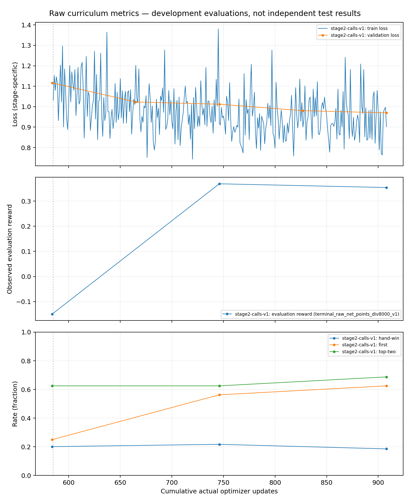

# Calls course: completed324, failed strategy-quality target

2026-11-21, Asia/Dubai. GPU312081 completed324 updates/40,474 exposures and audit312082 completed successfully. All376 optimizer states,4,721 final reloaded menus (maximum probability difference1.66e-7),224 cached/new complete-game ledgers, exact parent initialization, replay/group isolation and frozen source checks passed. **Software evidence passed; the original strategy-quality target failed.** Final324 is retained as the registered result. The smaller162-point result below is historical, not a substitute candidate.

## Final64 complete East matches

| Metric | Stage1 parent | Calls final324 | Frozen v8 |
|---|---:|---:|---:|
| First |35.94%|26.56%|42.19%|
| Top-two |59.38%|53.13%|59.38%|
| Fourth |20.31%|21.88%|14.06%|
| Net points/match |+1,760.94|+484.38|+4,290.63|
| Hand-win |26.54%|20.64%|24.32%|
| Dealin |15.94%|12.10%|10.44%|

Whole-seed paired net difference is−1,276.56 versus parent,95% interval[−5,684.01,+3,130.88]; the interval does not establish a stable regression. Versus v8 it is−3,806.25,[−7,414.37,−198.13] on this consumed development grid. Neither is an unseen final test or proof of v8 parity. Top-two differences are−6.25 percentage points against both; intervals include zero.

The original gate fails its nonnegative net gain over the parent. Its other components pass: ordinary exact agreement+0.375 points, riichi balanced−4.054 points (limit−5), five-call mean balanced+12.735 points, dealin−3.845 points (maximum increase+2). Lower imitation loss and better call agreement did not yield better complete-match utility.

The final same16 subset has top-two68.75%/net+2,831.25. That apparently favorable subset must not replace the full64 result. Curves retain the matching16 grid at0/162/324; full64 stays in its separate export.

[Standalone PDF](../figures/stage2-calls-v1/curriculum-curves.pdf). These are observed logs, with supervised reward null and observed game reward=net/8000. They contain no new simulations and do not turn development points into independent tests.

## Diagnosis and continuation status

Against the calling profile, net falls2,703.13→312.50 and hand-win28.23%→20.49%; against the efficiency profile, net changes818.75→656.25 and hand-win24.84%→20.79%. Each profile has32 matches. This localization is descriptive and does not isolate a causal mechanism.

Across all64 games, parent→calls→v8 own-operation counts are: chi199→72→68, pon105→117→84, ankan13→11→13, daiminkan0→16→4, kakan2→2→9, riichi108→91→105. Counts are not opportunity-conditioned rates. The student is not simply making more of every call. Excess daiminkan and reduced winning frequency remain concerns despite reduced dealin.

Final validation CE is0.970038, ordinary exact51.10%, riichiTP23/FN14/TN30/FP40. Daiminkan isTP84/FN4/TN29/FP79:95.45% observed acceptance but26.85% correct decline, versus the cached v8 diagnostic's62.04%. Expert labels are not optimality certificates; still, neither aggregate loss nor mean call gain resolves this imbalance.

Queued attack312276 verified the original quality requirement and exited1:0 before parent sealing, registration, model initialization or any optimizer update. Its dependent audit312277 was cancelled. Do not retry this unchanged recipe or relabel the failed gate. The original artifacts remain frozen. Any follow-up needs a separately registered experiment, explicit parent/admission and new success criterion before its first update; final v8 comparison remains reserved. Research weights and detailed game/prediction/world records stay private.

## Same16 complete East matches

The grid is two consumed development seeds ×four own seats ×two opponent profiles. The initial student's parameters exactly equal the completed fresh-base stable-v2 parent; its16 outcomes reproduce the parent's same subset. Full64 results are not mixed with these16-game points.

| Metric | Parent / step0 | Calls step162 | Frozen v8 |
|---|---:|---:|---:|
| First |25.00%|56.25%|62.50%|
| Top-two |62.50%|62.50%|62.50%|
| Fourth |18.75%|18.75%|31.25%|
| Net points/match |−1,193.75|+2,950.00|+3,612.50|
| Hand-win |20.07%|21.69%|22.37%|
| Dealin |12.86%|15.51%|10.34%|
| Observed net/8000 reward |−0.1492|+0.3688|+0.4516|

Net increases4,143.75 points/match over the parent, while top-two is unchanged and dealin increases2.65 percentage points. Against v8 on this same subset, net remains662.50 lower and dealin is about5.17 points higher. Two whole-seed groups are too few for a stable strength conclusion; these means neither establish equivalence nor select this checkpoint. Continue the fixed budget and evaluate final324 on all64 registered games.

Actual own-operation totals across the corresponding16 games are below. They are **counts, not opportunity-conditioned selection rates**; policies change subsequent hands and available decisions.

| Operation | Parent / step0 | Step162 | v8 |
|---|---:|---:|---:|
| Chi |53|41|18|
| Pon |50|50|37|
| Ankan |3|5|4|
| Daiminkan |0|6|2|
| Kakan |0|0|3|
| Riichi |31|14|20|

The student takes daiminkan in real simulator games, and net improves without increasing the chi count. Neither fact proves the chosen calls are optimal or isolates the cause of the score change. Zero kakan in16 games does not establish inability without opportunity counts; held-out menus below show actual kakan selections.

## Fixed4,721-menu validation

Weighted CE changes1.116720 at0 →1.023091 at81 →1.012235 at162 →0.980512 at243. Ordinary exact agreement is50.72% →50.35% →50.56% →50.08%. Riichi swings between acceptance and decline: TP/FN/TN/FP is26/11/30/40 initially,35/2/10/60 at81,17/20/48/22 at162, and30/7/23/47 at243. Balanced type agreement at162 is about57.26%; at243 it is about56.97%. Neither acceptance nor decline is reliably solved by these changing endpoints.

At162, operation-specific counts include overlapping menus. A nonselected operation can lose to another operation, not only to pass.

| Operation | TP | FN | TN | FP |
|---|---:|---:|---:|---:|
| Chi |141|70|320|74|
| Pon |165|50|285|86|
| Ankan |95|41|64|69|
| Daiminkan |88|0|3|105|
| Kakan |34|23|22|24|

**Daiminkan declining is a clear unresolved diagnostic:** all88 observed positives are selected, but only3/108 observed negatives avoid it. The aggregate five-call balanced score can hide that behavior. These labels are observed expert decisions, not optimality certificates; still, the result warrants checking type-specific counterexamples and the frozen v8 diagnostic before claiming calls are solved. Preserve the current fit. Use its final result and data/rollout coverage to decide a separately registered correction rather than silently changing active weights or thresholds.

The subsequent [data/reference/token diagnostic](curriculum-calls-data-diagnostic-20261121.md) finds341 positive/321 other-action expert TRAIN cases and109 MC contrasts. Frozen v8 correctly declines67/108 on the same consumed negative menus. All22,959/5,905 proposed attack records pass real encoding without rejection or truncation. Thus missing counterexamples or context rejection are not sufficient explanations; the planned risk objective and separate operation-level reporting remain useful next tests. These findings do not alter this fit or certify its final behavior.

At243, daiminkan changes toTP85/FN3/TN31/FP77: observed acceptance96.59%, correct decline28.70%, balanced62.65%. Decline has recovered from2.78% at162, but remains below the reference's62.04%. This evolution reinforces keeping the complete budget and reporting both classes. No243 game grid was registered; the latest game score remains the162 observation above.

The completed result and rejection above supersede this interim observation. The [original attack recipe](../plans/curriculum-stage3-attack-20261121.md) has zero updates because its qualified-parent requirement failed. Only aggregate results, curves and source are published.
