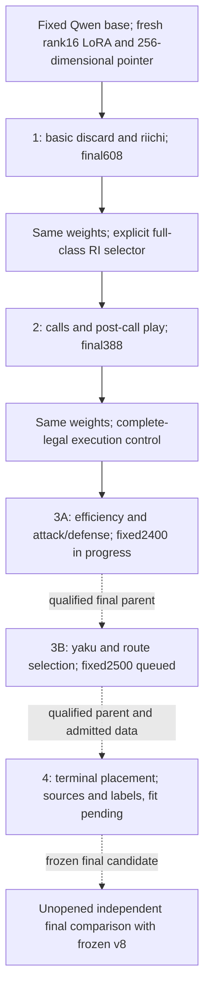

# Current four-course reproduction route

Evidence snapshot: 2026-11-24, Asia/Dubai. Courses1 and2 in the current
parameter ancestry are complete. Course3A is the active fixed2400-update
fit;3B is queued behind its qualified final audit. Course4 source acquisition
and teacher labeling are separate work; its complete fit/audit chain is queued
behind actual qualified parents, data and real-model integration. Its student
fit is not yet admitted or started.
See [research PR8](https://github.com/YokyYao/JevMajhong/pull/8) for dated live
job snapshots. This index does not claim that the curriculum matches v8.

The [historical guide](README.md) preserves earlier recipes and negative
outcomes. Its1162-step, stable-v2, calls324 and risk-recovery branches are
not parents of the current student. The current route reorganizes the
lessons of v8; it is not a byte-for-byte replay of v8's historical training.

## Actual parameter ancestry and four courses

| Course | What it learns | Actual data, budget and current state |
|---|---|---|
| **1: basic decisions** | Ordinary discard and riichi/decline decisions |14285 TRAIN/3266 validation, six strata, four epochs,57140 exposures,608 updates. Completed; the distinct RI selector is separately documented.|
| **2: calls and follow-up** | Chi, pon, ankan, daiminkan, kakan, pass and post-call discard |49022/12479 rows,13 strata, two epochs,98044 exposures,388 updates. Completed with the same adapter/head and a new optimizer.|
| **3A: efficiency and attack/defense** | Ordinary hand completion, risk under opponents' riichi, useful calls and executable defensive choices |87595/23688 rows, two epochs,175190 exposures,2400 updates. Active recovery job318979; final audit318980.|
| **3B: yaku and route selection** | Retain useful tiles, pursue feasible routes and abandon unsuitable routes |91247/24516 rows, two epochs,182494 exposures,2500 updates. Preparation318984 →fit318985 →audit318986 waits for actual qualified3A final.|
| **4: terminal placement** | Pursue top two when behind and take useful small wins/retain position when ahead |80% replay/20% across32 new pools; actual counts/exposures and two-epoch budget await data. Qualified-parent319359 →registration319401 →integration319427 →full fit319480 →audit319482 is queued, not started.|

The base is Qwen/Qwen3.5-0.8B revision
`2fc06364715b967f1860aea9cf38778875588b17`. The student begins with a fresh
rank16 adapter/256-dimensional pointer; it does not initialize from v8 or
Mortal parameters. Later courses continue the same adapter/head and reset
the optimizer as registered. No external residual decision network is added.

The pinned research-package digest is
`7a6e9471c95d529ecdc5d0a66cd240ae17d1f5914d76ce8dbd61ad45ce7104bc`;
JevAny is
`84fe7f0201a8d9928aabe4770912bf25e76c4916c1eded3011cf8f02862b758d`.
Use the source/bootstrap instructions in the historical guide. A different
selector, input projection or event-forwarding loop is a different policy,
even when every model tensor is unchanged.

## Learning targets and data roles

Course1 teaches actions, not a rule that wind tiles must always be discarded.
Value winds can form yaku; isolated guest winds still depend on shape,
turn and risk. Legal wins/yaku recognition are supplied by the native rule
engine. Course1/2 results do not establish learned hand scoring or a
win-versus-continue strategy.

Course3A loss mass is55% calls/basic replay,15% risk,20% ordinary completion
and10% masked Monte Carlo targets. Hard RI windows use the explicit full
reach-versus-discard class objective. Untested MC alternatives are masked,
rather than converted into negative labels.
[3A plan](../docs/experiments/plans/curriculum-progression-fit-20261123.md).

Course3B keeps all original replay objects and adds3652/828 decisions from
201/45 targeted families. Its loss mass is80% replay and20% across kokushi,
chuuren, suuankou, daisangen, chiitoitsu and an unselected random-hand
control. These teach route-related actions; they are not proof that a
student can name every yaku, compute han/fu or reliably complete rare hands.
[3B plan](../docs/experiments/plans/curriculum-yaku-launch-20261123.md).

Mortal supplies earlier expert/source-play actions. The terminal teacher is
separate approximate public-world search with frozen-v8 ordinary continuation,
two efficiency opponents and one calling opponent. Original private Mortal
histories are not installed into counterfactual sampled hands. Public
32-world outcomes and bootstrap preferences are neither expert optimality
labels nor calibrated win probabilities.

## Terminal data and explicit one-model execution

The earlier263-view win cohort concentrates on insufficient small wins and
matched leading controls. It compares hora with native ron pass or one
guarded tsumo discard. Its uncertain two-arm targets remain explicitly
partial; they do not identify untested legal actions.

The additional non-win cohort plans96 TRAIN/24 validation views from24/6
families, covering draw, post-call and call-response decisions in four score
contexts. Ordinary proposals test at most four candidates. A complete
reach/discard window instead tests every legal discard plus the unique
reach, so its soft target can supervise the full RI0.5 class probability.
[Full-RI proposal/loss](../docs/experiments/plans/curriculum-rank-nonwin-full-riichi-20261123.md).

The broad win-control cohort has96/22 views from70/17 families, with actual
native score/source reconstruction. It includes sufficient-behind,
leading-control and valuable-still-behind ron/tsumo cases. Its full current
menus require13408 terminal arms; labeling/merge319017/319028 are queued.
Public no-ura solo score only chooses cohorts; it never becomes a forced
accept label.
[Win controls](../docs/experiments/plans/curriculum-rank-win-controls-20261123.md).

Fresh targeted acquisition has completed72/36 unlabelled views from24/12
distinct canonical families:8/4 families per operation for win/reach,
win/ankan and win/kakan. Every case follows actual native turns in East4;
open kakan sources first execute pon and the mandatory discard. All108
inputs replay/encode,216 scripted accept/special one-model-call checks
passed and source quarantine is0. These are deliberately constructed
conditional opportunities, not natural match-frequency or strength data.
Array319102 and merge319103 will generate paired preferences; combined
catalog319104 waits for these and the earlier coherent data.
[Fresh sources](../docs/experiments/plans/curriculum-targeted-win-sources-20261123.md)
and [label recipe](../docs/experiments/plans/curriculum-targeted-win-labels-20261123.md).

Each tested action completes32 matched public worlds in two independent
blocks.512 bootstrap replicates retain uncertainty; exhausted sampling is
quarantined without partial labels or outcome-based replacements. Future
win replanning stays bounded/two-arm even for complete CURRENT menus.
The priority is terminal top two, then better final rank, then bounded net
points when initially third/fourth. Leading exact objective ties take the
win/ordinary reference. There is no per-state fourth-escape veto and no
reward for merely increasing calls or kan.

The current all-late projection supplies coherent placement instructions.
The explicit complete-win policy uses the same shared model to compare
legal current hora/discard/riichi/call/kan alternatives, while early and
unsupported robbed-kan shortcuts remain. The native loop must pass
`current_public_event`: reconstructed observations had empty event lists.
The old interface failed before model inference; its failed proof is
preserved. The corrected263-view/526-choice proof and118-view/419-choice
complete-menu proof passed, with tiny frozen-model probes. These prove
interfaces, not learned decisions.
[Event repair](../docs/experiments/plans/curriculum-native-public-event-20261123.md).

Source records/families and actual repeated exposures must be counted
separately. Preserving old replay does not mean every row must appear in
every update. Sparse new pools cannot receive large claimed loss mass by
silently exceeding scalar caps or pretending replicas add independent
examples. A count-only proposal now assigns80% replay loss mass and20%
equally across32 new pools, with at most8 virtual repeats per original and
a scalar weight cap16. It leaves validation and all original records alone.
Its actual-count preparation waits for data3; it does not admit a parent,
sampler, optimizer or student fit.
[Placement exposure proposal](../docs/experiments/plans/curriculum-placement-mix-20261123.md).

Current partitions are defined by the frozen files and group membership,
not inherited source metadata: actual3B validation contains5146 rows still
tagged source-train and219 without a source split. Current file IDs and
families remain disjoint. The placement membership adapter preserves raw
objects while supplying verified partition views and replica provenance.
Full57-source integration still waits for the completed labels.
[Current partition compatibility](../docs/experiments/plans/curriculum-placement-partition-20261123.md).

The full fit now has an executable dependent launch. It verifies the real
two-update integration's saved optimizer/tensors/losses and successful GPU
terminal, then binds the original prospective assessment and independent
auditor before the first candidate update. Integration control weights are
excluded from ancestry. The candidate continues actual qualified final3B
with a new optimizer and must run a fresh64-game child-policy zero baseline.
It cannot reuse parent outcomes after changing late instructions/dispatch.
The complete two-epoch final candidate is retained despite intermediate noise;
its64-game endpoint and the common16-cell plotted subset remain separate.
[Full placement launch](../docs/experiments/plans/curriculum-placement-launch-20261124.md)
and [development assessment](../docs/experiments/plans/curriculum-placement-assessment-20261124.md).

## Current3A recovery and weight integrity

Original3A job318606 completed600 updates/full validation, then failed
because native evaluation requested a checkpoint before it was saved.
Only its step0 weights exist. Its unsaved600 updates are not ancestors of
the current candidate and cannot supply a600-step strength result.

Recovery318979 uses a fresh output, the exact sealed calls388 parameters,
the same data/order/seed/gradient recipe and the original2400 budget.
A real two-update upstream integration verifies save ordering; those
control weights/updates are not a student parent or curve point.
The main run proved372 adapter/four head tensors, all12479 inherited
validation-menu probabilities with zero error and exact16-game identity
before updating. Real raw-input LoRA/head changes are recorded.

Native evaluation now waits for the complete model AND optimizer state.
3A saves every100 updates and3B every125, while their original600/625
validation/game cadences remain unchanged. The original final advancement
grade is not waived. No live job was restarted for these changes.
[Recovery plan](../docs/experiments/plans/curriculum-save-order-recovery-20261123.md).

## Real curves, development evidence and final comparison

Per-update journals retain actual loss/CE/source counts/gradient/LR and
local/effective-ancestry global steps. Discarded fits and control tests do
not become cumulative student updates. SFT training reward is null.
Reward, hand-win/first/top-two/fourth/net/deal-in curves use actual complete
matches; teacher preference or declining validation loss is not win rate.

Use separate loss panels for changed objectives and mark optimizer/policy
transitions. Intermediate curves use the fixed16-match development subset;
the final64 result retains its separate full-grid table. Do not join
different-sized samples into an apparent improvement trajectory.

| Same consumed64-match development grid | Top two | Net points/match |
|---|---:|---:|
|Calls388 with its original guarded route|65.625%|+2656.25|
|Same calls388 parameters, complete-legal route|59.375%|+2457.81|
|Frozen practical v8|59.375%|+4290.63|

These are development means from eight logical seed groups. The calls
mean does not establish parity; same parameters with changed dispatch are
not the same policy. These64-game baselines are distinct from the following
matched16 development result; the sample sizes must not be mixed.

| Same consumed16-match grid (two logical seeds) | Hand win | Top two | Net points/match |
|---|---:|---:|---:|
|3A step0, complete-legal RI0.5|17.75%|56.25%|+387.50|
|3A saved step600, same policy|19.57%|68.75%|+1887.50|
|Frozen practical v8|22.37%|62.50%|+3612.50|

Step600 gains1500 points/match over its zero baseline but remains1725 below
v8. This small consumed result does not prove stable improvement or parity.
RI balanced accuracy also declined70.33% →62.59%; its score-shift diagnostic
is descriptive, not a causal gradient explanation. Actual0/600 curves and
limitations are in the [result report](../docs/experiments/curriculum-3A-step600-20261123.md).
The registered budget remains2400; the next full evaluation is1200.

Final comparison still uses the unopened32 logical seeds2026300000–
2026300031, four seats and two profiles:256 complete East matches per
policy. Pair statistics by whole seed, not256 independent matches.
The new [statistical plan](../docs/experiments/plans/curriculum-final-comparison-20261123.md)
makes matrix validation and32-cluster uncertainty arithmetic executable
without playing those seeds. Candidate/policy/source identities and the
full acceptance/secondary-risk interpretation still must be frozen before
opening the final grid. A crossing-zero interval is not a noninferiority
test. Neither a stage exit, synthetic check nor this index completes the
goal.

The historical guide contains executable earlier recipes. This remains
an incomplete end-to-end reproduction artifact: finish the actual courses,
reliable labels/mix, portable stage registrations, curves, final candidate
seal and independent v8 evidence. New hosts must regenerate public sources
and bind their own actual paths/resources/receipts instead of fabricating
our private audit caches or job IDs.

All computation, including source preparation/tests/plotting, runs in
bounded scheduler GPU allocations with logs/exits. No login computation,
CPU-only workaround, unbounded poller or unmanaged background process.
Source/config/plans and aggregates may be published; raw hands/labels/
walls/traces/gradients and research weights remain private. Main, practical
v8 and Windows releases are unchanged.
