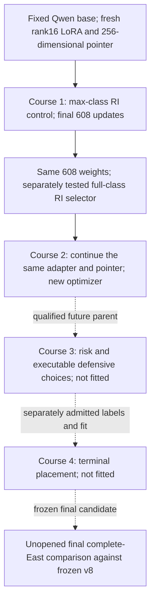

# Current four-course reproduction route

Evidence snapshot: 2026-11-23, Asia/Dubai. The active calls fit has at least
63 of 388 optimizer updates and remains RUNNING on its allocated GPU. Its
independent final audit is waiting on successful completion. There is no
post-update calls validation/game result yet. This index describes the current
parameter ancestry and remaining work; it does not declare the curriculum
complete or the student comparable to v8.

The [original reproduction guide](README.md) retains executable historical
recipes and their outcomes. Its original 1,162-step and stable-v2 584-step
students are separate experiments, not ancestors of the current student.
The [initial four-course plan](../docs/experiments/plans/curriculum-reproduction-20261120.md)
states the overall objective; its dated status is not a live training monitor.

## Actual current parameter ancestry

The student base is `Qwen/Qwen3.5-0.8B`, revision
`2fc06364715b967f1860aea9cf38778875588b17`. Course 1 uses initialization seed
2026112002 and starts with a fresh adapter/head, not previously trained Mahjong
parameters. Its initialization is numerically checked against the fresh
same-budget hard-CE control. That control is an experimental prerequisite and
comparison, not a trained-weight parent. v8 is a frozen evaluation reference;
Mortal supplies some supervised actions, not student initialization weights.

The fixed research package digest is
`7a6e9471c95d529ecdc5d0a66cd240ae17d1f5914d76ce8dbd61ad45ce7104bc`;
the JevAny package digest is
`84fe7f0201a8d9928aabe4770912bf25e76c4916c1eded3011cf8f02862b758d`.
Use the pinned bootstrap/dependencies in the original guide. A different
selection rule is a different policy even if every parameter is identical.

| Step in this route | Actual training/data | Evidence and present limit |
|---|---|---|
| Course 1, ordinary discard/RI | 14,285 TRAIN / 3,266 validation; six strata; four complete epochs; accumulation 94; 608 updates / 57,140 exposures | Fit and independent audit complete. The original raw selector still fails source-specific RI refusal. [Completed result and real curves](../docs/experiments/results/curriculum-riichi-control-final-20261123.md). |
| Distinct RI selection policy | No new training/data. Exactly one reach plus discards: choose reach at raw reach probability >=0.5; otherwise select a guarded discard. Other menus retain their existing dispatch. | Actual 16 baseline event/outcome reproductions and 64 candidate matches, independently audited. Its source metrics pass under this distinct selector; the old raw failure stays recorded. [Native comparison](../docs/experiments/results/curriculum-riichi-class-route-20261123.md). |
| Course 2, calls and followup | 49,022 TRAIN / 12,479 validation; 13 strata; accumulation 253; two full epochs; final 388 updates / 98,044 exposures | Currently fitting with the distinct RI selector, the same adapter/head and a new optimizer. No new call-strength result yet. [Frozen plan](../docs/experiments/plans/curriculum-calls-classroute-20261123.md), [launch evidence](../docs/experiments/results/curriculum-calls-classroute-launch-20261123.md). |
| Course 3, attack/risk | Preserve basic/calls replay and separately admit risk labels with executable candidates | A prospective defensive scope is native-interface audited, including corrected menzen/ankan diagnostics. It is not used by the current fit. No course-3 fit belongs to this current ancestry. [Scope evidence](../docs/experiments/results/curriculum-defensive-scope-20261123.md). |
| Course 4, terminal placement | Public scores, dealer/seat/wind, honba/sticks, remaining rounds and reliable full-terminal targets | Source windows, win-source/history/world interfaces exist; current-route labels and fitting remain unadmitted. [World/teacher preparation](../docs/experiments/plans/curriculum-live-worlds-20261122.md). |

Earlier calls324 and risk-recovery362 fits belong to the old stable-v2 branch.
Their negative outcomes remain in the original guide/results; they do not
provide course-2/3 completion for the new ancestry. Likewise, a prepared
dataset, passing sampler, successful job exit or static selector audit is not
a demonstrated improvement in complete-match play.

## Data, supervision and limitations

The current basic course retains all 9,292/1,972 admitted legacy decisions and
adds 4,993/1,294 true-trajectory Mortal decisions from 256 source families
(205 TRAIN / 51 validation). Every source family keeps its split. The original
675 reserved ancestral source groups remain excluded. See the
[basic data report](../docs/experiments/results/curriculum-basic-teacher-data-20261122.md).
Supervised validation is not an unseen test for v8, which trained on some
original source data. Teacher actions are not certified optimal decisions.

Course 2 keeps every previous 48,710/12,404 replay/call row unchanged and adds
312/75 distinct immediate post-reach decisions. Those followups reuse the
same source families; they do not add independent matches and all have zero
opponent RI. The [integration audit](../docs/experiments/results/curriculum-calls13-prerequisites-20261123.md)
preserves labels, visible inputs, source groups and ancestral exclusions.

| Course-2 component | TRAIN / validation decisions | Loss mass |
|---|---:|---:|
| Six basic discard/RI replay strata | 14,285 / 3,266 | 63.70% |
| Post-meld discards, both sources | 14,942 / 3,721 | 11.4333% |
| Chi/pon response windows, both sources | 16,968 / 4,635 | 11.4333% |
| Kan windows, both sources | 2,515 / 782 | 11.4333% |
| Distinct immediate post-reach discards | 312 / 75 | 2.00% |

Rounded masses above are explanatory; the exact configuration/registration is
authoritative. All 13 strata occur in every actual accumulation group, without
replacement within each epoch; the tail is 193 decisions. Basic RI retains
max-discard-class plus conditional-discard CE; other action targets use CE.
The serving rule uses full-class probability, a different boundary from the
max-class training loss. Keep actual selected RI recalls separate from raw
metrics; falling loss does not prove stable or improved RI decisions.

These are decision-window targets, not a final-yaku classification curriculum
or a prescribed yaku mixture. Legal wins are executed by a rule. The current
course has no learned win/pass scoring claim, seven-pairs bonus/penalty or
rare-yaku reward. The native Nine Gates/pure Nine Gates fixtures verify rule
recognition and legal win execution only, not learned hand construction.
Endgame decisions to decline an insufficient small win need a new admitted
action/label contract; the existing forced-win shortcut cannot learn that by
changing reward alone.

## What has actually been checked in the running fit

The complete course-2 source is frozen at
`e73fb33088dfed9467df4cea15c768362f5025ba`. Its configuration is
[`curriculum-calls-classroute-v1.json`](../configs/training/curriculum-calls-classroute-v1.json),
with seed 2026112209, adapter LR 1e-5, head LR 5e-5 and stage offset 608.
The offset tracks this parameter chain, not updates in discarded experiments.
The final candidate is local step 388, not a minimum-CE or favorable midpoint.

Before any update, the actual fit verifies all 372 adapter/four head tensors,
all 3,266 basic validation probabilities (maximum difference zero), identical
selected actions and 16 exactly identical native parent event/outcomes.
At least eight updates then demonstrate changed adapter/head parameters and
no cached encoder features. These checks prove execution/transfer integrity;
they do not prove improved strategy.

The active handles are fit 316781 and after-success audit 316782. The fit has
one GPU/four companion CPUs/48GB and a 12-hour limit, with timeout, logs and
shell exit receipt; invalid audit dependencies are automatically cancelled.
The registration's initial `registered_not_started` string is immutable
registration-time metadata. Query the actual scheduler to determine whether
the job is currently live, terminal or missing; neither that old string nor
an append-only status snapshot substitutes for live scheduler evidence.

No active/successful/failed bound source or output is edited. Repairs require
new versions and fresh output paths. All compute, including data processing,
tests, hashing, plotting and inference, runs inside finite scheduled GPU jobs.
Login is limited to light file work and scheduler submission/query/cancellation.

## Real curves and evaluation still required

Course 1 has published actual per-update loss and separate matched-grid game
curves in its completed report. Course 2 journals actual loss each update;
formal validation/native game points are 0/194/388. Supervised reward is null.
Evaluation reward is actual terminal net points / 8,000, alongside hand-win,
deal-in, first/top-two/fourth rates. Do not join losses across changed objectives
or replace a 16-match curve point with a 64-match stage-end mean.

The [current exporter evidence](../docs/experiments/results/curriculum-calls-curves-ready-20261123.md)
records a verified real 43-update snapshot, all 12,479 initial cached validation
menus and 16 initial native games. That baseline-only plot remains private
until post-update observations exist. Use the frozen exporter with a fresh
output directory at each later snapshot; its first-launch template already
has outputs and must not overwrite them. Final export additionally requires
the actual independent final audit, rather than treating training exit as a
quality pass.

| Same consumed 64-match development grid | Current ancestry's raw course-1 final | Same weights, distinct RI selector | Frozen v8 |
|---|---:|---:|---:|
| Net points / complete East match | +176.56 | +967.19 | +4,290.63 |
| Top two | 46.88% | 51.56% | 59.38% |
| Hand win | 17.13% | 19.63% | 24.32% |
| Deal-in | 14.43% | 15.37% | 10.44% |

These are development results from eight logical seed groups, four seats and
two opponent profiles. The selector-minus-raw net interval crosses zero;
the selector's mean remains below v8. This is neither stable improvement nor
evidence of parity. Paired uncertainty groups by logical seed, not by 64
independent matches. The source-linked native comparison retains the full
intervals and unfavorable results.

Next finish the unchanged full calls course and independent audit, then
assess source-specific RI retention, all five call operations' positive and
negative cases, post-meld play and full-match outcomes. Any later risk scope
requires a separate same-weight native comparison on the actual completed
calls parent before a risk fit. Placement still requires reliable terminal
labels, admitted replay/mix and a separately frozen fit.

Final success remains the predeclared unopened 32 logical seeds x four seats
x two profiles: **256 complete East matches per policy**, with the final
student and frozen v8 under identical rules/seeds/seats. Freeze its candidate
and statistical acceptance rule before opening those seeds; do not use them
to choose a training checkpoint. A development interval crossing zero is not
a noninferiority test. That final comparison has not been run.

This is not yet a one-command, completed end-to-end reproduction. Historical
private receipts/caches cannot be invented on another host: regenerate the
publicly specified sources and bind a new experiment's actual resources,
paths and immutable receipts before its outcomes. Fixed numerical recipes,
input/model tensor checks and actual trajectories are the reproducibility
targets; byte-identical CUDA weights across hardware are not promised.
Publish code/plans and aggregate evidence/minimal real curves only. New raw
hands, labels, probabilities, trajectories, gradients and research weights
remain private. Main, the practical v8 model and Windows releases are unchanged.
