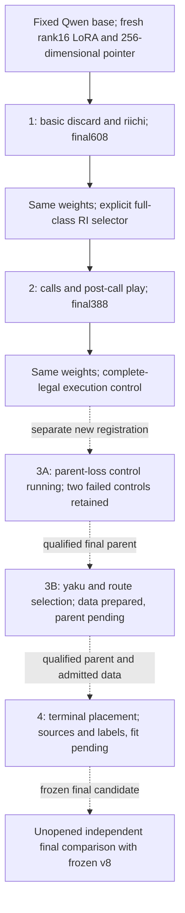

# Current four-course reproduction route

Evidence snapshot: 2026-11-24, Asia/Dubai. Courses1 and2 in the current
parameter ancestry are complete. The original fixed2400-update Course3A
completed with a passing execution audit but failed its strategy advancement
conditions. The same-parent RI-paired-order retry has also completed2400
updates, full validation,64 development matches and its independent execution
audit, but failed strategy admission. Its final top-two rate is48.4375% and
net points+1087.50/match, below same-grid v8's59.375%/+4290.625.
Both conditional3B/placement model chains have been canceled before student
updates; their actual terminals are preserved. The next controlled3A objective
retains the exact calls13 replay loss. All87595 TRAIN-row loss checks, nine
objective/recipe tests and full23688 cached validation reconstruction passed.
It has a separate registration and actual GPU job322022, started at18:32:06
Dubai on November24, with audit322023 and terminal capture322024. Preparation
is complete and actual optimizer updates are running. Exact
372-adapter/four-head tensor inheritance, all12479 inherited menus with zero
probability error, and16 baseline event records passed before its first update.
No new playing-strength
result is available. See the [launch snapshot](../docs/experiments/curriculum-3A-parent-loss-launch-20261124.md).
Course4 source acquisition and teacher labeling continue
independently. Neither3B nor4 student fit is yet admitted or started.
See [research PR8](https://github.com/YokyYao/JevMajhong/pull/8) for dated live
implementation and aggregate result reports. This index does not claim that the curriculum matches v8.

The first100-update checkpoint of the retained-parent control has been saved;
its7300 exposures and all376 optimizer-state counters were checked without
inference or extra updates. Full new strategy evaluation remains pending.
The separate [net-point exporter](../docs/experiments/plans/curriculum-net-points-export-20261124.md)
is bound to job322103 after the original audit322023. Existing loss/reward/rate
exports remain unchanged; the added PNG/PDF separates matched16 trajectories
from final64 results and retains failed grades instead of implying admission.

The conditional3B chain also has a separate finite
[actual-terminal preservation task](../docs/experiments/plans/curriculum-yaku-terminal-capture-20261124.md),
bound before preparation/fit starts and queued after its independent audit.
Seven terminal/receipt/exclusive-I/O checks passed. This task preserves
failed outcomes too; it does not admit Course4 or change any strategy grade.

The [historical guide](README.md) preserves earlier recipes and negative
outcomes. Its1162-step, stable-v2, calls324 and risk-recovery branches are
not parents of the current student. The current route reorganizes the
lessons of v8; it is not a byte-for-byte replay of v8's historical training.

## Actual parameter ancestry and four courses

| Course | What it learns | Actual data, budget and current state |
|---|---|---|
| **1: basic decisions** | Ordinary discard and riichi/decline decisions |14285 TRAIN/3266 validation, six strata, four epochs,57140 exposures,608 updates. Completed; the distinct RI selector is separately documented.|
| **2: calls and follow-up** | Chi, pon, ankan, daiminkan, kakan, pass and post-call discard |49022/12479 rows,13 strata, two epochs,98044 exposures,388 updates. Completed with the same adapter/head and a new optimizer.|
| **3A: efficiency and attack/defense** | Ordinary hand completion, risk under opponents' riichi, useful calls and executable defensive choices |87595/23688 rows, two epochs,175190 exposures,2400 updates per attempt. Original and paired-order finals both failed strategy admission. Separate registered parent-loss control job322022 is running; its final result is pending.|
| **3B: yaku and route selection** | Retain useful tiles, pursue feasible routes and abandon unsuitable routes |91247/24516 rows, two epochs,182494 exposures,2500 updates. Data are prepared; the failed-parent conditional chain was canceled. New student registration still requires an actual qualified3A final.|
| **4: terminal placement** | Pursue top two when behind and take useful small wins/retain position when ahead |80% replay/20% across32 new pools; actual counts/exposures and two-epoch budget await data. Labeling continues; qualified-parent admission, registration, integration and full student fit/audit are not started.|

The base is Qwen/Qwen3.5-0.8B revision
`2fc06364715b967f1860aea9cf38778875588b17`. The student begins with a fresh
rank16 adapter/256-dimensional pointer; it does not initialize from v8 or
Mortal parameters. Later courses continue the same adapter/head and reset
the optimizer as registered. No external residual decision network is added.

The pinned research-package digest is
`7a6e9471c95d529ecdc5d0a66cd240ae17d1f5914d76ce8dbd61ad45ce7104bc`;
JevAny is
`84fe7f0201a8d9928aabe4770912bf25e76c4916c1eded3011cf8f02862b758d`.
Use the source/bootstrap instructions in the historical guide. A different
selector, input projection or event-forwarding loop is a different policy,
even when every model tensor is unchanged.

## Learning targets and data roles

The third course has two explicit parts. **3A is efficiency and attack/defense**:
complete hands sooner, choose useful calls/kan, and balance attack against
deal-in risk. **3B is yaku and route selection**: retain key tiles for feasible
routes and learn when to pursue or abandon them, including targeted rare-yaku
opportunities. Course4 then applies score gaps and remaining rounds to placement
decisions. These are learning targets; a queued course or covered label does
not establish an acquired ability.

Course1 teaches actions, not a rule that wind tiles must always be discarded.
Value winds can form yaku; isolated guest winds still depend on shape,
turn and risk. Legal wins/yaku recognition are supplied by the native rule
engine. Course1/2 results do not establish learned hand scoring or a
win-versus-continue strategy.

Course3A loss mass is55% calls/basic replay,15% risk,20% ordinary completion
and10% masked Monte Carlo targets. The two completed controls used the explicit
full reach-versus-discard class objective. The running separate control will
retain the parent's exact13-source replay objective while keeping the six
new sources and source masses unchanged. Untested MC alternatives are masked,
rather than converted into negative labels.
[3A plan](../docs/experiments/plans/curriculum-progression-fit-20261123.md).

The [exact current operation-label classification](../docs/experiments/curriculum-operation-label-balance-20261124.md)
separates hard and masked-MC labels by operation and source. It finds341 legacy
TRAIN daiminkan positives but none in281 offered new-teacher windows; source
scalar weighting makes hard other-action mass about2.96 times hard daiminkan
mass. This is a data-design gap, not a causal gradient diagnosis or proof that
the teacher should have called. Existing six-case mask/Q checks are explicitly
limited. Both completed controls' inputs and numerical recipes remain frozen.
The [new native kan-source pilot](../docs/experiments/curriculum-kan-source-pilot-20261124.md)
has189 replayed cases and183 actual Mortal labels. It adds ankan/kakan
positives but no daiminkan positives; it remains separate from student fits.
The [expanded daiminkan context cohort](../docs/experiments/curriculum-daiminkan-context-sources-20261124.md)
adds554 native opportunities (412 TRAIN/142 validation) from576 fixed plans,
covering closed/value-pon/simple-pon hands and all three discarder roles.
Twenty-two prefix quarantines are preserved. Original32-family partitions
are retained. Teacher322084 and terminal capture322085 are queued; no new
teacher result or student gain is claimed, and the active3A recipe is unchanged.

Course3B keeps all original replay objects and adds3652/828 decisions from
201/45 targeted families. Its loss mass is80% replay and20% across kokushi,
chuuren, suuankou, daisangen, chiitoitsu and an unselected random-hand
control. These teach route-related actions; they are not proof that a
student can name every yaku, compute han/fu or reliably complete rare hands.
[3B plan](../docs/experiments/plans/curriculum-yaku-launch-20261123.md).

For a future qualified retained-parent3A, a separate
[3B replay-loss continuity module](../docs/experiments/curriculum-yaku-parent-loss-continuity-20261124.md)
preserves all nineteen inherited objective functions instead of restoring the
previous Class2 replay loss. All91247 actual TRAIN materializations/targets
were checked, with zero objective/CE differences and zero representative
weighted-gradient differences across25 sources. Four tests pass. These are
synthetic-logit contracts, not model predictions or3B admission. Six new-route
losses and the original80%/20% masses remain unchanged. The separate validation
adapter also passed all24516 actual menus with label-independent synthetic
probabilities: canonical CE and every unchanged classification metric match,
while retained objective/signed accounting is recomputed. These are software
contracts, not model validation scores. Trainer/auditor registration and actual
model evaluation still require the qualified3A final.

The [paired-parent continuation entry](../docs/experiments/plans/curriculum-paired-yaku-continuation-20261124.md)
reuses that exact3B numerical recipe, prepared data, weights/orders and actual
full-validation/I/O integrations. Only explicit parent/runtime references and
output identities change. Its source was bound during the actual paired3A fit;
six admission/terminal-bridge checks passed. The actual failed final was
rejected, and the dependent student jobs were canceled without updates.
The original final-only grade, tensor/full
prediction/native zero-baseline proofs and new-optimizer requirement remain.

Mortal supplies earlier expert/source-play actions. The terminal teacher is
separate approximate public-world search with frozen-v8 ordinary continuation,
two efficiency opponents and one calling opponent. Original private Mortal
histories are not installed into counterfactual sampled hands. Public
32-world outcomes and bootstrap preferences are neither expert optimality
labels nor calibrated win probabilities.

## Terminal data and explicit one-model execution

The earlier263-view win cohort concentrates on insufficient small wins and
matched leading controls. It compares hora with native ron pass or one
guarded tsumo discard. Its uncertain two-arm targets remain explicitly
partial; they do not identify untested legal actions.

This cohort has now completed and merged255 valid targets:210 TRAIN views
from46 retained source groups and45 validation views from10 groups. Eight
sampling-exhausted views remain quarantined. These are teacher preferences,
not student match results; they have not entered the active3A fit.
The [categorized data report](../docs/experiments/curriculum-terminal-win-data-20261124.md)
separates score contexts, source groups, uncertainty and the remaining
terminal-data work.

The additional non-win cohort plans96 TRAIN/24 validation views from24/6
families, covering draw, post-call and call-response decisions in four score
contexts. Ordinary proposals test at most four candidates. A complete
reach/discard window instead tests every legal discard plus the unique
reach, so its soft target can supervise the full RI0.5 class probability.
[Full-RI proposal/loss](../docs/experiments/plans/curriculum-rank-nonwin-full-riichi-20261123.md).

The broad win-control cohort has96/22 views from70/17 families, with actual
native score/source reconstruction. It includes sufficient-behind,
leading-control and valuable-still-behind ron/tsumo cases. Its full current
menus require13408 terminal arms. All118 views have now been processed:
116 labels and two quarantined views across the four completed shards.
Merge and coherent input preparation are complete, giving91647 TRAIN/24607
validation rows before the remaining targeted additions. Targeted follow-up
labeling is running separately from the active3A fit. See the
[complete-menu control report](../docs/experiments/curriculum-terminal-full-menu-controls-20261124.md).
Public no-ura solo score only chooses cohorts; it never becomes a forced
accept label.
[Win controls](../docs/experiments/plans/curriculum-rank-win-controls-20261123.md).

Fresh targeted acquisition has completed72/36 unlabelled views from24/12
distinct canonical families:8/4 families per operation for win/reach,
win/ankan and win/kakan. Every case follows actual native turns in East4;
open kakan sources first execute pon and the mandatory discard. All108
inputs replay/encode,216 scripted accept/special one-model-call checks
passed and source quarantine is0. These are deliberately constructed
conditional opportunities, not natural match-frequency or strength data.
The queued label collection and merge will generate paired preferences;
the combined catalog waits for these and the earlier coherent data.
[Fresh sources](../docs/experiments/plans/curriculum-targeted-win-sources-20261123.md)
and [label recipe](../docs/experiments/plans/curriculum-targeted-win-labels-20261123.md).

Each tested action completes32 matched public worlds in two independent
blocks.512 bootstrap replicates retain uncertainty; exhausted sampling is
quarantined without partial labels or outcome-based replacements. Future
win replanning stays bounded/two-arm even for complete CURRENT menus.
The priority is terminal top two, then better final rank, then bounded net
points when initially third/fourth. Leading exact objective ties take the
win/ordinary reference. There is no per-state fourth-escape veto and no
reward for merely increasing calls or kan.

The current all-late projection supplies coherent placement instructions.
The explicit complete-win policy uses the same shared model to compare
legal current hora/discard/riichi/call/kan alternatives, while early and
unsupported robbed-kan shortcuts remain. The native loop must pass
`current_public_event`: reconstructed observations had empty event lists.
The old interface failed before model inference; its failed proof is
preserved. The corrected263-view/526-choice proof and118-view/419-choice
complete-menu proof passed, with tiny frozen-model probes. These prove
interfaces, not learned decisions.
[Event repair](../docs/experiments/plans/curriculum-native-public-event-20261123.md).

Source records/families and actual repeated exposures must be counted
separately. Preserving old replay does not mean every row must appear in
every update. Sparse new pools cannot receive large claimed loss mass by
silently exceeding scalar caps or pretending replicas add independent
examples. A count-only proposal now assigns80% replay loss mass and20%
equally across32 new pools, with at most8 virtual repeats per original and
a scalar weight cap16. It leaves validation and all original records alone.
Its actual-count preparation waits for data3; it does not admit a parent,
sampler, optimizer or student fit.
[Placement exposure proposal](../docs/experiments/plans/curriculum-placement-mix-20261123.md).

Current partitions are defined by the frozen files and group membership,
not inherited source metadata: actual3B validation contains5146 rows still
tagged source-train and219 without a source split. Current file IDs and
families remain disjoint. The placement membership adapter preserves raw
objects while supplying verified partition views and replica provenance.
Full57-source integration still waits for the completed labels.
[Current partition compatibility](../docs/experiments/plans/curriculum-placement-partition-20261123.md).

The full-fit implementation has an executable dependent launch. It verifies the real
two-update integration's saved optimizer/tensors/losses and successful GPU
terminal, then binds the original prospective assessment and independent
auditor before the first candidate update. Integration control weights are
excluded from ancestry. The candidate continues actual qualified final3B
with a new optimizer and must run a fresh64-game child-policy zero baseline.
It cannot reuse parent outcomes after changing late instructions/dispatch.
The old model dependency chain was canceled after the original3A failed;
this implementation is not an active or admitted placement student fit.
The complete two-epoch final candidate is retained despite intermediate noise;
its64-game endpoint and the common16-cell plotted subset remain separate.
[Full placement launch](../docs/experiments/plans/curriculum-placement-launch-20261124.md)
and [development assessment](../docs/experiments/plans/curriculum-placement-assessment-20261124.md).

## 3A recovery, controlled retry and weight integrity

An earlier3A attempt completed600 updates/full validation, then failed
because native evaluation requested a checkpoint before it was saved.
Only its step0 weights exist. Its unsaved600 updates are not ancestors of
the current candidate and cannot supply a600-step strength result.

The completed save-order recovery used a fresh output, the exact sealed calls388 parameters,
the same data/order/seed/gradient recipe and the original2400 budget.
A real two-update upstream integration verifies save ordering; those
control weights/updates are not a student parent or curve point.
That run proved372 adapter/four head tensors, all12479 inherited
validation-menu probabilities with zero error and exact16-game identity
before updating. Real raw-input LoRA/head changes are recorded.

Native evaluation now waits for the complete model AND optimizer state.
3A saves every100 updates and3B every125, while their original600/625
validation/game cadences remain unchanged. The original final advancement
grade is not waived. No live job was restarted for these changes.
[Recovery plan](../docs/experiments/plans/curriculum-save-order-recovery-20261123.md).

The original final2400 then completed its full validation and64 development
matches. Its independent execution audit passed, but strategy admission failed.
The [final report](../docs/experiments/curriculum-3A-final2400-20261124.md)
retains the negative result, all five real curve points and remaining call gaps.

The completed [RI-paired-order retry](../docs/experiments/plans/curriculum-riichi-paired-replay-20261124.md)
started again from the exact qualified calls388 parent with a fresh optimizer.
Data, loss masses, learning rates, two-epoch exposure budget, execution policy
and original advancement conditions remain unchanged; only within-block RI
positive/negative sample order changes. Before its first update,372 LoRA/four
head tensors and all12479 inherited validation predictions matched the parent
exactly. The failed original3A2400 is a retained control, not a parameter parent.
Its2400 updates do not count toward the paired student's ancestry. Pairing
did not improve the final point estimates or resolve source-specific RI
retention. The [audited final report](../docs/experiments/curriculum-3A-paired-final2400-20261124.md)
preserves real curves, paired intervals and the failure. The next
[parent-loss control](../docs/experiments/plans/curriculum-3A-parent-loss-retention-20261124.md)
also starts from the same qualified calls388, excluding both failed3A runs
from its parameter ancestry. Its objective preflight is complete, but no
new registration or student fit has yet been admitted.

## Real curves, development evidence and final comparison

Per-update journals retain actual loss/CE/source counts/gradient/LR and
local/effective-ancestry global steps. Discarded fits and control tests do
not become cumulative student updates. SFT training reward is null.
Reward, hand-win/first/top-two/fourth/net/deal-in curves use actual complete
matches; teacher preference or declining validation loss is not win rate.

Use separate loss panels for changed objectives and mark optimizer/policy
transitions. Intermediate curves use the fixed16-match development subset;
the final64 result retains its separate full-grid table. Do not join
different-sized samples into an apparent improvement trajectory.

| Same consumed64-match development grid | Top two | Net points/match |
|---|---:|---:|
|Calls388 with its original guarded route|65.625%|+2656.25|
|Same calls388 parameters, complete-legal route|59.375%|+2457.81|
|Frozen practical v8|59.375%|+4290.63|
|Original3A final2400, complete-legal RI0.5|50.000%|+1559.38|
|Paired-order3A final2400, same complete-legal policy|48.4375%|+1087.50|

These are development means from eight logical seed groups. The calls
mean does not establish parity; same parameters with changed dispatch are
not the same policy. These64-game baselines are distinct from the following
matched16 development result; the sample sizes must not be mixed.

| Same consumed16-match grid (two logical seeds) | Hand win | Top two | Net points/match |
|---|---:|---:|---:|
|3A step0, complete-legal RI0.5|17.75%|56.25%|+387.50|
|3A saved step600, same policy|19.57%|68.75%|+1887.50|
|3A saved step1200, same policy|17.82%|62.50%|+1912.50|
|3A saved step1800, same policy|24.46%|87.50%|+4881.25|
|3A final2400, same-policy matched subset|19.22%|62.50%|+2300.00|
|Frozen practical v8|22.37%|62.50%|+3612.50|

Step600 gains1500 points/match over its zero baseline but remains1725 below
v8. This small consumed result does not prove stable improvement or parity.
RI balanced accuracy also declined70.33% →62.59%; its score-shift diagnostic
is descriptive, not a causal gradient explanation. Actual0/600 curves and
limitations are in the [result report](../docs/experiments/curriculum-3A-step600-20261123.md).
The [1200-step report](../docs/experiments/curriculum-3A-step1200-20261124.md)
recorded only25 more net points than600, with lower hand-win/first/top-two rates.
The [1800-step report](../docs/experiments/curriculum-3A-step1800-20261124.md)
now records+2968.75 net points and+25 percentage points top two over1200 on
the same16 cells. Its mean exceeds same-grid v8 by1268.75 points, but two
consumed seed groups cannot establish stable improvement or parity. Original
legacy RI acceptance is19/37 and source-specific quality remains unmet.
The [final2400 report and actual curves](../docs/experiments/curriculum-3A-final2400-20261124.md)
show that this process high point did not persist. Final64 net points were
2731.25 below v8 and top two9.375 percentage points lower. Eight-seed paired
intervals crossed zero, so this is neither a stable-inferiority claim nor
evidence of parity. Both original-source RI decline accuracies were below60%,
and source-specific retention failed. No intermediate point was promoted;
the current retry keeps the original admission criteria.

The controlled retry's [actual600-step report and curves](../docs/experiments/curriculum-3A-paired-step600-20261124.md)
now record56.25% top two and−62.50 net points/match on the same consumed16
cells, versus the original-order600's68.75% and+1887.50. Its full-validation
loss is lower at1.191926, but pooled RI balanced accuracy is only62.96%
and daiminkan remains0/88. This is not observed policy improvement or a
final admission result. The registered2400-update retry has now completed
and failed; neither intermediate checkpoint was promoted.

At [paired-order1200](../docs/experiments/curriculum-3A-paired-step1200-20261124.md),
the same16 development cells produced75.00% top two and+2387.50 net points/match,
compared with original-order1200's62.50% and+1912.50. Hand-win rate fell to14.05%,
RI balanced accuracy remains64.95%, and daiminkan is2/88. Two consumed seed
groups cannot establish stable improvement or parity; the unchanged final2400
rule and original admission conditions still apply. Actual0/600/1200 curves
are preserved in the report.

At [paired-order1800](../docs/experiments/curriculum-3A-paired-step1800-20261124.md),
full23688-menu validation and the same16 development games are complete.
Top two is87.50%, hand win22.45% and net points+4306.25/match, compared with
paired1200's75.00%,14.05% and+2387.50. Same-grid v8 has62.50% top two and
+3612.50 points, while original-order1800 has87.50% and+4881.25. Thus this
point improves over its own1200 but does not establish an ordering advantage
or stable v8 parity. Teacher-source RI decline remains142/238=59.66%, below
the unchanged60% condition; daiminkan is4/88. Actual0/600/1200/1800 curves
and80 reconstructed native ledgers are preserved. The subsequent final2400
matched16 subset fell to62.50% top two and+925.00 points; its full64 result
and failed advancement are in the audited final report. No3B parent is admitted.

The [120-view non-win placement cohort](../docs/experiments/curriculum-rank-nonwin-data-20261124.md)
is now labelled, merged and classified:96 TRAIN/24 validation,24/6 families,
zero cross-split record/family/physical overlap and no quarantine. Other win
branches, complete data preparation and qualified-parent admission remain
pending; this data milestone does not start Course4.

The [paired-parent Course4 continuation](../docs/experiments/plans/curriculum-paired-placement-continuation-20261124.md)
was source-bound and conditionally queued, with18 source/contract checks
passed in an actual allocated GPU job. It required a qualified3B final2500's
original qualification and preserved successful terminals, plus complete
expanded placement data. Its implementation then registers the Course4 recipe,
runs the actual isolated integration and starts the full student only if
these prerequisites pass. The actual3A parent failed, so the dependent
Course4 model jobs were canceled and their actual terminals preserved.
The child has no parent seal, registration or student updates. A new chain
needs a genuinely qualified parent; source-data jobs continue independently.

The intended curriculum is basic decisions → calls →3A tile efficiency and
attack/defence →3B yaku and route selection → terminal placement. Calls-course
operation coverage and3A's contextual use of calls are different learning
scopes.3B includes targeted feasible-yaku scenarios; neither legal-action
coverage nor recognising a rare yaku alone demonstrates a learned route.
Course4 covers chasing a better place, quick small wins when useful and
protecting a lead. Actual evidence, rather than stage names, determines
whether each stage is qualified.

The [prepared3B dataset card](../docs/experiments/curriculum-3B-dataset-card-20261124.md)
lists actual route/context counts, family splits and the distinction between
row counts and loss weights. New pools cover kokushi, chuuren, suuankou,
daisangen, chiitoitsu and ordinary controls, with equal3⅓% source loss mass
each within the20% new-data allocation. These rows are not in either completed3A
fit; neither this coverage nor teacher agreement proves learned rare-yaku
play. No new admission rule or test games are introduced by the card.

Final comparison still uses the unopened32 logical seeds2026300000–
2026300031, four seats and two profiles:256 complete East matches per
policy. Pair statistics by whole seed, not256 independent matches.
The new [statistical plan](../docs/experiments/plans/curriculum-final-comparison-20261123.md)
makes matrix validation and32-cluster uncertainty arithmetic executable
without playing those seeds. Candidate/policy/source identities and the
full acceptance/secondary-risk interpretation still must be frozen before
opening the final grid. A crossing-zero interval is not a noninferiority
test. Neither a stage exit, synthetic check nor this index completes the
goal.

The [JSON source-evidence helper](../docs/experiments/plans/curriculum-confirmation-json-sources-20261124.md)
now distinguishes exact hash-bound protected-range declarations from actual
reserved-seed data occurrences. Its actual307-artifact current subset and26
confirmation checks are complete; future3B/placement ancestry and full receipt
closure still require the final producer. No reserved native games were opened.

The historical guide contains executable earlier recipes. This remains
an incomplete end-to-end reproduction artifact: finish the actual courses,
reliable labels/mix, portable stage registrations, curves, final candidate
seal and independent v8 evidence. New hosts must regenerate public sources
and bind their own actual paths/resources/receipts instead of fabricating
our private audit caches or job IDs.

All computation, including source preparation/tests/plotting, runs in
bounded scheduler GPU allocations with logs/exits. No login computation,
CPU-only workaround, unbounded poller or unmanaged background process.
Source/config/plans and aggregates may be published; raw hands/labels/
walls/traces/gradients and research weights remain private. Main, practical
v8 and Windows releases are unchanged.
